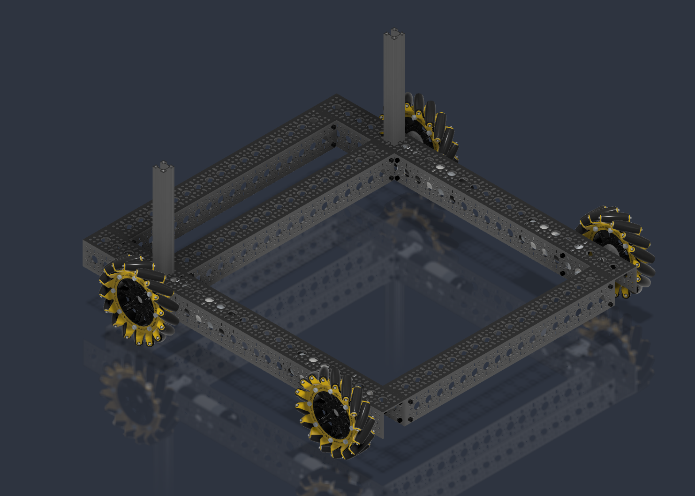
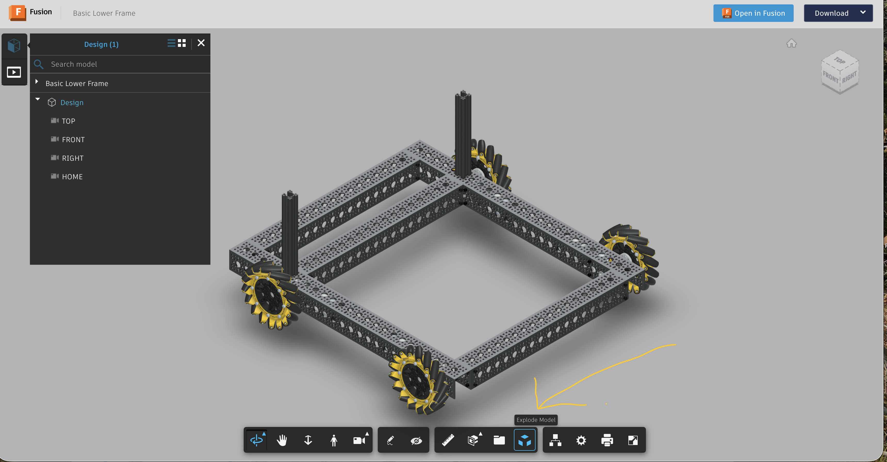
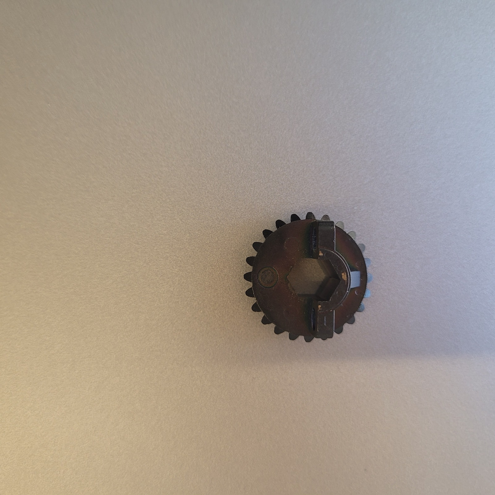
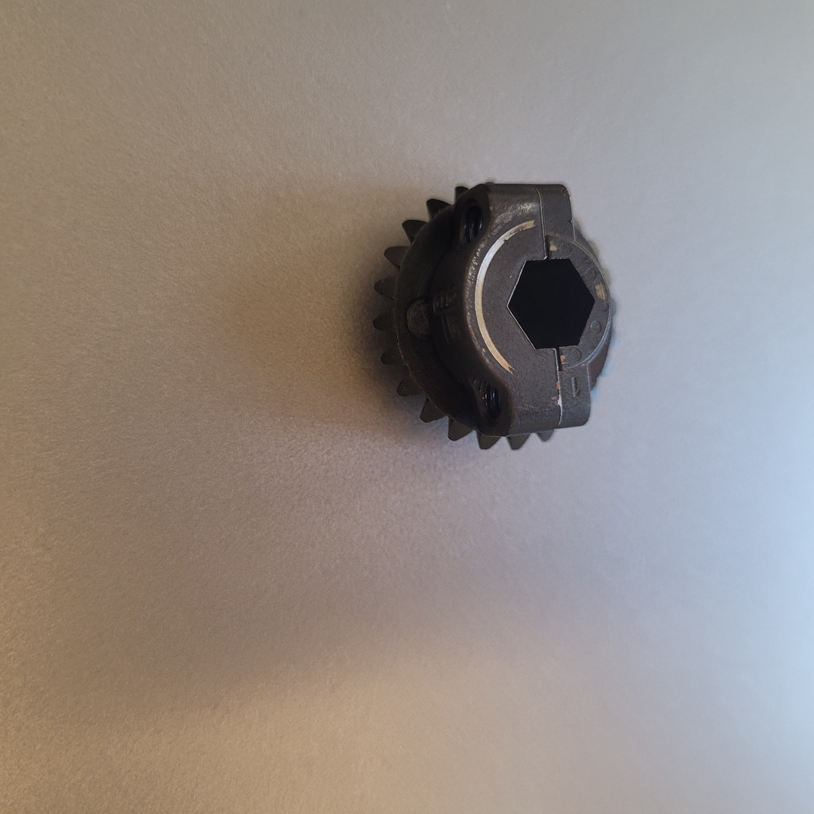

# 1 · Base Frame

<figure markdown="span">
  
  <figcaption>Assembly shown with wheels attached for visualization purposes — it is recommended <strong>NOT</strong> to install the wheels until significantly later in the build.</figcaption>
</figure>

The base frame is the goBILDA aluminum chassis every other module mounts to. It
also **defines the robot's coordinate origin** (see
[Coordinate frames & naming](../naming-frames.md)), so get the orientation right
before anything else goes on.

## The goBILDA (ServoCity) system

This robot is built on **goBILDA** structural components (sold through
**ServoCity**). goBILDA is widely used in **FIRST Tech Challenge (FTC)** robotics,
so there's a deep catalog of parts, CAD, and tutorials to lean on.

!!! tip "goBILDA / ServoCity resources"
    - [gobilda.com](https://www.gobilda.com) — parts, CAD downloads, kits
    - [servocity.com](https://www.servocity.com) — same catalog plus user manuals
    - [Product Insight](https://www.servocity.com/product-insights) — goBILDA's guide to how the system assembles and the design patterns behind it
    - [Strafer Chassis Kit build guide (PDF)](https://www.servocity.com/content/user_manuals/3209-0012-0002_assembly-instructions.min.pdf) — the drivetrain in this build follows it

**Reading goBILDA part numbers.** Structural parts follow the pattern
`XXXX-YYYY-ZZZZ`:

| Field | Meaning |
|-------|---------|
| `XXXX` | part family — e.g. `1120` = U-channel |
| `YYYY` | for structure, the number of **large holes** |
| `ZZZZ` | length in **mm** |

For example, **`1120-0025-0624`** is a U-channel (`1120`) with **25 large holes**,
**624 mm** long — and this step uses **qty 2** of them for the long sides of the frame.

!!! info "At a glance"
    | | |
    |---|---|
    | **You'll build** | The 432 × 624 mm goBILDA frame + the four drive pods (motor + miter gear + hub) |
    | **Time** | ~TODO |
    | **Difficulty** | Beginner |
    | **Prerequisites** | None — this is the first build |
    | **Mates to** | Mast, electronics tray, payload deck (later modules) |

## CAD & 3D model

- **View in browser (Fusion):** <https://a360.co/4xbG4gZ>

!!! tip "The viewer is interactive — use it"
    The Fusion link isn't just a picture. Drag to orbit/zoom in 3D, and hit
    **Explode Model** (the box icon in the bottom toolbar) to pull the assembly
    apart and see how the pieces fit together — often the fastest way to understand
    a step before you pick up a tool.

▶ Open the interactive 3D model

*Click the model above to load the live Fusion viewer in place — then orbit/zoom, and hit
**Explode Model** (the box icon in the bottom toolbar) to pull the assembly apart.*

- **Download:** export a STEP from the Fusion link into `hardware/` for offline reference. *(TODO: add exported STEP/STL)*

## Bill of materials

!!! note "Generated from `hardware/parts.csv`"
    Part numbers are goBILDA SKUs — order from [servocity.com](https://www.servocity.com)
    (**educational discount** — see the [Hardware BOM](../hardware-bom.md)). Read them with
    the `XXXX-YYYY-ZZZZ` convention above. **This table is generated — edit the CSV, not the
    table.** Quantities are module totals (each drive assembly, ×4, takes 1 hub shaft, 2 miter
    gears, and so on — see the per-part notes).

!!! tip "Motor choice"
    We recommend the goBILDA **5303-series, 99.5:1, 24 mm** (8 mm REX, 180 RPM, encoder) — a
    good speed/torque mix for this robot — but **any 5303-series motor fits physically.**

!!! warning "Do not install the wheels yet"
    The mecanum wheels are handed (2 left + 2 right) and go on much later — order them now,
    set them aside.

<!-- BOM-AUTO:build:base-frame -->
**Frame structure**

| Part | SKU | Qty | Notes |
|---|---|---:|---|
| [U-channel, 25-hole, 624 mm](https://www.servocity.com) | `1120-0025-0624` | 2 | Frame long side rails |
| [U-channel, 17-hole, 432 mm](https://www.servocity.com) | `1120-0017-0432` | 3 | Cross rails (three lower-rail assemblies) |
| [Quad block mount](https://www.servocity.com/1201-series-quad-block-pattern-mount-43-2/) | `1201-0043-0002` | 10 | 6 for lower rails + 4 for drive assemblies |
| [1118 Series Open goRAIL, 192 mm](https://www.servocity.com/1118-series-open-gorail-192mm-length/) | `1118-0024-0192` | 4 | 192 mm open goRAIL (T-slot extrusion); 4 per frame |

**Drive assembly (x4)**

| Part | SKU | Qty | Notes |
|---|---|---:|---|
| [Hub shaft](https://www.servocity.com) | `2110-0608-0002` | 4 | 1 per drive assembly |
| [Bearing, 6 mm ID](https://www.servocity.com) | `1611-0514-0006` | 4 | 1 per drive assembly |
| [Bearing, 8 mm](https://www.servocity.com) | `1611-0514-0008` | 4 | 1 per drive assembly |
| [Miter gear, 8 mm REX](https://www.servocity.com) | `2320-4008-0024` | 8 | 2 per drive assembly; orientation sets wheel direction |
| [Spacer, 9 mm](https://www.servocity.com) | `1522-0010-0090` | 4 | 1 per drive assembly |
| [Shim, 6 mm ID](https://www.servocity.com) | `2807-0609-0250` | 4 | 1 per drive assembly |
| [Shim, 8 mm ID](https://www.servocity.com) | `2807-0811-0500` | 4 | 1 per drive assembly |
| [Washer, 4 mm](https://www.servocity.com) | `2801-0004-0008` | 4 | 1 per drive assembly |

**Drive motors**

| Part | SKU | Qty | Notes |
|---|---|---:|---|
| [goBILDA 5303-series motor, 99.5:1, 24 mm](https://www.servocity.com/5303-series-saturn-planetary-gear-motor-99-5-1-ratio-24mm-length-8mm-rex-shaft-180-rpm-3-3-5v-encoder/) | `5303-series (99.5:1 / 24 mm)` | 4 | RECOMMENDED for this build (good speed/torque mix); ANY 5303-series motor fits physically. 1 per drive assembly; same motor class reused for the mast |

**Wheels**

| Part | SKU | Qty | Notes |
|---|---|---:|---|
| [Mecanum wheel, LEFT slant](https://www.servocity.com) | `3606-0000-0140` | 2 | Handed; do NOT install until late in the build |
| [Mecanum wheel, RIGHT slant](https://www.servocity.com) | `3606-0100-0140` | 2 | Handed; do NOT install until late in the build |
<!-- /BOM-AUTO:build:base-frame -->

Structural screws are bought in bulk, not itemized here — each drive assembly uses
~1 × M4 × 10 mm + 4 × M4 × 8 mm socket-head screws. See the fasteners on the
[Hardware BOM](../hardware-bom.md#tools--consumables).

## Tools

goBILDA hardware is **metric**, and the structural screws take a **3 mm hex**. You can
build the whole frame with a hand wrench; a powered driver just makes it much faster.

<!-- BOM-AUTO:shared:tools -->
| Item | Need | Qty | Source | Notes |
|---|---|---|---|---|
| Safety glasses (PPE) | required | 1 | — | Wear during ALL assembly — cutting, wiring, battery handling |
| Work gloves (PPE) | required | 1 | — | Protect hands during assembly, wiring, and battery handling |
| 3 mm hex wrench (4-pack) | required | 1 | [buy](https://a.co/d/028aG2GM) | Minimum tool; builds the frame by hand (~$7) |
| Rechargeable hex driver (incl. 3 mm bit) | recommended | 1 | [buy](https://a.co/d/06aqx7Jc) | Much faster for the bulk of the screws |
| 2.5 mm hex wrench / bit | recommended | 1 | — | For M4 cap-head screws |
| 7 mm ratcheting wrench | optional | 1 | [buy](https://a.co/d/03lJ5n8P) | For nuts |
| Long 3 mm hex bits | optional | 1 | [buy](https://a.co/d/05i2Vbj9) | Reach screws in tight spots |
<!-- /BOM-AUTO:shared:tools -->

**Consumables**

<!-- BOM-AUTO:shared:consumables -->
| Item | Need | Qty | Source | Notes |
|---|---|---|---|---|
| Blue removable threadlocker | recommended | 1 | [buy](https://a.co/d/0igs0Bmw) | Apply to structural screws; BLUE (removable), not red |
<!-- /BOM-AUTO:shared:consumables -->

!!! tip "Manual vs. powered — your choice"
    The ~$7 hex-wrench set is all you *strictly* need. If you're building more than one
    robot (or value your wrist), the rechargeable driver pays for itself fast — it ships
    with a 3 mm bit, and the long bits above extend its reach into tight corners.

!!! warning "Use BLUE threadlocker, not red"
    Blue is **removable** — you'll want to take things apart later. Red is permanent. A
    small drop on the threads is plenty; it keeps screws from backing out under vibration.

*(Third-party tool links are examples — any equivalent works.)*

## Assembly

!!! tip "Reuse: goBILDA Strafer Kit drivetrain"
    The drive pods here — **motor + miter gear + hub** — are assembled **identically
    to the goBILDA Strafer Kit**. If a step is unclear, the Strafer manual has the
    detailed exploded views:
    [Strafer Kit assembly instructions (PDF)](https://www.servocity.com/content/user_manuals/3209-0012-0002_assembly-instructions.min.pdf).

!!! note "Photos in progress"
    Only completed-frame photos exist today (see [Reference](#reference-completed-frame)).
    Step-by-step photos get dropped into `docs/assets/build/base-frame/` as the team
    shoots them — filenames per the convention in that folder's README, then replace
    each `TODO photo` below.

### Step 1 — Build the frame rectangle
Assemble the four U-channels into the 432 × 624 mm rectangle and square it up.

*TODO photo: `01-frame-rectangle.jpg`*

!!! warning "Orientation sets the origin"
    The **rear-most 432 mm rail** carries the coordinate origin
    ([naming-frames](../naming-frames.md)). Note which end is front before you commit
    the corners — flipping it later means re-deriving everything.

### Step 2 — Assemble the four drive pods
Build each pod: motor → miter gear → hub (see the Strafer tip above). The miter gear sub-assembly:

<figure markdown="span">
  
  <figcaption>The 8 mm REX miter gear (goBILDA `2320-4008-0024`) — two go into each drive pod.</figcaption>
</figure>

<figure markdown="span">
  
  <figcaption>The gear mated to the hub — the hex bore is what drives the wheel shaft.</figcaption>
</figure>

*TODO photo: the full pod (motor + gears + hub) — `02-drive-pod.jpg`*

!!! tip "Miter-gear orientation flips wheel direction"
    Which way the miter gears mesh sets the rotation direction of that wheel. Keep the
    four pods consistent — mismatches show up as a wheel driving backwards, and you'd
    then fix it in firmware ([drive bring-up](../drive-bringup.md)) rather than rebuild.

### Step 3 — Mount the pods to the frame corners
*TODO photo: `03-pods-mounted.jpg`*

### Step 4 — Route the motor leads
*TODO photo: `04-leads-routed.jpg`*

## Verify — done when…

- [ ] Frame is square (equal diagonals) and the front/rear orientation is marked.
- [ ] All four drive pods spin freely by hand, no binding.
- [ ] Motor leads reach their connector positions without strain.
- [ ] (After electronics) run [Drive bring-up](../drive-bringup.md) to map each
      channel → wheel → direction.

## Reference — completed frame

*Completed base frame with drive pods mounted. Source photos are on the team Drive
("1 - Base Frame Build", HEIC) — convert to JPG/WebP and drop into
`docs/assets/build/base-frame/` to render here.*

*TODO photo: `completed-01.jpg`*
