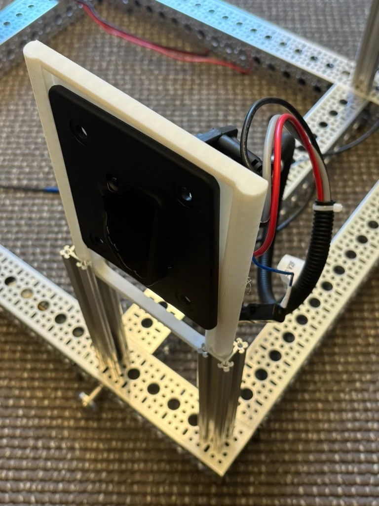
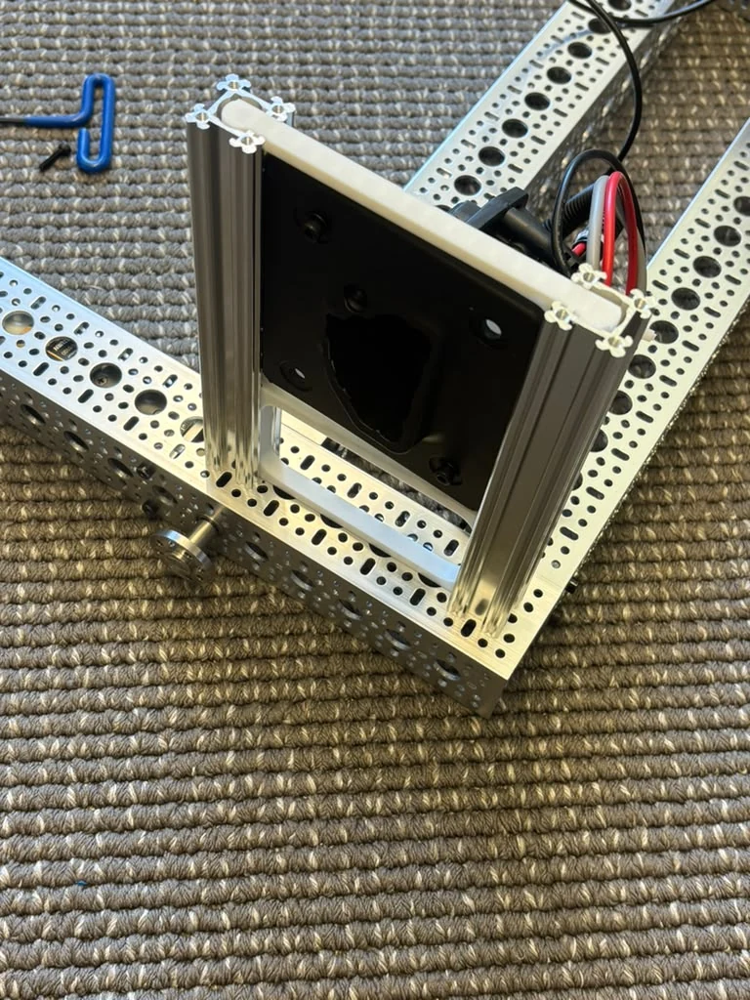
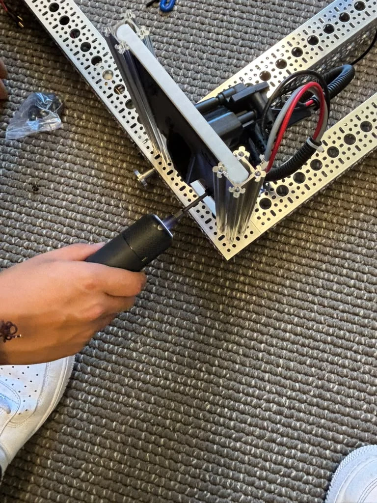
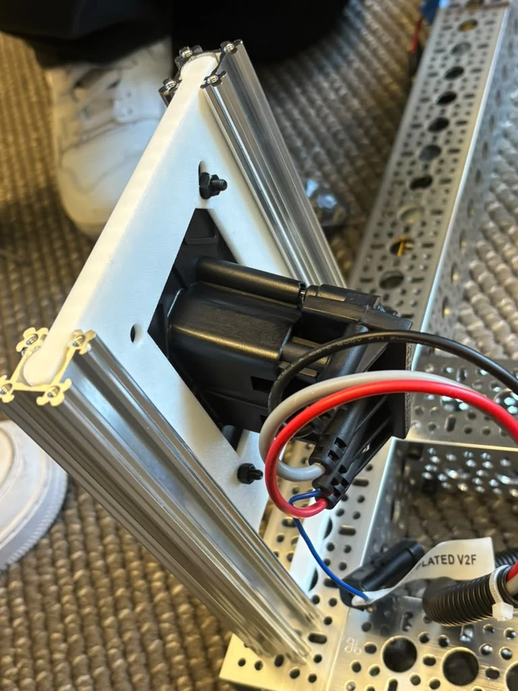
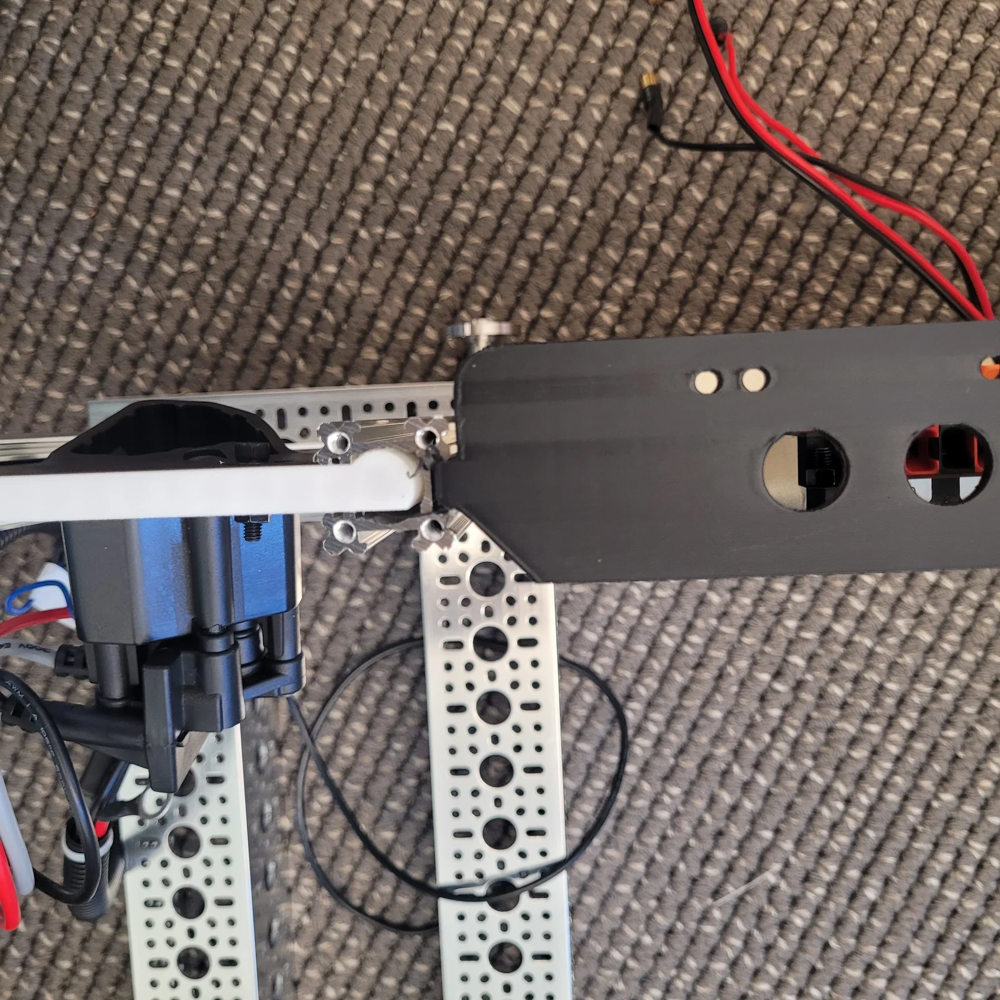
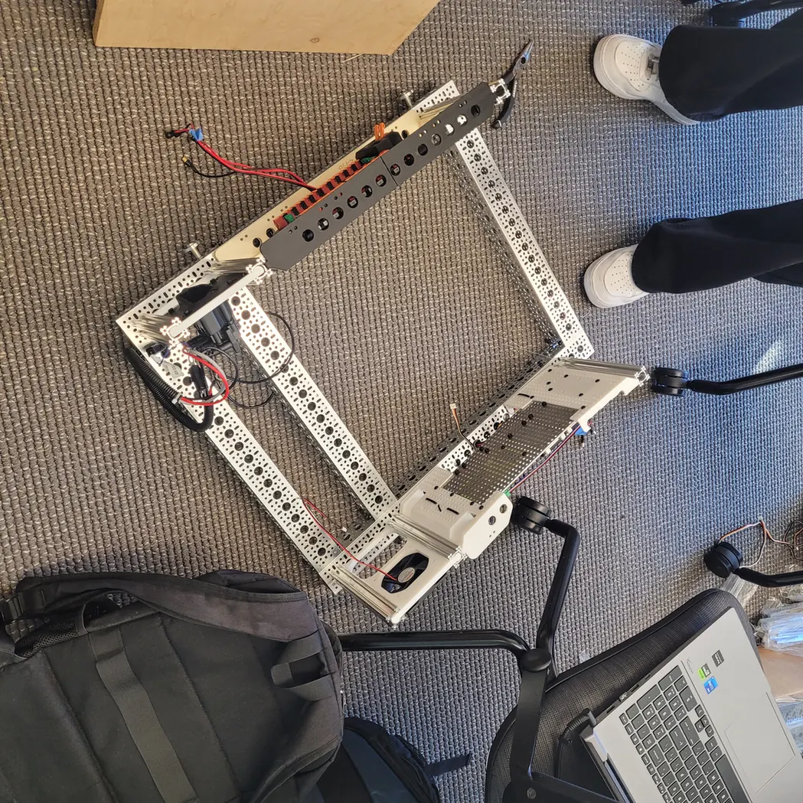

# 4 · Charger Port Integration

## At a glance

| | |
|---|---|
| **You'll do** | Mount + wire the external charge port; land the charger-present sense |
| **Prerequisites** | [Power Bay](power-bay.md) |
| **Interlock** | Charger connected ⇒ drive inhibited (see [Power architecture](../power-architecture.md)) |

!!! note "Stub — assembly steps coming"
    Mount the charge port on the lower frame and wire it into the power system, including the
    **charger-present → drive-inhibit** interlock (the robot must not drive while plugged in).

<figure class="amap amap--charge-port" markdown="1">
  

--8<-- "amap-map.html"
  

  <figcaption>Where the <strong>Charge Port panel</strong> sits in the lower frame — see the <a href="../lower-frame/">assembly overview</a>.</figcaption>
</figure>

  ▶ Open the interactive 3D model — charge port panel

## Assembly

Like the [fan](cooling-fan.md), the charge port is its own **module**: a printed panel
carrying the connector, captured between two short goRAIL uprights and locked with corner
brackets. Build that module first (**Construction**), then fit it to the robot
(**Installation**) — the assembled module slides into the frame's rail from the top, so it
goes in before the upper frame caps those rails.

!!! danger "Wire it de-energized"
    The charge port lands on the battery side of the system. Build and wire it with the
    **battery disconnected** — see [Power architecture](../power-architecture.md).

## Construction

### Step 1 — Bring the panel down onto the uprights

The connector is a flanged receptacle behind a black faceplate, carried in the printed
surround. Stand the two goRAIL uprights up and bring the panel down over them so its side
edges engage the uprights' T-slots — faceplate **outward**, leads fed through to the back
before the panel goes on.

<figure markdown="span">
  
  <figcaption>Panel brought down over the uprights but not yet engaged, leads already fed through to the inside face.</figcaption>
</figure>

!!! warning "Get the facing right now"
    Faceplate outward, leads inward. Turning the panel round after it is locked to the
    uprights means taking the module back apart.

### Step 2 — Slide the panel down and lock it

Slide the panel down the uprights to its height, then lock it with the corner brackets, top
and bottom.

<figure markdown="span">
  
  <figcaption>Slid down and locked — this is the finished charge-port module, ready to go into the frame.</figcaption>
</figure>

## Installation

### Step 3 — Fit the module to the frame and lock it down

The completed module drops into the frame rail from the top and slides down to position.
Before you tighten anything, check the connector actually presents where you want it —
**then** lock it.

<figure markdown="span">
  
  <figcaption>Locking the module down once its height and reach are right. A powered driver makes short work of the bracket screws.</figcaption>
</figure>

!!! warning "Try the actual charge lead, not just a look"
    A connector you can see is not necessarily one you can get a plug into — the latch needs
    clearance to release as well as to seat. Mate and unmate the real lead before the module
    is locked and the frame closes up.

### Step 4 — Land the charger wiring

<figure markdown="span">
  
  <figcaption>The connector from inside the frame. The body sits in the printed pocket with its leads exiting toward the bay — this is the face you work from when landing the wiring.</figcaption>
</figure>

<figure markdown="span">
  
  <figcaption>Installed, seen along the rail. Leads run inboard along the rail toward the power bay.</figcaption>
</figure>

<figure markdown="span">
  
  <figcaption>Both in context — charge-port module on the left-hand rail, fan module on the right.</figcaption>
</figure>

Route the charge leads along the inside of the rail back to the [Power Bay](power-bay.md),
clear of the frame opening and of anything that moves.

## Verify — done when…

- [ ] Panel locked to the uprights — it should not slide under hand pressure.
- [ ] Module seated in the frame rail and locked.
- [ ] The real charge lead mates **and releases** with the robot assembled.
- [ ] Charge leads routed along the rail, correct polarity, no strain at either end.
- [ ] **Charger connected ⇒ drive inhibited.** Verify the interlock before the robot is ever
      driven while plugged in.

!!! warning "The interlock is NOT documented here — it is not in the photos"
    The page header specifies **charger connected ⇒ drive inhibited**, and that is a safety
    behaviour, not a nicety: without it the robot can drive off while tethered to a charger.
    The photos in the "3 - Fan and Charge Port Install" Drive folder show the **mechanical**
    build and install and the back of the connector, but nothing showing how charger-present
    is sensed or how that signal reaches the drive path. So nothing about that wiring is
    written above rather than guessed at. Whoever wired it: please add that step.

!!! note "Still to document"
    This module has **no rows in `hardware/parts.csv`** yet, so the page has no generated BOM —
    the connector, its printed panel, the goRAIL uprights and the corner brackets all need
    adding, then `python3 tools/bom.py --inject`. The exact connector part is also not
    identified above; the rear view shows the body and its leads but no legible marking.
