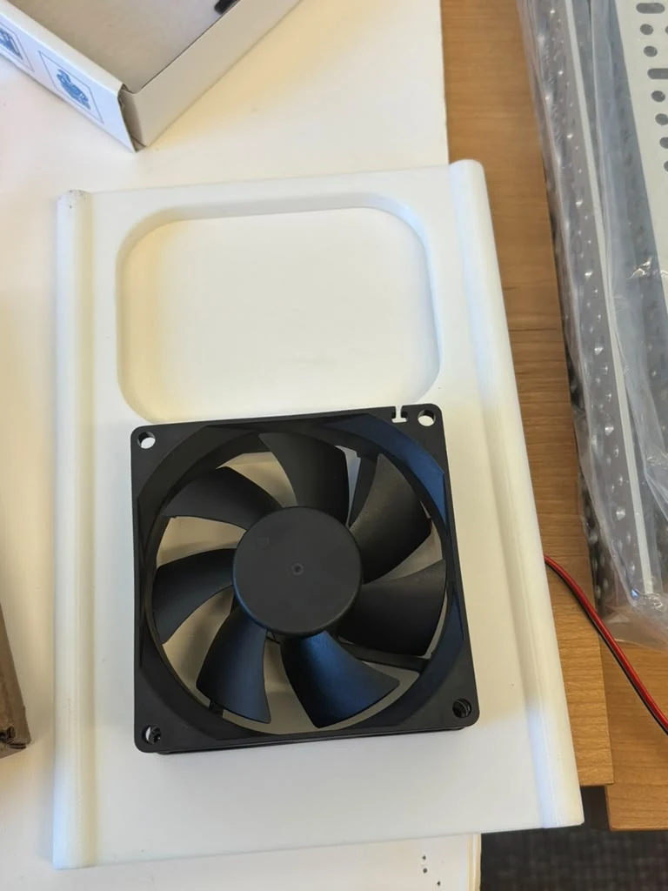
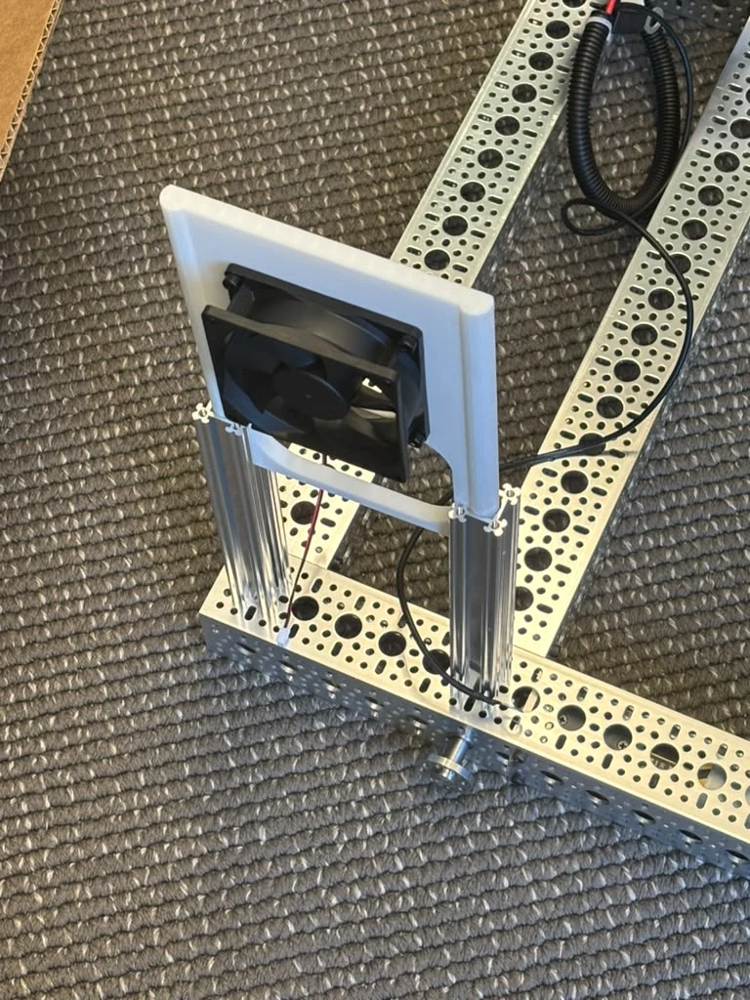
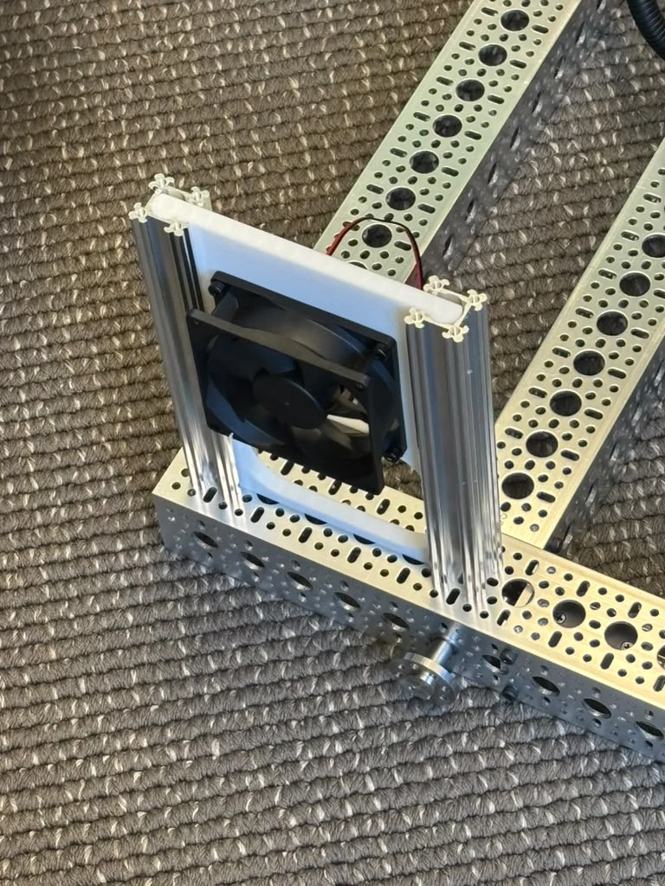
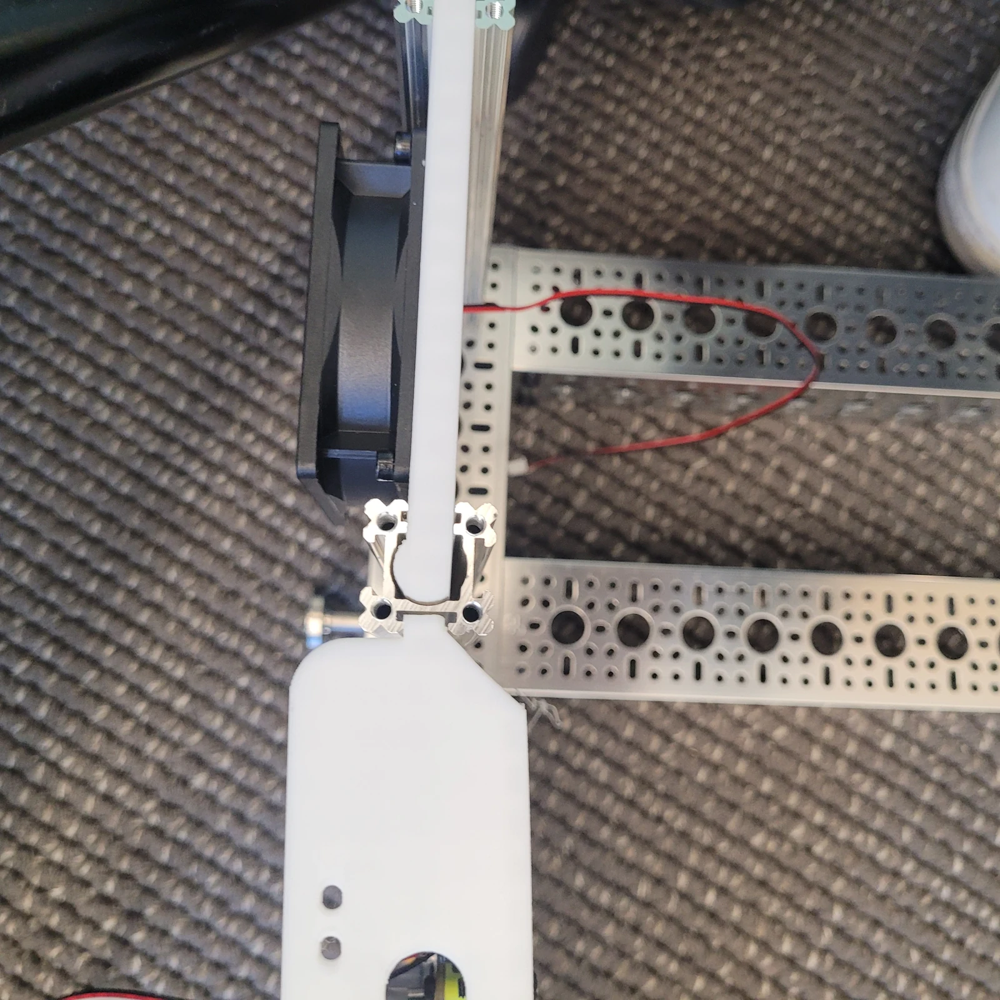
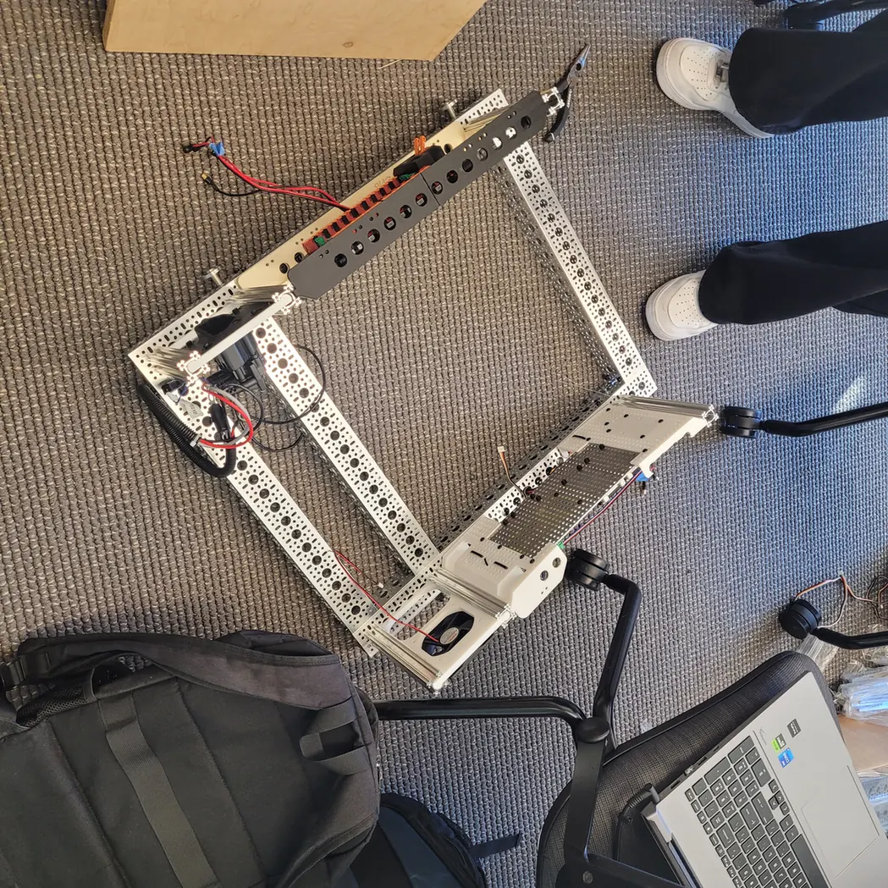

# 5 · Cooling Fan Integration

## At a glance

| | |
|---|---|
| **You'll do** | Mount the fan(s), duct/aim airflow over the hot components, wire fan power |
| **Prerequisites** | [Electronics Bay](electronics-bay.md) |

!!! note "Stub — assembly steps coming"
    Install the cooling fan(s) for the electronics / compute and wire their power, so the bay
    stays within temperature under sustained load.

<figure class="amap amap--fan" markdown="1">
  

--8<-- "amap-map.html"
  

  <figcaption>Where the <strong>Fan panel</strong> sits in the lower frame — see the <a href="../lower-frame/">assembly overview</a>.</figcaption>
</figure>

  ▶ Open the interactive 3D model — fan integration panel

## Assembly

The fan is its own **module**: a printed panel carrying the fan, captured between two short
goRAIL uprights and locked with corner brackets. Build that module first (**Construction**),
then fit it to the robot (**Installation**) — the assembled module slides into the frame's
T-slot from the top, so it goes in before the upper frame caps those rails.

## Construction

### Step 1 — Mount the fan to the panel

The printed panel does all the work: the fan fastens to it, and the panel carries the load
into the uprights. The fan never touches the frame directly.

<figure markdown="span">
  
  <figcaption>The fan and its printed panel before assembly. The fan sits into the square aperture; the recessed pocket above it is part of the panel, not somewhere the fan goes.</figcaption>
</figure>

!!! tip "Do this flat, on a bench"
    Both fan screws are easy on a desk and awkward once the panel is between the uprights.

### Step 2 — Set the airflow direction

Axial fans are directional and every case has an arrow moulded into the housing for airflow,
usually with a second for rotation. Decide **now** whether this fan pulls air in or pushes it
out — reversing it later means taking the module back apart.

!!! warning "Check the arrow, not the blades"
    You cannot reliably tell a fan's direction by looking at the blades. Find the moulded
    arrow on the housing edge and aim the flow across the electronics that actually get hot —
    see [Electronics Bay](electronics-bay.md).

### Step 3 — Slide the panel down onto the uprights

Stand the two goRAIL uprights up, then bring the panel down over them so its side edges
engage the uprights' T-slots. Slide it down to its height and lock it with the corner
brackets, top and bottom.

<figure markdown="span">
  
  <figcaption>Panel brought down over the uprights but not yet engaged — fan facing outward, lead already fed through and hanging clear behind.</figcaption>
</figure>

<figure markdown="span">
  
  <figcaption>Slid down and locked. The corner brackets at top and bottom are what hold the panel's height on the uprights — this is the finished fan module.</figcaption>
</figure>

!!! tip "Slide to height before you tighten"
    The brackets clamp the panel wherever you leave it, so set the height against whatever the
    fan needs to blow across, then lock it. Loosening and sliding is easy; drilling is not.

## Installation

### Step 4 — Fit the module to the frame

The completed module drops into the frame's rail from the top and slides down to position.

<figure markdown="span">
  
  <figcaption>The module installed on the frame, seen along the rail.</figcaption>
</figure>

!!! tip "Fit it before the upper frame closes the rails"
    The module goes in from the open end at the top of the frame rail. Once the upper frame
    caps that rail there is no way in, and you are backing a rail off to fit a module that
    would have dropped straight in earlier.

### Step 5 — Route and land the fan power

Run the fan lead along the inside face of the rail and back to its supply in the bay, clear
of the frame opening and of anything that moves.

<figure markdown="span">
  
  <figcaption>Both in context — fan module on the right-hand rail, charge-port panel on the left.</figcaption>
</figure>

## Verify — done when…

- [ ] Fan solidly fastened to the panel; no contact between blades and any cable.
- [ ] Panel locked to the uprights — it should not slide under hand pressure.
- [ ] Airflow direction confirmed against the housing arrow, aimed at the hot components.
- [ ] Module seated in the frame rail and locked.
- [ ] Fan lead routed along the rail, not across the frame opening, with no strain at either end.
- [ ] Fan spins up on power and runs without rubbing or rattling.

!!! note "Still to document"
    This module has **no rows in `hardware/parts.csv`** yet, so the page has no generated BOM —
    the fan, its printed panel, the goRAIL uprights and the corner brackets all need adding,
    then `python3 tools/bom.py --inject`. The fan's supply voltage and where in the bay it
    lands are not shown in the photos and are not stated here.
