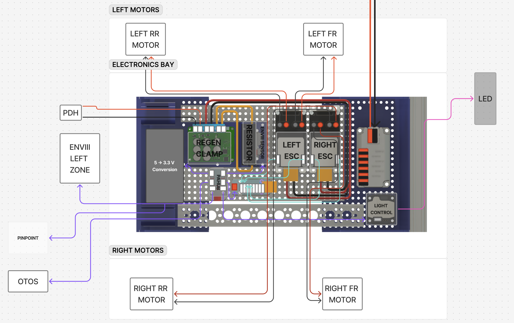

# 2 · Electronics Bay

!!! info "At a glance"
    | | |
    |---|---|
    | **You'll build** | The grid-plate tray with power distribution, drive electronics, I2C hub + level-shift, regen clamp, and PRISM |
    | **Time** | *TODO* |
    | **Difficulty** | Intermediate (wiring + a little soldering) |
    | **Prerequisites** | [Base Frame](base-frame.md); [Power Bay](power-bay.md) *(TODO confirm order)* |
    | **Mates to** | Right/lower side of the frame; power bay; sensors |

▶ Open the interactive 3D model

*The electronics bay — power distribution, drive electronics, I²C hub + level-shift, regen clamp,
and PRISM on one grid plate. **Click to orbit/zoom the live Fusion model.***

<figure class="amap amap--electronics-bay" markdown="1">
  

--8<-- "amap-map.html"
  

  <figcaption>Where the <strong>Electronics Bay</strong> sits in the lower frame — see the <a href="../lower-frame/">assembly overview</a>.</figcaption>
</figure>

The electronics bay occupies the **right / lower side** of the OpenDubs base. The idea is to
**concentrate the complex wiring in one easily accessible, well-protected place** — so most
of the fiddly interconnects live here rather than scattered around the robot.

## What lives in the bay

**Power distribution.** The **24 V "logic" bus** is a
[REV Mini Power Module](https://www.revrobotics.com/rev-11-1956/) with **6 fused branch
circuits**. Most branches feed large components **outside** the bay — Thor, the StampPLC, the
wireless router, the USB hub(s), and the E-stop signal — and one feeds the **PRISM** light
controller, which lives **inside** the bay.

Also in the bay: the **goBILDA drive ESCs**, the **ODrive Regen Clamp**, the **M5Stack PaHub**,
the **ENVIII** sensor (mounted **under the regen clamp's resistor** as its thermal probe), and
the **8Servo**.

!!! note "This bay owns the Pinpoint level-shift"
    The 3.3 V ↔ 5 V step-down for the [Pinpoint odometry](pinpoint.md) I2C lives **here**, not
    in the Pinpoint module: PaHub (5 V M5 I2C) → **Adafruit level converter** (Qwiic) →
    goBILDA wire out to the Pinpoint.

## Mounting

Everything attaches to the robot via **two 3D-printed parts** and a **goBILDA
[grid plate `1116-0136-0232`](https://www.servocity.com/1116-series-grid-plate-17-x-29-hole-136-x-232mm/)**
(17 × 29 hole, 136 × 232 mm). Both the **M5Stack** units and the **goBILDA** parts mount onto
the grid plate with **M4 screws**.

!!! warning "Soldering + wiring notes"
    - **Soldering is required** to build the **regen clamp's resistor lead**.
    - **WAGOs** join the **PaHub (M5 I2C)** to the **goBILDA PRISM (goBILDA I2C)**.
    - More **WAGOs + the Adafruit level converter** bridge the **PaHub (M5 I2C)** → converter
      (Qwiic) → the **goBILDA wire out to the Pinpoint** module.
    - Prefer to crimp/solder instead of WAGOs? You'll want a **crimper + crimp assortment**
      (listed on the [Power Bay](power-bay.md) BOM) and the heat-shrink below.

## CAD & 3D model

- **View in browser (Fusion):** <https://a360.co/4wDfT1I> — or click the hero above to load it inline.
- **Download:** *TODO — export STEP + the two printed-part STLs into `hardware/`*

## Wiring

The bay's bus + wiring layout — pan/zoom the live board:

  <iframe style="position: absolute; inset: 0; width: 100%; height: 100%; border: 0;" src="https://embed.figma.com/board/LVbgJwMKO65TARF3m6v7I6/OpenDubs?node-id=35-1657&embed-host=opendubs-docs" allowfullscreen loading="lazy" title="Electronics bay wiring (Figma)"></iframe>

- **Diagram source (Figma):** [OpenDubs board — electronics bay](https://www.figma.com/board/LVbgJwMKO65TARF3m6v7I6/OpenDubs?node-id=35-1657) — anyone with the link can view and export it.

## Bill of materials

!!! note "Generated from `hardware/parts.csv`"
    Edit the CSV (rows tagged `module = electronics-bay`), then run `tools/bom.py --inject`.
    Several of these (ESCs, 8Servo, regen clamp, PRISM) also appear on the core
    [Hardware BOM](../hardware-bom.md).

<!-- BOM-AUTO:build:electronics-bay -->
**Power distribution**

| Part | SKU | Qty | Notes |
|---|---|---:|---|
| [REV Mini Power Module (24 V logic bus)](https://www.revrobotics.com/rev-11-1956/) | `REV-11-1956` | 1 | 6 fused branch circuits — feeds Thor / StampPLC / router / USB hub(s) / E-stop signal (outside the bay) and the PRISM (inside) |

**Drive electronics**

| Part | SKU | Qty | Notes |
|---|---|---:|---|
| [goBILDA 2x80A ESC](https://www.servocity.com/content/user_manuals/3105-0202-0080_data-sheet.pdf) | `3105-0202-0080` | 2 | Drive ESCs (datasheet at the link). NOTE: 2x80A is likely OVER-SPEC for this drivetrain — a lower-amperage ESC would work and cost less; we used these because we had them on hand. |
| [M5 8Servo unit](https://docs.m5stack.com/en/unit/8Servos%20Unit) | — | 1 | PWM source to the ESCs; I2C 0x25 (same as Core BOM) |

**Regen & protection**

| Part | SKU | Qty | Notes |
|---|---|---:|---|
| [ODrive Regen Clamp](https://shop.odriverobotics.com/products/odrive-regeneration-clamp) | — | 1 | Absorbs braking regen; the resistor lead requires SOLDERING |

**I2C bus & level shift**

| Part | SKU | Qty | Notes |
|---|---|---:|---|
| [M5Stack PaHub (I2C hub)](https://docs.m5stack.com/en/unit/pahub) | — | 1 | I2C hub for the M5 bus |
| [Adafruit logic level converter](https://www.adafruit.com/product/5637) | `Adafruit 5637` | 1 | 3.3 V<->5 V step-down for the Pinpoint I2C (the Pinpoint module has none) |

**Sensors**

| Part | SKU | Qty | Notes |
|---|---|---:|---|
| [M5 ENV III sensor](https://docs.m5stack.com/en/unit/env-iii) | — | 1 | Thermal probe under the regen clamp resistor |

**Lighting**

| Part | SKU | Qty | Notes |
|---|---|---:|---|
| [goBILDA PRISM light controller](https://www.gobilda.com/) | — | 1 | In the bay; fed by the REV Mini Power Module; goBILDA I2C |

**Mounting**

| Part | SKU | Qty | Notes |
|---|---|---:|---|
| [goBILDA grid plate, 17x29-hole, 136x232 mm](https://www.servocity.com/1116-series-grid-plate-17-x-29-hole-136-x-232mm/) | `1116-0136-0232` | 1 | M5 + goBILDA components both mount here with M4 screws |
| 3D-printed mounting components | — | 2 | 2 printed parts attach the bay to the robot; STLs in hardware/ TBD |

**Wiring**

| Part | SKU | Qty | Notes |
|---|---|---:|---|
| [WAGO lever connectors](https://a.co/d/09VO6gwP) | — | a few | PaHub<->PRISM (goBILDA I2C) and PaHub<->LLC<->Pinpoint joins |
| [Heat-shrink assortment / labels](https://a.co/d/04p7f5Vs) | — | 1 | Heat-shrink tube assortment or heat-shrink labels |

**Bay-specific tools**

| Part | SKU | Qty | Notes |
|---|---|---:|---|
| Soldering iron + solder | — | 1 | Required to build the regen clamp resistor lead |
| [Wire cutter](https://a.co/d/04pImvE0) | — | 1 | Or similar |
| [Wire stripper](https://a.co/d/05DNUngu) | — | 1 | Or similar |
| [Heat gun](https://a.co/d/00PNwYUp) | — | 1 | For heat-shrink; or similar |
<!-- /BOM-AUTO:build:electronics-bay -->

## Tools

Uses the shared build tools — see the [Hardware BOM](../hardware-bom.md#tools--consumables) —
**plus a soldering iron** (regen clamp resistor lead; see the *Bay-specific tools* group above).

## Assembly

!!! note "Photos pending"
    Drop step photos into `docs/assets/build/electronics-bay/`, then add numbered steps here.

Outline (fill in once photos are in):

1. Mount the grid plate to the two printed brackets; fix the bay to the right/lower side.
2. Mount the components onto the grid plate with M4 screws (REV Mini Power, ESCs, 8Servo,
   regen clamp, PaHub, PRISM; ENVIII under the regen resistor).
3. Build the **regen clamp resistor lead** (soldered).
4. Wire the **6 fused branches** out to Thor / StampPLC / router / USB hub(s) / E-stop, and
   the PRISM.
5. Wire the I2C: PaHub → PRISM (WAGO), and PaHub → level converter → Pinpoint out (WAGO).

## Verify — done when…

- [ ] Each fused branch lands on its intended load; no over/under-fusing.
- [ ] Regen clamp resistor lead soldered and secure; ENVIII probe against the resistor.
- [ ] PaHub sees the PRISM and the Pinpoint (through the level converter).
- [ ] *TODO*
