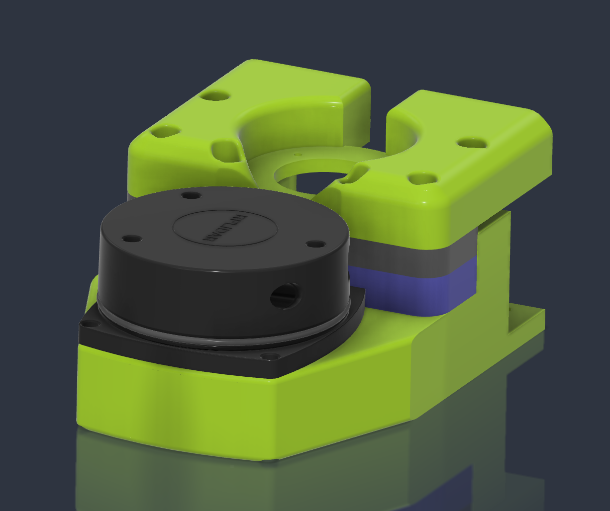

# Lidar — Front & Rear

!!! info "At a glance"
    | | |
    |---|---|
    | **You'll build** | Front lidar (+ GPS stack) **and** rear lidar, built together |
    | **Time** | *TODO* |
    | **Difficulty** | Beginner |
    | **Prerequisites** | [Base Frame](base-frame.md) |
    | **Mates to** | Frame front/rear; USB hub (in the electronics bay) |

▶ Open the interactive 3D model

The front and rear mounts each carry a **[Slamtec RPLIDAR A1](https://www.adafruit.com/product/4010)**
facing outward, for 360° 2-D scan coverage. Each module is mostly **3D-printed mount parts**
plus the **lidar, its USB-adapter daughter board, and a USB cable**. The two are **nearly
identical and built at the same time**.

!!! note "Front vs. rear — what differs"
    The **front** module has **additional stacked printed parts** that mount a
    **[Holybro M9N GPS / compass](https://docs.holybro.com/gps-and-rtk-system/m8n-m9n-m10-gps/standard-m10-m9n-m8n-gps/overview)**
    above the lidar — the **rear does not**. Otherwise the difference is **position /
    orientation** and cable routing, and each unit is pinned to a stable USB **by-path** (the
    two A1s enumerate identically, so they must be distinguished by port).

## CAD & 3D model

- **View in browser (Fusion):** *TODO — add permalink(s), front + rear if separate*
- **Download:** *TODO — export STEP + the mount / GPS-stack STLs into `hardware/`*

## Bill of materials

!!! note "Generated from `hardware/parts.csv`"
    Edit the CSV (rows tagged `module = lidar`), then run `tools/bom.py --inject`. The **GPS +
    GPS mount are front-only**; everything else is one per unit (×2, front + rear).

<!-- BOM-AUTO:build:lidar -->
**Lidar (front + rear)**

| Part | SKU | Qty | Notes |
|---|---|---:|---|
| [Slamtec RPLIDAR A1](https://www.adafruit.com/product/4010) | — | 2 | One front, one rear; the A1 typically ships with its USB adapter + cable |
| RPLIDAR USB adapter (daughter board) | — | 2 | Interface/daughter board — usually included with the A1 |
| USB cable (A1 to hub) | — | 2 | Usually included with the A1 |
| 3D-printed lidar mount set | — | 2 | One set per unit (front + rear); STLs in hardware/ TBD |

**GPS (front only)**

| Part | SKU | Qty | Notes |
|---|---|---:|---|
| [Holybro M9N GPS / compass](https://docs.holybro.com/gps-and-rtk-system/m8n-m9n-m10-gps/standard-m10-m9n-m8n-gps/overview) | — | 1 | FRONT lidar only |
| 3D-printed GPS mount stack | — | 1 | FRONT only; stacked parts that raise the M9N above the front lidar; STLs TBD |
<!-- /BOM-AUTO:build:lidar -->

## Tools

Uses the shared build tools — see the [Hardware BOM](../hardware-bom.md#tools--consumables).
Module-specific tools/consumables: *none beyond the shared set*.

## Assembly

!!! note "Photos pending"
    Drop step photos into `docs/assets/build/lidar/`, then add numbered steps here. Where a
    step differs front vs rear (the GPS stack), note it inline.

Outline (fill in once photos are in):

1. Print both mount sets (plus the extra GPS-stack parts for the front).
2. Build each lidar: A1 + daughter board into the mount; run the USB cable.
3. On the **front**, add the stacked parts and mount the **M9N GPS/compass** above the lidar.
4. Mount front and rear to the frame; route USB to the hub.
5. Pin each unit to its correct **USB by-path** (front vs rear not swapped).

## Verify — done when…

- [ ] Both units mounted with an unobstructed scan arc.
- [ ] Front GPS stack solid; M9N clear of the lidar's sweep.
- [ ] Each unit pinned to its correct USB by-path (front vs rear not swapped).
- [ ] *TODO*
