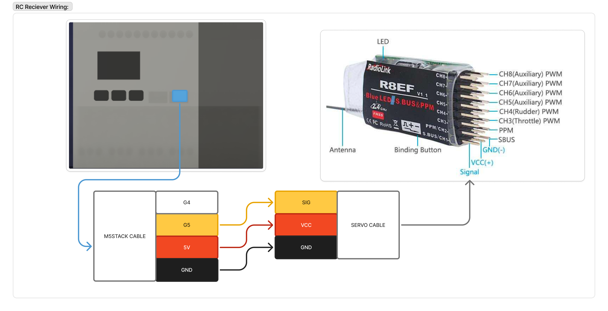

# RC receiver wiring

!!! info "At a glance"
    - **Time:** ~15 min · **Difficulty:** easy (one pigtail, three wires)
    - **You make:** a StamPLC blue-port (Grove) ⟷ 3-pin servo pigtail
    - **Result:** RC receiver powered from the port, SBUS on G5, `[SBUS]` frames flowing

The RC receiver's **SBUS** output feeds the StamPLC's **blue serial port** (signal on **G5**,
inverted in firmware). You make a short **Grove-to-servo pigtail** to bridge the StamPLC's
**M5Stack / Grove** 4-wire port to the receiver's **3-wire servo cable** (signal / +5 V / ground).

<figure markdown="span">
  
  <figcaption>The pigtail: StamPLC blue-port Grove (G4 unused · G5 signal · 5 V · GND) → servo
  cable → the receiver's SBUS pins (Signal / VCC+ / GND−). Receiver shown: RadioLink R8EF.</figcaption>
</figure>

- **Diagram source (Figma):** [OpenDubs board — RC controls](https://www.figma.com/board/LVbgJwMKO65TARF3m6v7I6/OpenDubs?node-id=2-83) — anyone with the link can view and export it.

!!! warning "Verify +5 V and GND before plugging in the receiver"
    On this M5Stack Grove cable the colors happen to line up (**G5 = yellow/signal, 5 V = red,
    GND = black**) — but the Grove connector carries a **4th wire, G4 (white), that is unused here**,
    and pin order varies between cables. Reversing +5 V and GND can destroy the receiver, so **meter
    the pigtail** (5 V on the right pin, GND continuity) *before* you connect it.

## Pin / wire map

| Function | StamPLC **blue port** (Grove) | Wire | RC receiver **SBUS** pin |
|---|---|---|---|
| **Signal** | **G5** (RX, inverted) | yellow | **Signal** |
| **Power** | **+5 V** | red | **VCC (+)** |
| **Ground** | **GND** | black | **GND (−)** |
| *(unused)* | G4 | white | — |

The receiver's SBUS output is the **S.BUS / CH1** pin group (on the RadioLink R8EF shown, the bottom
row = Signal / VCC+ / GND−). Servo colors vary by brand, so wire by **function** and confirm against
your receiver's silkscreen.

!!! note "Confirm the blue-port pin positions"
    Check the exact GND / 5 V / G5 pin order against the StamPLC silkscreen and the
    [M5StamPLC pinout](https://docs.m5stack.com/en/core/StamPLC) before crimping — get GND and
    +5 V right first.

## Make the pigtail

1. Start from a **Grove 4-pin cable** (or a connector that mates the blue port) and a **3-pin servo
   lead** (male header to plug the receiver's female SBUS socket, or vice-versa — match your
   receiver).
2. Join them **by function** using the table above: receiver **signal → G5**, **red → +5 V**,
   **black → GND**. Cap or tape the unused 4th Grove wire.
3. Join method: WAGO / solder + heat-shrink / crimp — your choice (same as the rest of the build).
4. **Meter it:** with the StamPLC powered and the receiver *unplugged*, confirm +5 V on the power
   pin and continuity to GND. Only then plug in the receiver.

*TODO photo: the finished pigtail, Grove end + servo end, colors labeled.*

## Why inverted, and no hardware inverter

SBUS is an **inverted** serial signal. The StamPLC firmware puts G5 into inverted-UART mode in
software ("SBUS is locked to inverted mode on the blue port"), so you **do not** need an external
inverter — wire the receiver's SBUS pin straight to G5.

## Verify

1. Power the StamPLC and turn on the RC transmitter.
2. On the dashboard (or `[SBUS]` telemetry), confirm **`ok` climbing, `bad` ~0**, and **RC live**.
3. Move a stick — the drive bars on the RC/DRIVE screen should track it.

If `ok` stays 0: re-check signal is on **G5** (not the other Grove signal pin) and that the receiver
has power. If `bad` climbs, suspect the signal wire routing (keep it away from motor/power leads).

## See also

- [StamPLC connections](../stamplc-connections.md) — the full port/pin reference.
- [RC control mapping](../rc-control-mapping.md) — which channel drives which function.
- [Flash a StamPLC](../flashing-stamplc.md) — get firmware on the board first.
