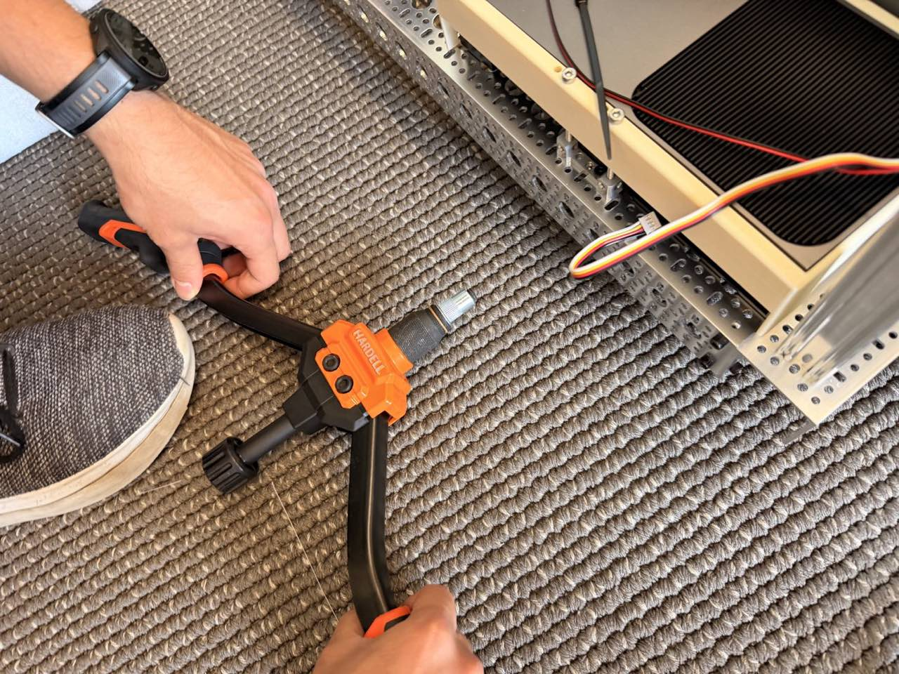
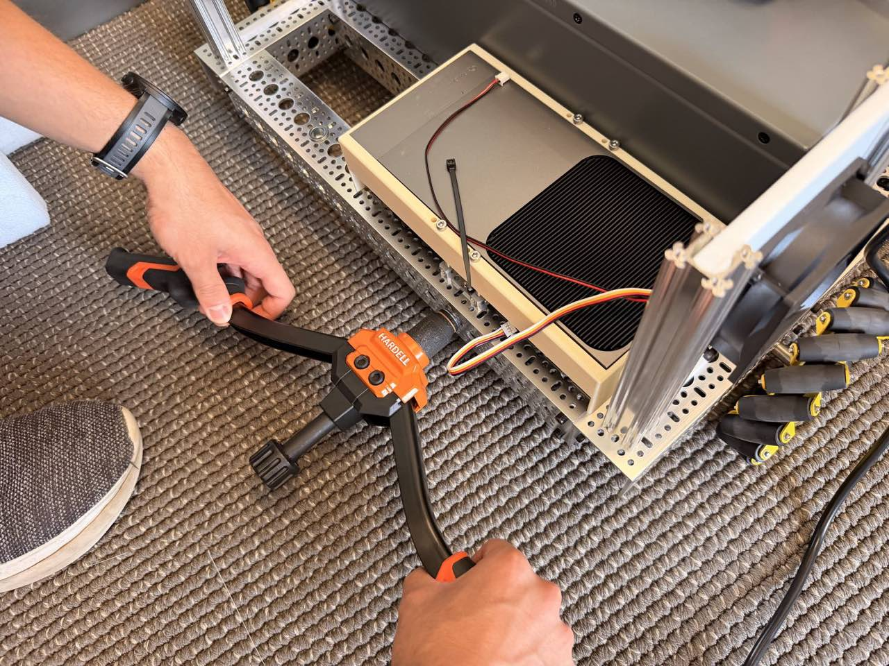
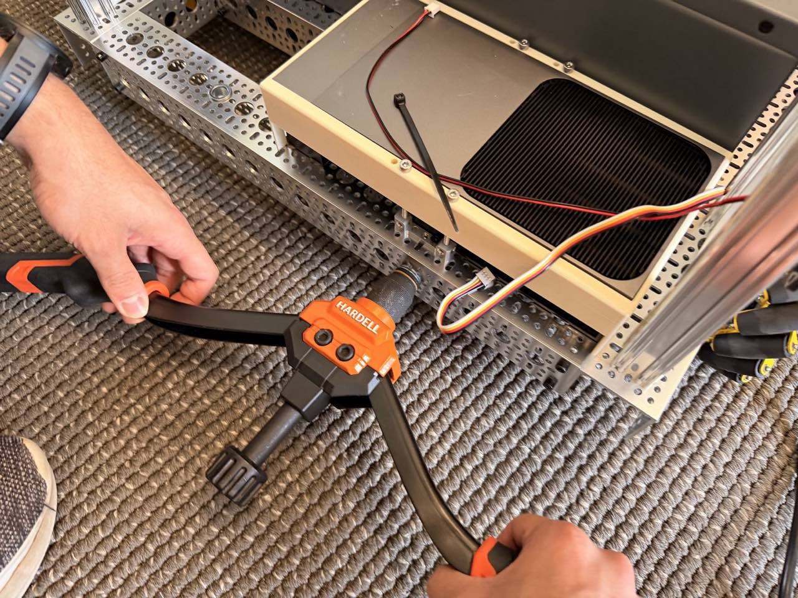
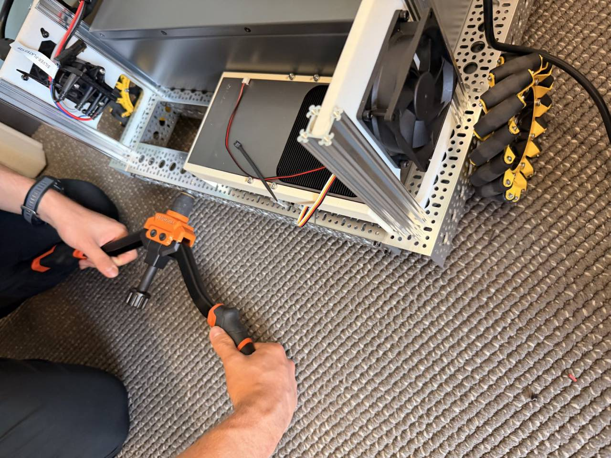
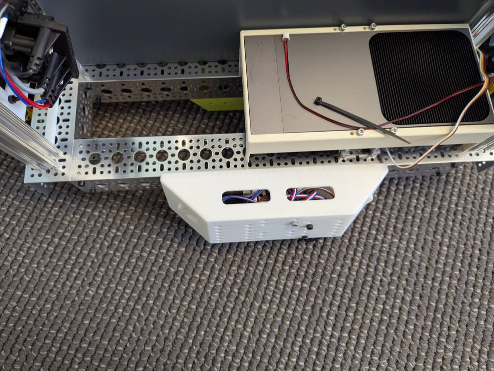

# 2 · Rivnut Installation

!!! info "At a glance"
    | | |
    |---|---|
    | **You'll do** | Set **M10 riv-nuts** into the base-frame rails to create threaded mounting points for modular sub-assemblies |
    | **Time** | *TODO* |
    | **Difficulty** | Beginner — but **effortful by hand** (a drill-driven tool helps a lot) |
    | **Prerequisites** | [1 · Base Frame](base-frame.md) |
    | **Why now** | The bare frame gives clear access to every hole — far easier than reaching past mounted bays, wiring, and the battery later |

**Riv-nuts** (rivet nuts / blind threaded inserts) give strong machine-thread anchors in the
goBILDA rail's holes, so sub-assemblies can **bolt on and off as modules**. Setting them now,
on the bare frame, is dramatically easier than after the electronics bays and battery are in.

!!! note "Front and rear are the same"
    Riv-nuts go in the **same positions on the front and the rear rail**. Set both while the
    frame is bare.

!!! note "The photos show a more complete frame than yours"
    The frame in the photographs below has modules fitted that you have not built yet. Ignore
    them — only the riv-nut positions and the tool technique matter here.

!!! danger "Keep the tool FLAT and TIGHT against the rail"
    The one technique that makes or breaks this: during the squeeze, hold the riv-nut tool
    **firmly flat against the goBILDA rail face**. If it lifts even slightly, the riv-nut body
    **bulges *outside* the frame** instead of clamping the rail — ruining the fastener *and* the
    mounting point. Seat it flush, keep steady pressure on, then squeeze (or drive) it home.

## Tools & fasteners

- **M10 riv-nut** — [the M10-thread riv-nut](https://a.co/d/07JbuGAl) fits the **14 mm hole** in
  the goBILDA rail. *(Quantities are counted with the module that uses them — see each module's BOM.)*
- **Riv-nut tool** — either a **manual** tool ([manual riv-nut tool](https://a.co/d/0am8KbEV), the
  one shown in the photos below) or, **strongly preferred**, a **drill-driven** tool
  ([example drill-driven riv-nut tool](https://a.co/d/07xBUxUD), which needs a drill of your own).
  Closing an M10 riv-nut by hand takes significant physical force, so the drill-driven version
  saves a great deal of effort over many holes.

## Rear rivnuts — Pinpoint / odo-pod module mount

The **[Pinpoint dead-wheel module](pinpoint.md)** mounts to the **rear of the frame** and is
designed to come on and off as a unit, so it threads onto riv-nuts set into the rear rail (the
module uses 3D-printed **M10 thumb screws** that thread into these inserts).

*TODO photo: the concept render — the odo-pod module aligning to the rear rail's riv-nut holes.*

- **View the module (Fusion):** [Pinpoint / odo-pod module](https://a360.co/4wVo4qs).

**Steps** (set each rear riv-nut, then hang the module):

1. **Thread the M10 riv-nut onto the tool.** Spin it fully onto the mandrel so the tool's face
   sits flat against the riv-nut flange.

    

2. **Press the tool TIGHTLY and flat against the goBILDA rail, then set the riv-nut** — squeeze
   (manual) or drive (drill-driven) until it clamps. **Keep the tool flush the entire time**
   (see the danger note above), then back the mandrel out.

    

    *Alternate views of the same set:*

    

    

3. **Attach the odo pods.** The module's 3D-printed holes line up with the newly-set riv-nuts —
   thread the **M10 thumb screws** through the print into the inserts.

    

## Other rivnut locations

*TBD — additional riv-nut locations will be added here as each module (electronics bays, upper
frame, payload mounts, …) confirms where it fastens to the frame.*

## Verify — done when…

- [ ] Each riv-nut is **seated flush** and **clamped tight** to the rail — **no bulge outside the frame**.
- [ ] An **M10 screw threads cleanly** into every installed insert.
- [ ] The rear set matches the Pinpoint module's mounting pattern (dry-fit the module if available).
