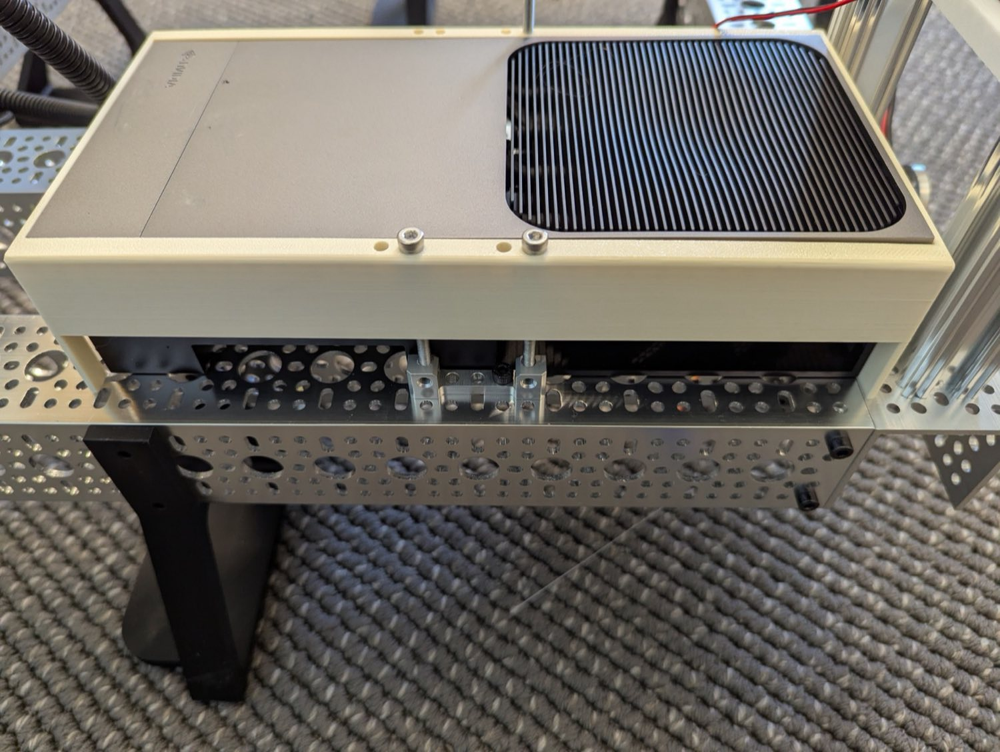
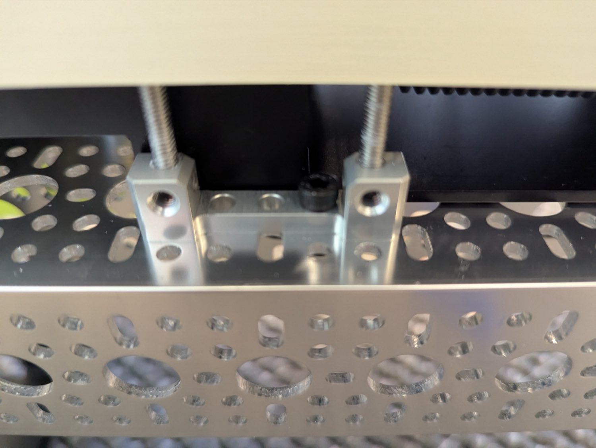
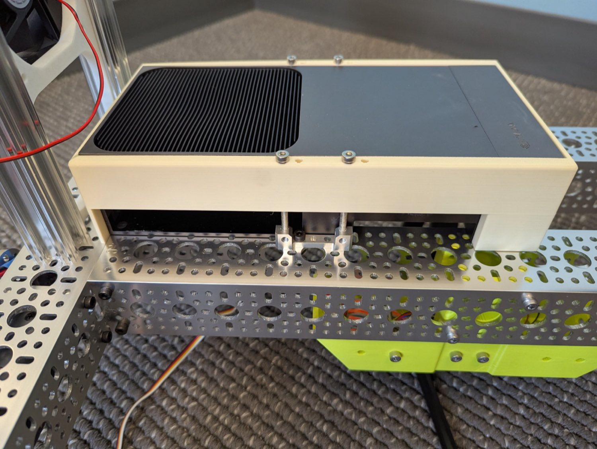
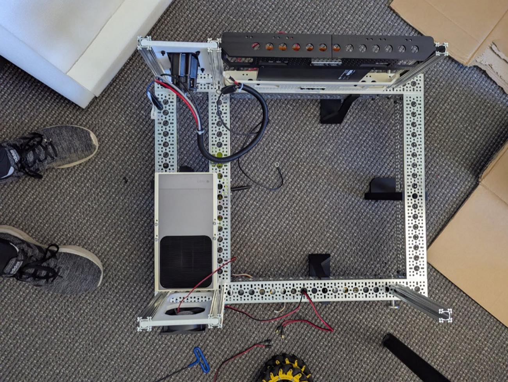

# 3 · Thor Install

!!! info "At a glance"
    | | |
    |---|---|
    | **You'll do** | Mount the **NVIDIA Jetson AGX Thor** (the autonomy compute) to the base frame in a 3D-printed cradle held by two goBILDA dual blocks |
    | **Time** | *TODO* |
    | **Difficulty** | Beginner |
    | **Prerequisites** | [1 · Base Frame](base-frame.md) |
    | **Why now** | Setting the dual blocks + long screws is far easier on the open frame, before the electronics bays crowd the area |

The **Thor** sits in a **3D-printed cradle** that is clamped to a base-frame rail by **two goBILDA
dual blocks** and long **M4 screws**. Mounting it now, while the frame is open, keeps clear access
to both sides of the rail.

<figure markdown="span">
  
  <figcaption>The Thor slid into its printed cradle — the cradle is screwed down to the rail through the dual blocks.</figcaption>
</figure>

## Print this first

!!! note "3D-printed part — STL TODO"
    This step needs the **Thor cradle** (a 3D-printed part that holds the Thor to the frame).
    *TODO: export the cradle STL into `hardware/` and link it here.* Print it before you start so
    it's ready to drop onto the screws.

## Bill of materials

!!! note "Generated from `hardware/parts.csv`"
    Edit the CSV (rows tagged `module = thor-install`), then run `tools/bom.py --inject`.

<!-- BOM-AUTO:build:thor-install -->
**Mounting**

| Part | SKU | Qty | Notes |
|---|---|---:|---|
| [goBILDA 1205-series dual block mount (2-pack)](https://www.servocity.com/1205-series-dual-block-mount-1-5-2-pack/) | — | 1 | The 2-pack gives the two dual blocks that clamp the Thor cradle to the rail. |
| [M4 x 55 mm socket-head screws](https://www.amazon.com/gp/product/B0DFYK39N6) | — | 2 | Run up through the dual blocks into the printed Thor cradle; confirm exact qty. |
| Thor cradle (3D-printed) | — | 1 | Holds the Thor to the frame; STL in hardware/ TBD. |
<!-- /BOM-AUTO:build:thor-install -->

## Steps

1. **Mount the two dual blocks + screws.** Set the two goBILDA **1205-series dual blocks** on the
   frame rail at the Thor location and run a **55 mm M4 screw** up through each — the screws stand
   up out of the blocks to receive the cradle.

    <figure markdown="span">
      
      <figcaption>The two dual blocks clamped to the rail; the 55 mm M4 screws run up through them.</figcaption>
    </figure>

    <figure markdown="span">
      
      <figcaption>Same mount, opposite side — confirm both blocks sit flat and square on the rail.</figcaption>
    </figure>

2. **Set the printed cradle** over the standing screws so it seats flat on the blocks.

3. **Slide the Thor into the cradle.** Orient it so the **port-less side faces the side opposite
   the charge port** (i.e. the Thor's ports face *toward* the charge-port side of the robot), then
   run the screws home to clamp the cradle.

4. **Confirm it's solid** — the Thor shouldn't shift in the cradle, and the cradle shouldn't rock
   on the blocks.

    <figure markdown="span">
      
      <figcaption>Mounted — top view, Thor seated in the cradle.</figcaption>
    </figure>

## Verify — done when…

- [ ] Both dual blocks sit **flat and square** on the rail; the M4 screws are seated.
- [ ] The cradle is **clamped down** and doesn't rock.
- [ ] The Thor is **seated with the correct orientation** (ports toward the charge-port side) and
      doesn't shift.
