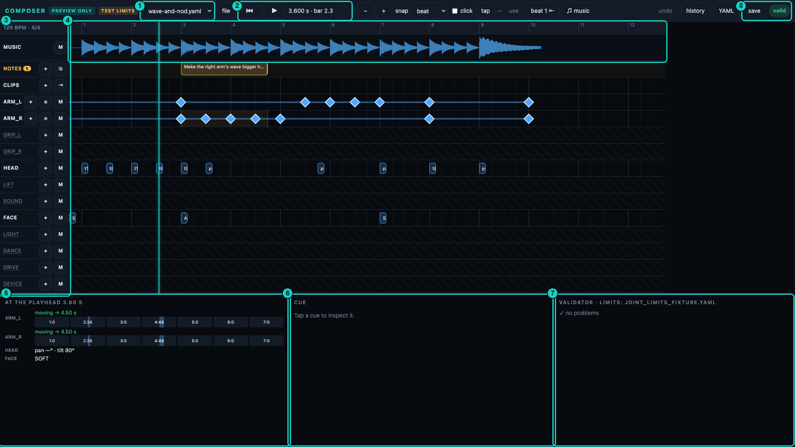
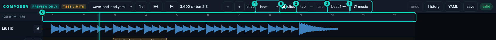
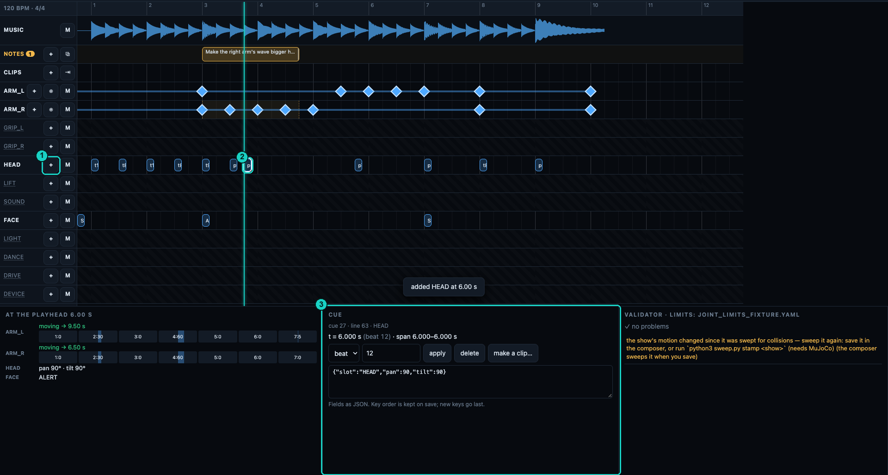
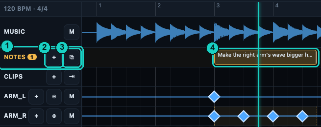
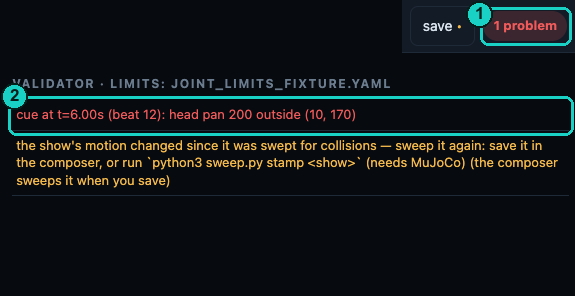
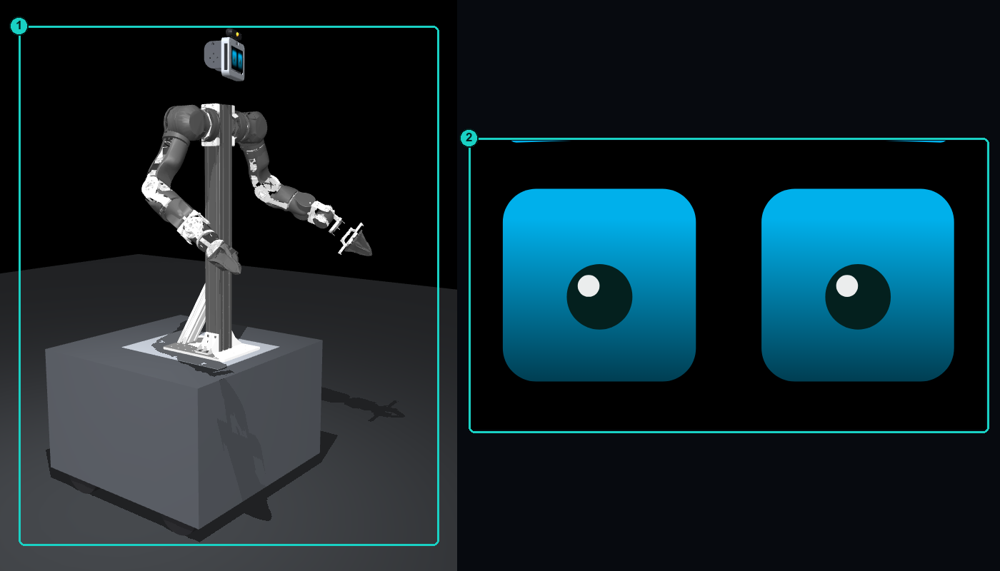
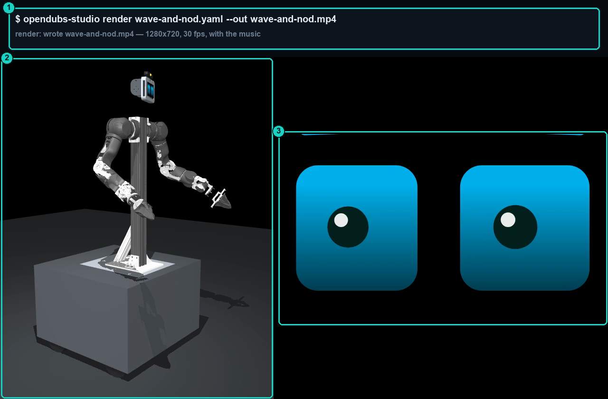
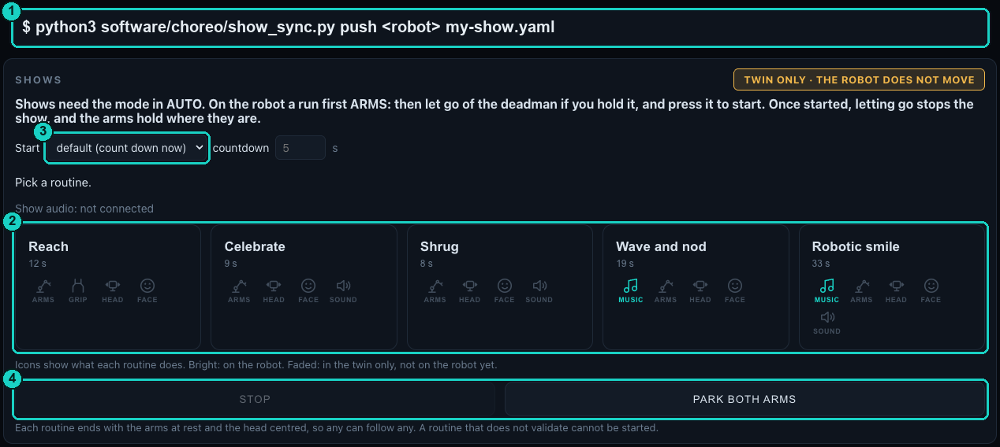

# Composer quickstart

The composer is the app for writing **shows**: timed routines for the robot's arms, head, lift,
face, lights and sound. A show is a file, a cue sheet that says what each part of the robot does
and when. The composer checks it against the real robot's limits before anything moves, previews it
on a digital twin, and sends it to the robot.

This page takes you from installing the composer to running a show live, in seven steps.

<figure markdown="span">
  
  <figcaption>1 the show being edited, and the file menu · 2 play and the playhead clock · 3 the lanes, one per part of the robot · 4 the bar and beat ruler over the song · 5 what every part is doing at the playhead · 6 the selected cue · 7 the validator · 8 save, and the verdict on the whole show</figcaption>
</figure>

## :octicons-download-24: 1. Install

The composer runs on your own computer. It works on macOS and Linux; Windows is untested. You need
[uv](https://docs.astral.sh/uv/), which fetches everything else the first time it runs.

From a copy of the repository, run `software/choreo/studio-up.sh`. It starts the composer and
prints its address (usually `http://127.0.0.1:8091/`). It also opens a preview of the robot's face
in your browser, and a 3D preview of the whole robot in its own window. Everything runs on your
computer only. Show files are kept outside the repository (in `~/opendubs-shows` if it exists,
else `~/.local/share/opendubs-studio/shows` on Linux or `~/Library/Application Support/opendubs-studio/shows` on macOS)
so your routines are preserved across git updates. `software/choreo/studio-down.sh` stops it all.

## :octicons-unmute-24: 2. Bring the music

Press **♫ music** and pick a song from the library, or add one: drop an audio file on the page. A
song added to the library must record where it came from and its licence.

Then set the tempo, so cues can sit on beats and bars. Play the song and press **tap** on four or
more beats, then **use** to write the tempo into the show; or type it in the **♫ music** dialog. To
set the first downbeat, stop the playhead on it and press **beat 1 ⇤**. Cues placed on the beat
grid follow the tempo if you change it later.

Each sound plays as **dialogue** or **music**, set by **plays as** in the **♫ music** dialog, or in a
sound cue's fields. Dialogue always plays from the tablet. Music plays from a projector's speaker
when the show has a projector ready, and from the tablet otherwise. A track with any speech in it
is dialogue.

<figure markdown="span">
  
  <figcaption>1 ♫ music: choose or add a song, or type the tempo · 2 tap, then use · 3 beat 1 ⇤ · 4 snap and click: what dragged cues snap to, and a metronome · 5 the grid the show is written on, bar.beat · 6 plays as: dialogue or music</figcaption>
</figure>

## :octicons-cpu-24: 3. Know the robot

A show is checked against a real robot's arm limits. Copy them from the robot once with
`uv run software/choreo/studio/studio.py limits --from-robot <robot>`; if that fails, ask whoever
runs the robot for its arm limits file. Until then the composer shows **TEST LIMITS**, and its
checks use test values.

Each lane in the composer is one part of the robot: the two arms and grippers, the head, the lift,
sound, face and lights. A cue for a part the robot cannot play yet is still valid, and the
composer says so in a note. Shows that drive the base are the exception: the composer accepts
them, but the robot refuses to run them.

## :octicons-pencil-24: 4. Write the show

There are three ways to write a show, and you can mix them.

- **By hand.** Each lane's **+** adds a cue at the playhead. Drag a cue to move it in time, and tap
  it to change it in the **Cue** panel. **save** (Ctrl- or Cmd-S) writes the file. For an arm cue,
  the Arm Inspector lets you adjust joint angles with sliders, solve Cartesian reach targets with SSIK,
  or click **Rest** to set `pose: rest` directly. Clicking **Plan Path** routes a collision-free path
  around obstacles using CBiRRT or cuRobo, preserving `pose: rest` when moving to or from rest.
- **With notes and an agent.** On the **NOTES** lane, **+** adds a note at the playhead: say what
  should happen there, in plain words. Then **⧉** copies the open notes as a prompt for a coding
  agent, such as Claude Code, which writes the cues into the file. Save first: the agent works on
  the saved file.
- **By an agent alone.** An agent can write a whole show file from the show format
  (`notes/design/choreo-format-v1.md` in the repository). Open it in the composer to check and
  adjust it.

<figure markdown="span">
  
  <figcaption>1 + adds a cue to this lane at the playhead · 2 the new cue: drag it to move it · 3 its fields; every edit is re-checked</figcaption>
</figure>

<figure markdown="span">
  
  <figcaption>1 the NOTES lane · 2 + adds a note at the playhead · 3 ⧉ copies the open notes as a prompt (save first) · 4 a note over a stretch of the show; the agent replies on it</figcaption>
</figure>

## :octicons-checklist-24: 5. Check it

The composer re-checks the show after every change. The status chip reads **valid**,
**valid · N warnings**, **N problems** or **does not parse**, and the **Validator** panel lists
each one: arm limits, speed caps, and the clearance between the shoulders and the head.

The two previews follow the playhead: the face in the browser, the whole robot in the 3D window.
Press **▶︎**, or the space bar, to play the music and the preview together. To share a preview
as a video, render it with `uv run software/choreo/studio/studio.py render <show> --out show.mp4`.

<figure markdown="span">
  
  <figcaption>1 the verdict on the whole show · 2 each problem names its cue and what to change; tap it to select the cue</figcaption>
</figure>

<figure markdown="span">
  
  <figcaption>1 the 3D twin: the robot as the show moves it · 2 the face twin, driven by the same show</figcaption>
</figure>

<figure markdown="span">
  
  <figcaption>1 the render command · 2 the robot, framed to the whole show · 3 the face beside it</figcaption>
</figure>

## :octicons-comment-24: 6. Correct it

When something in the preview is wrong, stop at that moment and add a note there on the
**NOTES** lane, saying what should change. Copy the notes as a prompt with **⧉** and give it to the
agent. It edits the show, checks it again, and marks each note done or declined.

Earlier versions of the show are kept: **history** brings one back.

## :octicons-play-24: 7. Run it live

Send the show to the robot with:
```bash
python3 software/choreo/show_sync.py push <robot> path/to/<show>.yaml
```
For example, with the default Linux shows folder:
```bash
python3 software/choreo/show_sync.py push opendubs2 ~/.local/share/opendubs-studio/shows/my-show.yaml
```
Add `--dry-run` to see what would happen without sending anything. The `<robot>` destination
is reached over SSH (such as `opendubs2.local` via mDNS, an IP address, or a hostname configured
in `~/.ssh/config`). If connecting to a freshly provisioned robot whose shows directory
(`/var/lib/opendubs/shows`) does not yet exist, pass `--create` on your first push. If SSH cannot
connect, `show_sync` reports the connection failure directly.

The push refuses a show that does not pass its checks, or that plays music or sounds the robot's
library does not have; music must come from the show library, not a file beside the show.

### Palette requirements for deployment

The robot dashboard's **Shows — routines** page only lists shows registered with a `palette:` block. Because an operator can trigger routines in any order, the push validator enforces that every palette routine must end in the safe rejoin state:

1. **`palette:` block**: Add a button label and sort order at the top of the show YAML:
   ```yaml
   palette: { label: "My Show", order: 50 }
   ```
2. **Return to rest**: Any arm moved by the show must end with a `pose: rest` keyframe:
   ```yaml
     - { t: 8.0, slot: ARM_R, pose: rest }
   ```
   Always use `pose: rest` (or click **Rest** in the composer) rather than explicit joint angles. `pose: rest` dynamically evaluates against the robot's physical stop without penalty, whereas explicit joint angles are checked with a 5° margin that fails the rest check.
   If the head moved, it must end centred (`pan 90, tilt 90`), and any state light must be released (`do: release`).

On the dashboard, open **Shows — routines** and tap the routine. Shows need **CH5 in AUTO**. **Start**
sets how a run begins: **wait for the deadman** makes the run **READY**, then counts down when you
press the deadman; **count down now** needs the deadman already held; **now** starts at once. On the
robot the default is to wait for the deadman. Once started, letting go of the
deadman stops the show, and the arms hold where they are.

<figure markdown="span">
  
  <figcaption>1 push the show to the robot · 2 each show on the robot, as a button; its icons show what it uses · 3 how a run starts · 4 STOP, and park both arms</figcaption>
</figure>

!!! note "Planned"
    Not in the composer yet: analysing a song for its beats and sections; listing what each
    payload module can do; reusable show skills; more output devices, such as DMX stage lights;
    cues that adapt to what the robot senses; and handing one part of a show to an agent to
    perform live.
