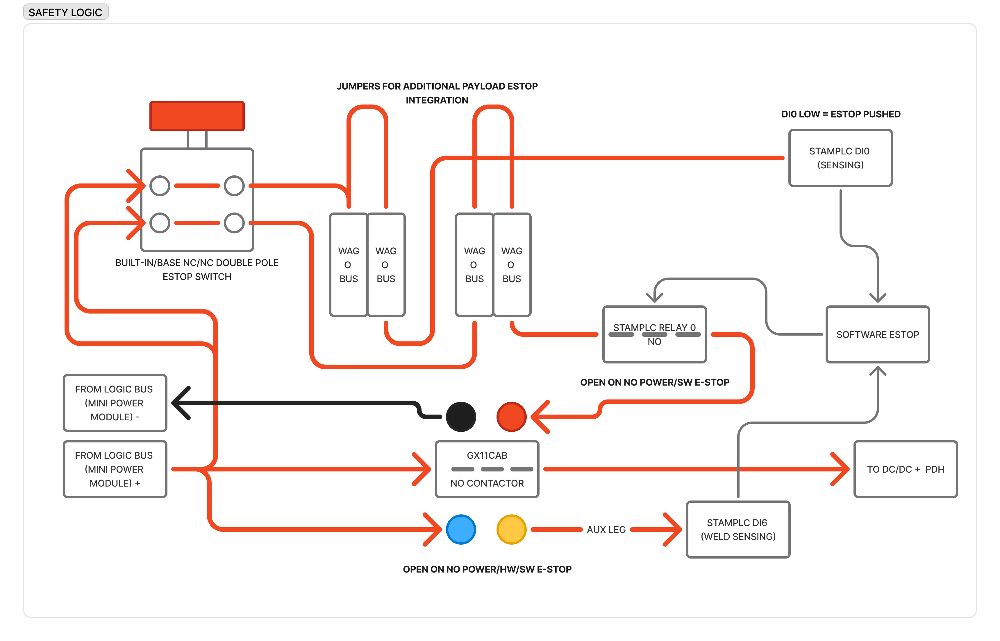
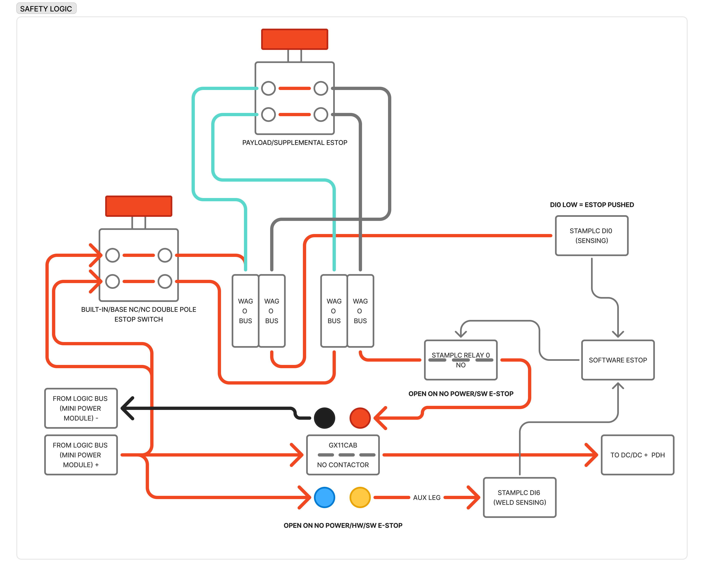

# E-stop system

<figure markdown="span">
  
  <figcaption>E-stop safety logic — the GX11 contactor coil chain, the double-pole e-stop
  switch, DI0 state sensing, and DI6 weld sensing.</figcaption>
</figure>

- **Diagram source (Figma):** [OpenDubs board — e-stop](https://www.figma.com/board/LVbgJwMKO65TARF3m6v7I6/OpenDubs?node-id=4-1155) — anyone with the link can view and export it.

The e-stop cuts drive power by dropping the main **GIGAVAC GX11** contactor, which feeds the
drive path (to the DC/DC + PDH — see [Power architecture](power-architecture.md)). The diagram
is the authoritative wiring; the summary follows.

## What holds the contactor closed

The GX11 coil is powered from the **logic bus** (the REV Mini Power Module `+`/`−` in the
[Electronics Bay](build/electronics-bay.md)), through a series chain:

```
logic-bus +  →  built-in E-STOP (NC pole)  →  payload-e-stop jumpers (WAGO bus)
             →  StampPLC R0 (NO relay)  →  GX11 coil  →  logic-bus −
```

The built-in e-stop is a **double-pole NC/NC** switch: **one pole sits in the coil chain**
above; **the other pole feeds DI0 sensing** (below). The contactor is held closed **only when**
every link is made — the e-stop (and any payload e-stops) not pressed, and the StampPLC's **R0**
relay closed. When it's held, the GX11 main contacts pass power to the DC/DC + PDH.

## Ways it opens (independent kill paths)

Per the wiring, the contactor **opens on no-power / hardware / software e-stop**:

- **Physical E-STOP** (built-in or a payload e-stop) pressed → the NC pole opens the chain.
- **Software e-stop** → the StampPLC opens **R0** (R0 is "open on no-power / SW e-stop").
- **Loss of logic power** → the coil can't be held, so it fails open. The **RUN button** is the
  master switch for the logic bus that powers this chain *and* the StampPLC — so with RUN off
  the StampPLC never powers up, **R0** stays open, and the contactor can't close.

!!! danger "The hardware path is independent of every control source"
    The e-stop button → coil-chain → contactor kill path does **not** depend on RC, WiFi, the
    tablet, or Thor. Whatever is driving the robot, the hardware e-stop still stops it (see the
    [Command & telemetry interface](interfaces/command-telemetry.md) safety rules).

## Sensing — DI0 (e-stop state)

The e-stop switch's second pole drives **StampPLC DI0**: **DI0 LOW = e-stop pushed** (the NC
pole opens, dropping the sensed signal).

The StampPLC's digital inputs are **opto-isolated** (per the
[M5StamPLC docs](https://docs.m5stack.com/en/core/StamPLC): EL3H4 optocouplers, DC 5–36 V, with
**INPUT** and **COM** terminals) — so this is **not** a measurement referenced to StampPLC
ground. For a **+24 V high-level** sense signal into DI0, the M5 doc specifies **COM connects to
the negative (return) of that 24 V supply**, and INPUT receives the +24 V. You provide the
reference by landing the 24 V signal's return on the DI **COM** terminal; the input side is
galvanically isolated from the StampPLC's logic ground.

## Weld detection — DI6

The GX11's **SPDT auxiliary contact** ("AUX LEG") reports the main contacts' true state to the
StampPLC on **DI6** (weld sensing). If the main contacts weld shut, the aux state disagrees with
the commanded state → the StampPLC flags a **welded-contactor** fault (see
[State machines](state-machines.md)).

## Payload / supplemental e-stops

<figure markdown="span">
  
  <figcaption>A payload/supplemental e-stop wired into the WAGO-bus jumper points, in series
  with the built-in e-stop.</figcaption>
</figure>

The coil chain exposes **WAGO-bus jumper points** for integrating **additional payload
e-stops**. A supplemental e-stop (another double-pole NC/NC switch) lands on those buses in
**series** with the built-in one — so pressing *any* e-stop in the chain, built-in or payload,
drops the contactor.

## References

- **StampPLC digital inputs** (opto-isolated, INPUT/COM wiring): <https://docs.m5stack.com/en/core/StamPLC>
- **GIGAVAC GX11 contactor** datasheet: <https://www.sensata.com/sites/default/files/a/sensata-gigavac-gx11-series-open-contactors-datasheet.pdf>
- [Power architecture](power-architecture.md) — where the contactor sits in the power spine.
- [Power Bay](build/power-bay.md) — the physical build.
