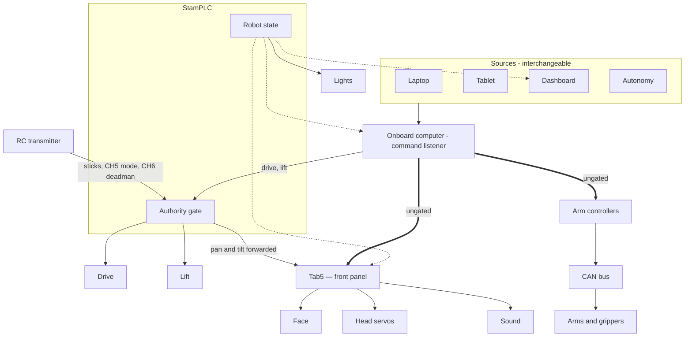

# Command & telemetry interface

*(Draft — the contract every control source speaks, and the safety rules around it.)*

The base is driven by a **single failsafe-gated command contract**: a source produces drive and
lift commands, they pass the **StamPLC arm + failsafe gate**, and telemetry streams back.
Swapping control sources never changes the robot's safety behavior — only who's holding the
(virtual) stick.

**Two paths do not pass that gate today** — the arms and the Tab5. See
[what the gate does not cover](#what-the-gate-does-not-cover) below, which is a gap rather than
a design choice.

## Where a command goes



Solid is a command, thick is a command that does not pass the authority gate, dashed is state.

Three controllers share the robot. The **StamPLC** (an ESP32-S3 industrial controller) owns the
RC receiver, the robot state, drive mixing, the lift relays, the lights and the e-stop
contactor. The **Tab5** (an ESP32-P4 panel) is the front control panel and the
human–robot interface, and it drives the pan/tilt system: the face screen, the head servos and
the speaker. The **onboard computer** runs ROS 2, forms and sends the arms' CAN
traffic, and hosts a listener that accepts commands from any source.

Three things follow from the drawing:

- **Releasing the deadman stops actuators, not software.** The computer keeps listening and
  keeps sending; the StamPLC stops acting on what arrives.
- **State is an output**, broadcast from the StamPLC to the Tab5, the computer and the
  dashboard. The face and the lights follow state rather than being commanded per device.
- **The Tab5 drives the head servos.** The StamPLC forwards pan and tilt from the
  sticks; the computer can also send them directly.

## Control sources — all speak the same contract

| Source | Role | Notes |
|---|---|---|
| **RC** (2.4 GHz) | Independent safety backstop + manual | Deterministic, low-latency, **long range**, own radio link. |
| **On-robot touchscreen** | Local UI / status | A supported variant of the build. |
| **WiFi tablet** (PWA + gamepad) | Primary UX, teleop, richer display | Reuses the web dashboard; removable/handheld. Shares fate with the network. |
| **Autonomy / LeRobot policy** | Programmatic control | Same command topics — teleop, dataset capture, and learned policies all drive here. |

The base is **designed to fit a tablet**, and an **on-robot touchscreen variant** is also
supported — both are just UIs over this one contract.

## Safety rules (non-negotiable)

1. **Every source is heartbeat-gated.** Lose the heartbeat → motion cuts to neutral (the RC
   failsafe and the StamPLC Ethernet heartbeat watchdog are the existing pattern).
2. **The hardware e-stop is independent of every source.** The physical button → GX11 contactor
   kill path must not depend on RC, WiFi, the tablet, or Thor. Never let the thing you drive
   with be the only thing that can stop you.
3. **RC wins on determinism *and* range.** WiFi teleop is convenient but not a substitute for an
   independent, long-range control/e-stop link — so RC stays as the backstop until (if ever) a
   WiFi watchdog is proven equivalent.
4. **The control path is authenticated.** A source must be trusted (token/cert) before it can
   command motion — the same gap flagged for rosbridge/foxglove/dashboard.

## What the gate does not cover

**Every driven element is on the drive bus**, including the arms and the front-panel head — the
60&nbsp;A step-down sits behind the contactor and feeds the power distribution hub, the drive ESCs
and the arms (see [Power architecture](../power-architecture.md)). So an e-stop de-energizes all of
them. Stopping all driven motion with the e-stop is foundational and is not configurable.

What the contactor does **not** express is authority during normal operation. It is one bit —
motion power present or absent — and the onboard computer forms and sends the arms' CAN traffic
itself, so no controller-side gate stands between a publisher and an arm. In `MANUAL`, releasing
the deadman stops drive and lift but not the arms, the head or sound.

For the arms that is now deliberate rather than a gap: a teleoperator is in a headset, not holding
the transmitter, so the teleop session's own engagement is its deadman. The remaining work is
making normal-operations authority legible to consumers that the contactor cannot gate, which is
what `[AUTH]` below is for. The model is in `notes/design/arm-authority.md`.

### `[AUTH]` — the authority facts

Published by the StamPLC every **100&nbsp;ms** on the same tick as `[DRIVE]`, over the same
transport:

```
[AUTH] ch5=off|manual|auto|unknown deadman=0|1 estop_sw=0|1 estop_btn=0|1 contactor=0|1 \
       rc_live=0|1 rc_ok=0|1 drive_safe=0|1 drive_armed=0|1 ms=<uptime>
```

These are the **individual conditions**, not the single AND the controller computes for the wheels,
because a consumer must choose its own required subset. The drive gate requires `rc_live`; the arms
should not, since working at a bench with the transmitter off is legitimate and a single AND would
weld arm authority to the RC link for no safety gain. `estop_*` and `contactor` are nobody's to
ignore.

| Field | Meaning |
|---|---|
| `ch5` | authority switch position — **`unknown` whenever the RC link is not trustworthy**, rather than the last value seen |
| `deadman` | CH6 held. Reported `0` on an untrusted link |
| `estop_sw` | the controller's own latch — set by the `ESTOP` command, an OTA, or the panel button |
| `estop_btn` | the DI0 chain, **normally closed**: `1` means pressed *or* a broken conductor |
| `contactor` | R0 — motion power actually present |
| `rc_live` | RC frames arriving within the timeout |
| `rc_ok` | not in failsafe and no channel out of band |
| `drive_safe` | the control loop is keeping time; a stalled loop cannot stop anything |
| `drive_armed` | the **wheels'** resolved outcome, for display and comparison. Not a gate for anyone else — keying off it inherits the drive's `rc_live` requirement, which is the coupling this line exists to avoid |
| `ms` | controller uptime, so a consumer can distinguish a frozen-but-transmitting board from a current one |

**Absence is a stop.** A consumer must treat a gap of a few periods as loss of authority, not as
*unchanged* — the same fail-safe-by-omission as the RC failsafe and the 250&nbsp;ms `MAST CMD`
heartbeat. A stale switch position is reported as `unknown` for the same reason the odometry bridge
publishes nothing when `[ODO]` reports `ok=0`: a consumer can detect a missing fact, but not a
confidently wrong one.

## The contract

*TODO:* the actual ROS 2 topics / message types for command + telemetry, the heartbeat rate and
timeout, the arm/deadman semantics, and the auth/pairing scheme. Once specified, RC, the
touchscreen, the tablet PWA, and a policy are all just clients of it.
