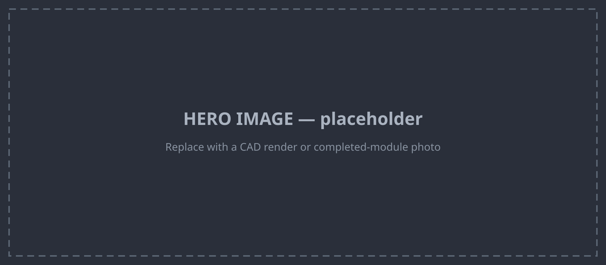

# Mechanical mount interface

How anything attaches to the OpenDubs base. There are **two** mounting systems, and together
they're the mechanical half of the modularity contract: a **structural grid on top** for
payloads, and an **opengrid cladding ecosystem** on the surfaces for accessories and wire
management.

<figure markdown="span">
  
  <figcaption><em>Annotated render (pending): <strong>yellow</strong> = top-deck pattern-spacer
  grid; <strong>teal</strong> = opengrid patterns in the printed claddings.</em></figcaption>
</figure>

## 1 · Top-deck payload grid (structural)

The **top of the base** exposes a grid of **goBILDA
[1505-series 32 mm counterbored pattern spacers](https://www.servocity.com/1505-series-32mm-od-counterbored-pattern-spacer-8mm-length/)**
(8 mm length), laid out on the **goBILDA 24 mm pattern**. This is the load-bearing mount for
whatever you put on the robot.

- Each spacer presents **four upward-facing tapped M4 holes**.
- So a payload bolts on with **M4 fasteners from the top — no disassembly** of the robot required.
- Because it's the standard **24 mm goBILDA pattern**, you can mount goBILDA rails, plates, or
  any custom part made to that pattern — or build an adapter plate for something that isn't.

!!! success "The contract"
    If your payload bolts to the **goBILDA 24 mm pattern with M4**, within the base's load / CG
    / envelope limits (TODO: specify), it mounts on top with no robot teardown. That's the
    interface — everything above (Z-axis, arms, sensor masts, bins) is "just" a payload on this
    grid.

*TODO: load rating, CG envelope, keep-out zones, and the exact grid extents — with the annotated
photo/render.*

## 2 · opengrid cladding ecosystem (accessories & wiring)

The **printed claddings** that form the top and sides of the robot expose
**[opengrid](https://www.opengrid.world)** patterns. That single choice unlocks a whole
community ecosystem of snap-on accessories:

- **[opengrid](https://www.opengrid.world)** — the base wall/desk mounting framework.
- **[Gridfinity](https://gridfinity.xyz/)** — modular bins / storage.
- **[Underware](https://handsonkatie.com/underware-2-0-the-made-to-measure-collection/)** —
  made-to-measure cable channels and covers.
- **[Multiconnect / opengrid ecosystem](https://www.printables.com/model/1214361-opengrid-walldesk-mounting-framework-and-ecosystem/files)**
  — the broader mounting framework.

**Why this matters beyond "stick stuff on":** the **Underware** system lets you route and
**cover / protect add-on wiring** along the claddings — ideal for a camera you add later, extra
sensor leads, etc., without redesigning the robot. Accessories print from open community models
and clip on.

*TODO: which faces carry opengrid, tile size/orientation, and a few worked examples (a camera
arm on the top grid with its cable run in Underware).*

## Design intent

The point of both systems is the same as the [design philosophy](../design-philosophy.md): a
**stranger can extend the robot without forking it.** Structural loads go on the goBILDA
top-deck grid; accessories and wiring go on the opengrid claddings; neither requires opening up
the base.
