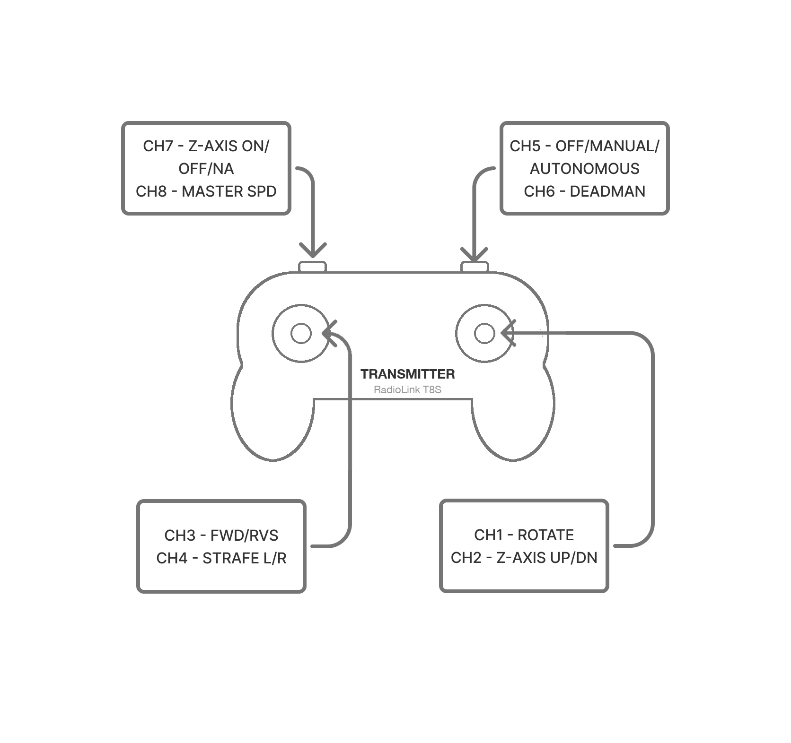

# Operating the robot

How to power the robot on, make it move, and charge it. This is the operator's page — for why
things are built this way see [Control authority](control-authority.md),
[Power architecture](power-architecture.md) and [E-stop system](e-stop.md).

!!! note "One item outstanding"
    The robot's **contactor auto-arm** behaviour exists on the machine but not in the repo, so the
    contactor state at power-on may not match step 5 below. It needs settling at the robot.
    Everything else on this page is verified against the firmware and the wiring.

## The controls

| Control | Where | What it does |
|---|---|---|
| **BATTERY** | latching button, **on the battery itself** | connects the pack. The robot is electrically dead with this off |
| **RUN** (logic) | latching button, **rear face**, lit green when on | master switch for the **logic bus** — the Thor, the StamPLC, the router, the sensors |
| **E-STOP** | two, **rear of the robot, left and right** | drops the drive contactor. Cuts motion, not the brain |
| **CH5** | transmitter, 3-position | **authority**: `OFF` / `MANUAL` / `AUTO` — who may command |
| **CH6** | transmitter | **deadman** — held means a human is deliberately engaging |
| **CH7** | transmitter, 3-position | **what the right stick talks to**: `OFF` / `Z-AXIS` / `PAN-TILT` |
| **CH8** | transmitter, knob | speed scale |

The RUN button is lit green while the logic bus is up, which is the fastest confirmation that the
robot is powered.

*TODO photo: the rear face showing the RUN button and both emergency stops, and the battery with
its latching switch.*

The logic bus is **always on** once RUN is on — it is deliberately *not* behind the e-stop, so the
robot keeps thinking, reporting and showing state while its actuators are dead.

## The transmitter

<figure markdown="span">
  
  <figcaption>Physical layout of the sticks and switches.</figcaption>
</figure>

| Channel | Function |
|---|---|
| CH1 | rotate (yaw) |
| CH2 | right stick vertical — **Z-axis up/down**, or **tilt**, per CH7 |
| CH3 | forward / reverse |
| CH4 | right stick horizontal — **strafe**, or **pan**, per CH7 |
| CH5 | **authority**: OFF / MANUAL / AUTO |
| CH6 | **deadman** — hold to enable motion; release commands neutral |
| CH7 | **payload mode**: OFF / Z-AXIS / PAN-TILT |
| CH8 | speed scale |

CH7 decides what the **right stick** addresses, because there are two sticks and three things that
want one. It is not an enable — authority is CH5 and only CH5. Full detail, including the SBUS
wiring, is in [RC control mapping](rc-control-mapping.md).

## Powering on

1. **CH5 to `OFF`** before anything else. Authority off means nothing can drive, whatever else is
   true.
2. **BATTERY on.**
3. **RUN on.** The StamPLC screen and the Tab5 come up; the Thor takes longer.
4. **Open the dashboard** from the tablet at `http://<robot>:8080`. The robot has no screen of its
   own — the tablet is the interface.
5. **Confirm both e-stops are released** and that the dashboard reports the contactor closed.

*TODO: the robot carries a contactor auto-arm behaviour that is not in the repo. Confirm what it
does at power-on and settle whether it stays — until then, the contactor state at boot may differ
from what this page describes.*

## Making it move

Every one of these must hold, and the firmware re-checks all of them every tick:

- **CH5 in `MANUAL`** (or `AUTO` with a live command stream from the Thor)
- **the drive contactor closed** — no e-stop pressed, and no software e-stop latched
- **the RC link alive**, not in failsafe, and its channels in range
- **CH6 (deadman) held** — the sticks do nothing without it

Then: **hold the sticks at neutral for two seconds.** The ESCs arm on two seconds of neutral with
the gate satisfied, not the instant the gate is met. If any condition drops out the arming is lost
immediately and the two seconds start again.

The arm gate and the neutral hold are re-evaluated continuously, so an intermittent RC link or a
momentarily released deadman will keep the drive disarmed even though every switch looks correct.

## First drive

For a robot that has not been driven before, or after any change to drive wiring or calibration.
Do this with the robot on blocks or with its wheels clear of the floor.

1. **Clear the area.** Mecanum wheels move sideways, and a sign error sends the robot the way you
   did not expect.
2. **Power on** as above, with **CH5 in `OFF`**.
3. **Set CH8 (speed) to minimum.** Every later step is safer at low scale.
4. **Confirm the RC link** on the dashboard before granting authority — a stale link is the one
   failure that looks identical to a working one until you move a stick.
5. **CH5 to `MANUAL`**, sticks centred, and let the two-second arm hold elapse. The dashboard
   reports the drive armed.
6. **Hold CH6** and give a small forward input. Check that the robot moves **forward**, and that
   all four wheels turn the way they should.
7. **Test strafe and rotate** the same way, one axis at a time.
8. **Release CH6.** Motion must stop immediately. If it does not, press an emergency stop and do
   not drive again until it does.
9. **Press an emergency stop while moving.** Motion must stop and the dashboard must report the
   contactor open. This is worth doing deliberately once, on blocks, rather than discovering it
   under load.

If an axis is reversed or a wheel turns the wrong way, that is drive calibration, not an operating
fault — see [Drive bring-up](drive-bringup.md). Those values are **per-robot** and are not carried
in the repository, so a freshly deployed robot needs its own.

## Z-axis pinch protection

The Z-axis arrests its own descent short of the bottom, where the closing gap is a pinch hazard.

**What you will see:** the lift stops on its own, the Tab5 shows an amber **Z-AXIS HELD** banner
reading *release, then press down again*, and two short tones sound.

**To continue:** release the stick, then command DOWN again. The release must be held for roughly
half a second — the guard requires a deliberate new request rather than stick bounce. The banner
turns green and reads **LOWERING** once the descent resumes.

This is a guard, not a fault: nothing latches and nothing needs clearing. It will arrest the
descent again on the next approach to the bottom.

!!! note "Why a second request is required"
    Resuming on the same continuous stick input would make the guard invisible: the platform would
    pause and carry on, conveying nothing. Requiring a fresh request makes closing the gap an
    explicit operator decision.

## Stopping the robot

| Control | What it does | How to clear it |
|---|---|---|
| **The red mushrooms**, rear left and right | Break the contactor coil circuit directly. They work with the software dead or the Thor off — this is the real e-stop | Release the button, then re-arm |
| **E-STOP on the Tab5** | Sends the controller the same software e-stop the dashboard sends: the contactor drops and the robot latches `E-STOP` | **From the dashboard only** — see below |
| **E-stop on the dashboard** | Identical mechanism to the Tab5's | The dashboard's guarded re-arm |

!!! warning "The Tab5's E-STOP switches the Tab5 off"
    The Tab5 is powered from the **drive branch**, behind the contactor. So its own E-STOP button
    removes its own power: the command reaches the controller, the contactor opens, and the head
    goes dark a moment later.

    That is correct behaviour, not a fault — but it means **you cannot re-arm from the head**,
    because the head is off. Re-arm from the dashboard on the tablet, or over the network. The
    button briefly displays *"clear at the dashboard"* before the screen dies, which is why it is
    written here instead.

Re-arming is deliberately guarded and will refuse unless **CH5 is OFF**, the button is released,
telemetry is fresh and no contactor weld is detected. "CH5 not OFF" is the usual refusal.

The robot also **arms itself at power-on**: the contactor closes a couple of seconds after boot,
provided nothing is latched and authority is OFF. If authority is *not* OFF it waits rather than
giving up — the PRISM strobes **amber** to say it is waiting on you, and it arms the moment CH5
reaches OFF. An e-stop disables that self-arming for the rest of the session, so nothing re-arms
behind you.

## Charging

!!! danger "The BATTERY switch must be on while the charger is connected"
    With the BATTERY switch **off** and RUN **on**, the charger's output reaches the **logic bus**
    through the logic converter with no pack in the circuit. A charger is a current-limited
    constant-voltage source, not a bench supply: it cannot regulate against the logic bus's load,
    so its output pulses and the electronics cycle.

    **RUN may be on or off.** Charging with the robot running is fine, and the charger-present
    interlock inhibits drive while it is plugged in. The requirement is only that the pack is in
    the circuit.

1. **BATTERY on.**
2. Set the charger to **48 V**. Any of its current settings will charge the pack; **8 A** is the
   recommended one.
3. Plug into the charge port.
4. Charge time depends on depletion.
5. **Unplug before driving.** Charger-present inhibits drive by design, so the robot will refuse to
   move while tethered — treat that as a backstop, not as the procedure.

Charger: <https://a.co/d/0aP9q4YX>

## Powering off

1. **CH5 to `OFF`.**
2. Lower the Z-axis, or leave it at a height from which it cannot fall.
3. **RUN off**, then **BATTERY off.**

Cutting power while the robot is in motion has previously disturbed the StamPLC and the RC link. A
defined bring-down sequence — command neutral, disarm, open the contactor, park the Z-axis, then
bring down the compute — is specified but not yet implemented.

## When something is wrong

See [Troubleshooting](reference/troubleshooting.md). It is organised by what you see — the robot
won't drive, re-arm is refused, the head is dark — and lists the causes in the order to check
them. The dashboard's **?** beside a refusal opens the matching entry.
