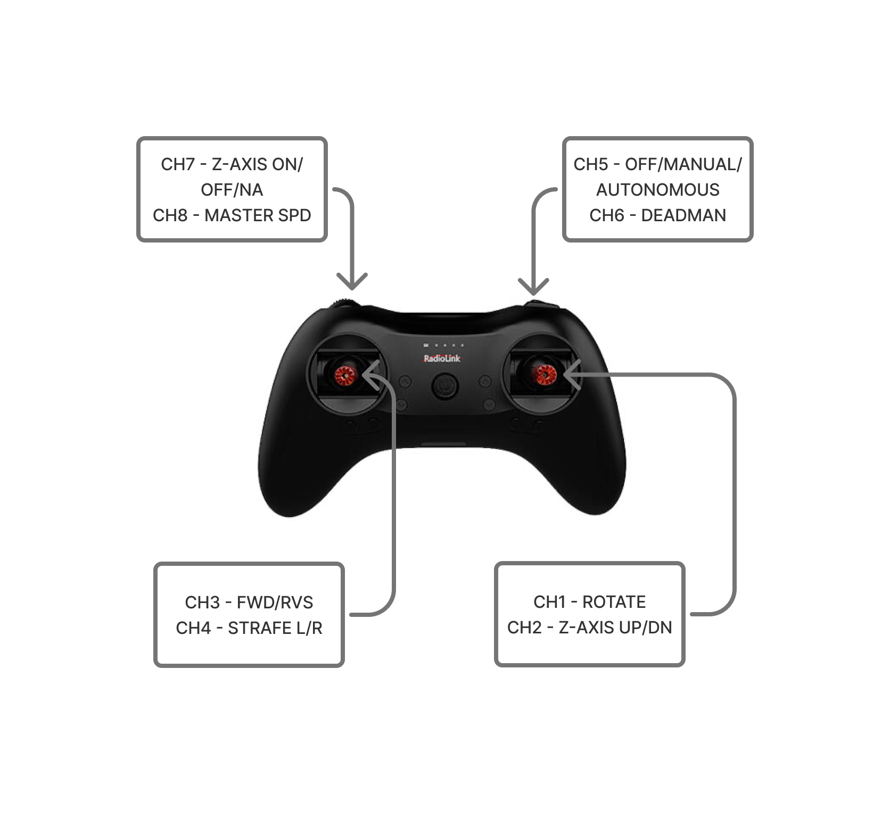

# RC control mapping

<figure markdown="span">
  
  <figcaption>Which stick / switch drives which robot function.</figcaption>
</figure>

- **Diagram source (Figma):** *TODO — add the Figma share link (view / download).*

The transmitter's sticks and switches map to the robot's drive, mast, and mode functions as
below; the diagram shows the physical layout. RC reaches the robot as **SBUS** into the
StampPLC.

| Channel | Function | Notes |
|---|---|---|
| CH1 | **Rotate** (yaw) | mecanum rotate input |
| CH2 | **Mast** up / down | |
| CH3 | **Forward / reverse** | mecanum drive input |
| CH4 | **Strafe** | mecanum strafe input |
| CH5 | **Mode** | OFF / MANUAL / AUTO |
| CH6 | **Deadman** | hold to enable motion; release → neutral |
| CH7 | Mat | *TODO — confirm function* |
| CH8 | **Speed** | scales drive output |

## See also

- [Control authority & modes](control-authority.md) — how RC interacts with autonomy (precedence,
  override).
- [Command & telemetry interface](interfaces/command-telemetry.md) — RC as one control source, and
  the failsafe/deadman rules.
