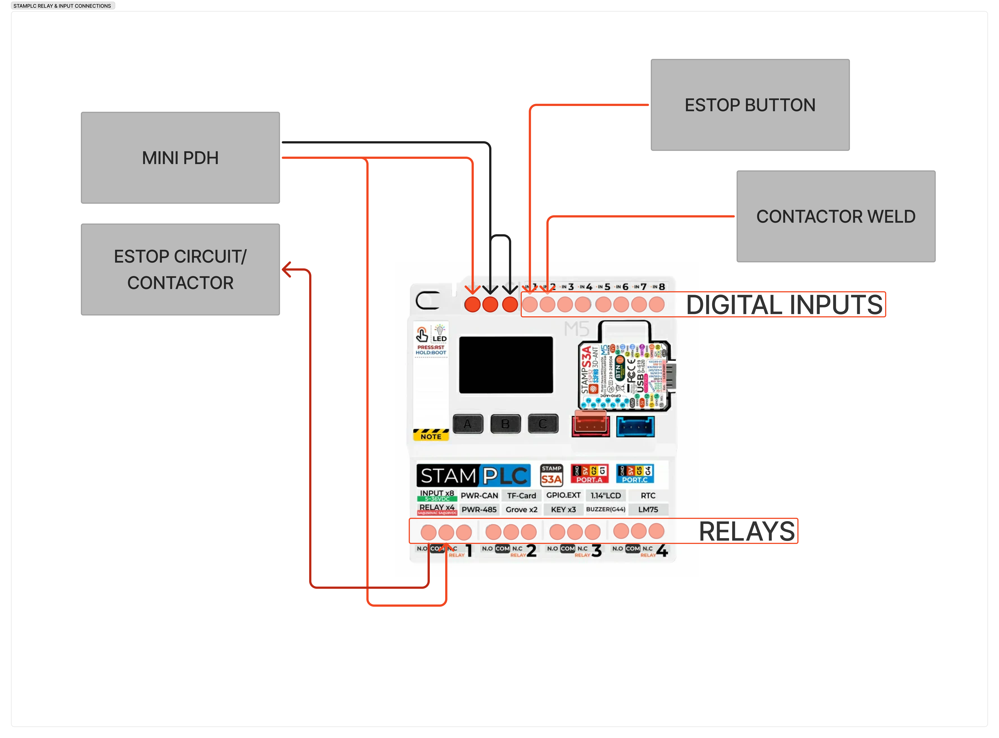

# StamPLC connections

The **M5Stack StamPLC** is the mobile base's edge controller — it ingests RC, mixes the mecanum drive, runs the
safety I/O (e-stop contactor + weld sense), and is the telemetry hub. This page is the wiring
reference for **assembly and troubleshooting**: which bus lands on which port, and the canonical
relay / isolated-input map. It is the source of truth the dashboard labels and the block diagrams
follow.

## External buses

<figure markdown="span">
  
  <figcaption>The buses landing on the StamPLC: RC (servo ↔ Grove) on the blue port, I²C (Grove)
  on the red port, plus CAN (XT30), RS485/BMS, PoE Ethernet to the router, and the 24 V logic feed.</figcaption>
</figure>

- **Diagram source (Figma):** [OpenDubs board — StamPLC buses](https://www.figma.com/board/LVbgJwMKO65TARF3m6v7I6/OpenDubs?node-id=10-268) — anyone with the link can view and export it.

Every bus below is on a fixed StamPLC pin (from the firmware `pin_config`). Pins are ESP32-S3
GPIO numbers.

| Bus / signal | Port | Pins | Notes |
|---|---|---|---|
| **RC (SBUS)** | **Blue** port | **G5** (RX), inverted | RC receiver SBUS in. The Grove-to-servo pigtail is an assembly step — see [RC receiver wiring](build/rc-receiver.md). |
| **Ethernet (PoE)** | W5500 module | SPI **SCK G7 / MISO G9 / MOSI G8**, **CS G11** | Shares the LCD/SD SPI bus. Telemetry + commands over **UDP :5005** — the USB-less transport. |
| **CAN** | CAN port | **TX G42 / RX G43**, 1 Mbps | REV PDH sniff / CAN master. |
| **RS485 (BMS)** | RS485 port | **TX G0 / RX G39 / DIR G46**, half-duplex | JBD BMS (Modbus over RS485). |
| **External I²C** | **Port A** (Grove RED) | **SDA G2 / SCL G1** (I²C_NUM_1) | PaHub mux → PRISM, 8Servo, OTOS, Pinpoint, ENV. See the [I²C map](#external-i2c-devices). |
| **Internal I²C** | on-board | **SDA G13 / SCL G15** (I²C_NUM_0) | AW9523 (relays + DIs), LM75B (temp), INA226 (power). |
| **Logic power in** | 24 V terminal | — | From the always-on **logic-24 V** bus (upstream of the e-stop contactor). |

## Relays & isolated inputs

The StamPLC's **4 relay outputs** and **8 opto-isolated digital inputs** are both driven by the
on-board **AW9523** I/O expander on the internal I²C bus. The inputs are galvanically isolated
(INPUT + COM terminals, DC 5–36 V) — reference a signal by landing its return on that input's **COM**
(see the [E-stop system](e-stop.md) page for the DI0 wiring worked example).

<figure markdown="span">
  
  <figcaption>As wired: the e-stop button and contactor-weld sense land on the digital inputs,
  RELAY&nbsp;1 (R0) drives the e-stop contactor, and the Mini PDH feeds the input COMs + the relay
  circuit.</figcaption>
</figure>

- **Diagram source (Figma):** [OpenDubs board — StamPLC relays & inputs](https://www.figma.com/board/LVbgJwMKO65TARF3m6v7I6/OpenDubs?node-id=10-268) — anyone with the link can view and export it.

!!! note "Numbering: silk is 1-indexed, the API is 0-indexed"
    The dashboard and these tables use the **1-indexed silk numbers** (IN 1–8, RELAY 1–4) to match
    the board. The **M5 firmware API and host commands stay 0-indexed** — so **IN 1 = DI0**,
    **RELAY 1 = R0**, and the command to close RELAY 1 is `RELAY 0`.

### Relay outputs

| Relay | Label | Function |
|---|---|---|
| **RELAY 1** *(R0)* | **E-STOP CONTACTOR** | Drives the GIGAVAC GX11 coil. Held closed = drive bus live; opens on e-stop / software `ESTOP` / logic-power loss. See [E-stop system](e-stop.md). |
| **RELAY 2** *(R1)* | **Z-AXIS DOWN** | Pulses the scissor-lift controller's DOWN button (board silk `R2`). Pulse-toggle — see [Scissor lift](build/scissor-lift.md). |
| **RELAY 3** *(R2)* | **Z-AXIS UP** | Pulses the scissor-lift controller's UP button (board silk `R3`). |
| **RELAY 4** *(R3)* | Spare | — |

### Isolated inputs

| Input | Label | Function |
|---|---|---|
| **IN 1** *(DI0)* | **E-STOP BTN** | E-stop button sense. Polarity is the NC fail-safe convention (pressed = circuit open); see [E-stop system](e-stop.md). |
| **IN 2** *(DI1)* | **CONTACTOR WELD** | GX11 auxiliary contact → welded-contactor detection (commanded open but aux still closed ⇒ welded). |
| **IN 3 – IN 8** *(DI2–7)* | Spare | Unused. The Z-axis is driven by this controller (relays R1/R2, behind the pinch guard) and senses height with the ToF on PaHub ch3, so there are no limit-switch or battery-present inputs here; drive mode is software-set (no physical jumper). |

### External I²C devices

Behind the PaHub mux on Port A: PRISM RGB (0x38), 8Servo ESC driver (0x25), ENV temp/humidity
(0x44), OTOS (0x17), Pinpoint (0x31). The live set is reported in `[I2C] scan:` telemetry and on the
dashboard.

## See also

- [E-stop system](e-stop.md) — the R0 coil chain, DI0 sensing, and DI1 weld detection in detail.
- [RC receiver wiring](build/rc-receiver.md) — the SBUS blue-port → servo-cable assembly step.
- [Electronics Bay](build/electronics-bay.md) — where the StamPLC physically mounts.
- [Power architecture](power-architecture.md) — the logic vs drive buses this controller sits across.
