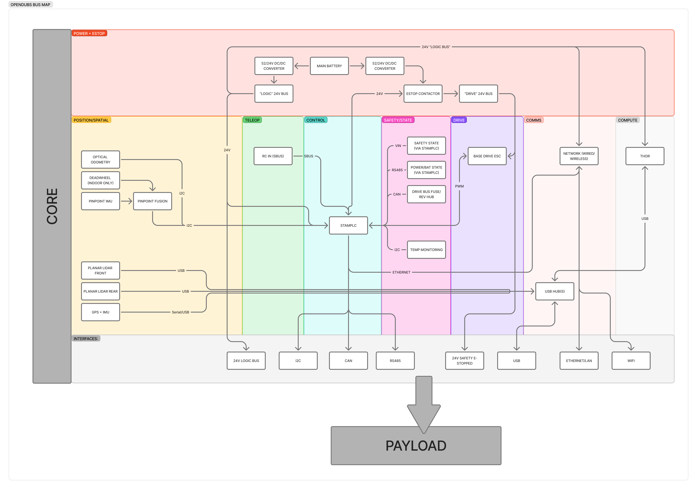

# System Overview

## Purpose

Document the robot architecture and subsystem boundaries so implementation and
safety decisions are consistent across repositories.

## Core Architecture

The core robot as buses and interfaces. **Click the diagram to pan and zoom the live board** — the
labels are small at page scale:

  
  ▶ Pan &amp; zoom the live board

Power + e-stop, position/spatial, teleop, control, safety/state, drive, comms, and compute —
converging on the StampPLC and Thor, and exposed to a payload through the standard interfaces
(24 V logic, I²C, CAN, RS485, USB, Ethernet, Wi-Fi, and 24 V safety/e-stopped).

- **Open in Figma:** [OpenDubs board — bus map](https://www.figma.com/board/LVbgJwMKO65TARF3m6v7I6/OpenDubs?node-id=21-995) — the live board also includes the **payload-connected** system bus map (the poster above shows the core version). Clicking the diagram loads the full interactive board.

- Primary robot brain: **NVIDIA Thor AGX Dev Kit**
- Embedded control edge: **M5StampPLC**
- Mobile base: mecanum drive (4 motors + 2 dual-channel ESCs) with mecanum mixer path
- Vertical mast: lift mechanism with encoder and limit switches
- Manipulators: dual OpenArm 7-DOF arms

OpenArm reference:
- https://github.com/enactic/OpenArm

## Responsibility Split

### Thor AGX (robot-level)

- High-level behavior, planning, and autonomy orchestration
- Robot mode supervision
- Subsystem enable/disable coordination
- System-level fault handling policy decisions

### StampPLC (edge controller)

- RC/SBUS ingest and normalization
- PWM output generation and safety gating
- I2C/CAN edge interactions
- Fast safety fallback behaviors
- Hardware telemetry publishing

## Subsystems

- Mobile base subsystem
- Mast subsystem
- Left arm subsystem
- Right arm subsystem

Each subsystem has local state, fault state, and enable state.

## Implementation Reality (May 2026)

- RC driving path: in progress and actively used
- Telemetry schema: documented in `rc_serial_probe/docs/telemetry-spec.md`
- Autonomous drive/mast authority: intended, not complete
- Full robot-level and subsystem FSM implementation: not complete

## Related Docs

- [Control Authority and Modes](control-authority.md)
- [Robot and Subsystem State Machines](state-machines.md)
- [PWM and ESC Safety](pwm-esc-safety.md)
