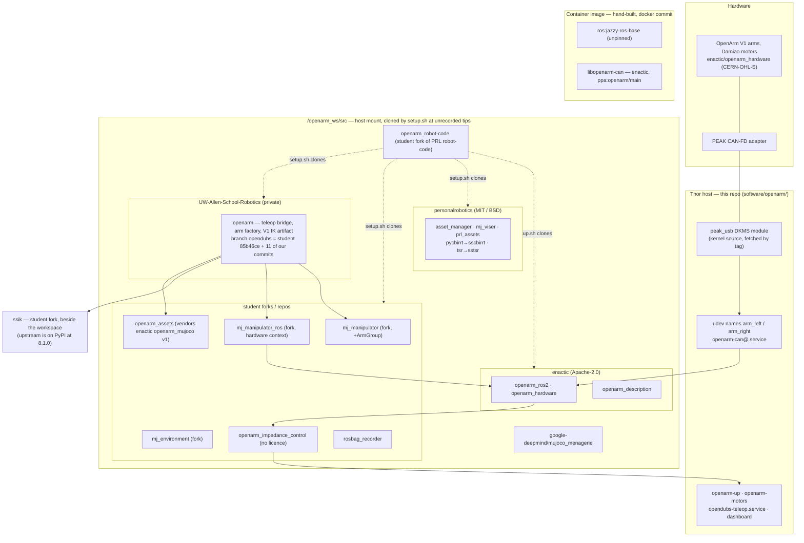

# Where the arm stack comes from, and a canonical setup for it — design

Arms plan DEC-27 (this design), DEC-18 (narrowed by it), DEC-20, DEC-26, Q9 (retired), 6.3 (#107).
Written 2026-10-09 as a proposal; **design of record since 2026-10-09** — option B below.

## Decided, 2026-10-09

1. **Canonical setup: B — upstream-first with a manifest, forking only the `openarm` teleop
   package** (DEC-27). DEC-18 narrows to that one repository; Q9 (mirror ~15 repositories) is
   retired.
2. **The SSIK desk test** was approved and **is done**: SSIK 8.1.0 solves V1 completely and about
   100× faster than the fork (below).
3. **The teleop's author is asked** for licence files (`openarm`, `openarm_impedance_control`),
   consent to send their library changes upstream as credited PRs, and DEC-20's public-fork
   question. **No upstream PR to the lab or enactic is opened until they consent.**
4. **The image base** is a pinned plain `ros:jazzy-ros-base`, as #107 builds it — not the Isaac
   ROS base.
5. **The backup** of opendubs2's arm image and source is kept on the project team's machine,
   outside the repo, taken at the next robot session together with `capture-pins.sh`.

## What makes the arms work today

### Component table

**Robot commit** is what opendubs2 runs. The robot was not reachable while this was written, so
only the `openarm` commit is known, from the 2026-10-07 session. The rest were cloned at whatever
the tips were in late September and never recorded: `capture-pins.sh` (#107) records them,
read-only, at the next robot session. **#107 pins** is the same for every row: #107 names each
repository and leaves its URL and commit blank, so it pins nothing yet.

| Component | Comes from | Robot commit | Reaches the robot by | Licence | Our change upstreamable? |
|---|---|---|---|---|---|
| Arm hardware | enactic/openarm_hardware (V1) | — | bought, assembled | CERN-OHL-S-2.0 | — |
| `peak_usb` driver | Linux kernel source, by tag | per kernel | `provision-openarm.sh`, DKMS on the host | GPL-2.0 | n/a (we build it, not modify it); the Jetson recipe is worth a community doc |
| udev, `openarm-can@` | this repo | `main` | `deploy-all.sh` | this repo's | no — per-robot |
| CAN library | enactic/openarm_can, `ppa:openarm/main` | unrecorded version (release 1.4.0 exists) | apt in the hand-built image | Apache-2.0 | none |
| Container image | the student workspace's `.devcontainer`, `docker commit` | unrecorded | built by hand once | — | replaced by #107 |
| Workspace root | `EricJGoossen/openarm_robot-code`, fork of `personalrobotics/robot-code` (+18 / −1) | unrecorded; a stale branch here pinned `f632ded` | host mount, `setup.sh` clones the rest at tips | MIT | its setup belongs in our manifest (#107) |
| `openarm_ros2` (hardware interface, bringup) | enactic/openarm_ros2 | unrecorded (release 0.9.2 exists; supports V1 via `arm_type v10`) | `setup.sh` clone, colcon | Apache-2.0 | **A1** (activate holding the measured pose) — **yes, strongly**: a safety improvement every V1 owner needs |
| `openarm_description` | enactic/openarm_description | unrecorded (release 1.0.4; a v1.0 compatibility path) | clone, colcon | Apache-2.0 | none |
| `openarm_impedance_control` | `EricJGoossen/openarm_impedance_control`, original | `b517999` per DEC-18 | clone, colcon | **none** (`package.xml` says "TODO") | 1.3's J2 cap is robot config, not upstream |
| `rosbag_recorder` | `EricJGoossen/rosbag_recorder`, original | unrecorded | clone, colcon | MIT in `package.xml`, no licence file | none |
| `mj_manipulator` | `EricJGoossen/mj_manipulator`, fork of personalrobotics (+3 / −2) | unrecorded | clone, uv workspace | MIT | the student's **ArmGroup** (`ArmGroupConfig`), which the bridge imports and upstream v2.0.0 lacks — **yes**; the ownership fix in `arm-authority.md` — **yes** |
| `mj_manipulator_ros` | `EricJGoossen/mj_manipulator_ros`, fork (+5 / −0) | unrecorded | clone, colcon and uv | MIT | the real-hardware context and bimanual refactor — **yes**, generic |
| `mj_environment` | `EricJGoossen/mj_environment`, fork (+1 / −0) | unrecorded | clone, uv | MIT | "integrated with robot and fixed bugs" — **probably** |
| `asset_manager`, `mj_viser`, `prl_assets` | personalrobotics | unrecorded | clone, uv | MIT | none |
| `pycbirrt`, `tsr` | personalrobotics, renamed **sscbirrt**, **sstsr** (on PyPI, 3.4.0 / 3.4.1) | unrecorded | clone, uv | MIT / BSD-2 | none |
| `openarm_assets` | `EricJGoossen/openarm_assets`, original; vendors enactic/openarm_mujoco `v1/` at `5c6e1b4` | unrecorded | clone, uv | MIT (vendored part Apache-2.0) | none |
| **`openarm`** (teleop bridge, arm factory, V1 IK artifacts) | `EricJGoossen/openarm`, original → **our private copy** | `7fcd3f9` (`0c21ead` merged, deploy pending) | org copy, fetched into the host-mounted checkout by bundle | MIT declared in `pyproject.toml`, **no licence file** | see the next table |
| `ssik` | `EricJGoossen/ssik`, fork of personalrobotics/ssik: **+1 / −170** (a v3-era base; upstream is **8.1.0 on PyPI**) | unrecorded; a stale branch here pinned upstream `d153492`, *without* the student's fix | path dependency `../ssik`, editable | BSD-3-Clause | the student's fix (a perturbation for a degenerate geometry) patches a solver the teleop never calls — **not needed**; the desk test shows 8.1.0 solves V1 completely |
| `mujoco_menagerie` | google-deepmind | unrecorded | clone | per model | none |
| `software/openarm/patches/` | this repo | — | was `docker cp` + script | this repo's | **superseded**: its one patch (the headless viewer) is in the org copy's `1f0f8f1` |

### Our 11 commits on the org copy

| Commit | What | Upstream? |
|---|---|---|
| `1f0f8f1` | the robot's uncommitted drift as found: headless viewer, ports 8444/8766, `target_hz` 150 | **the author's own unreleased work**: theirs to publish |
| `99f671e` | losing the headset disengages; a held grip never resumes | yes: a generic safety fix |
| `470ff3c` | say *why* a target is unreachable | yes |
| `2c18fef` | the grip clutch gates the gripper too | yes |
| `4530665` | stop where it is on release; hold X / A to home | yes; the stow pose is config |
| `5ffb96a`, `aa79db1` | measure the real arm; keep the model on the real joints | **yes: the most important.** The shadow model drifting from the arm affects every hardware user |
| `7fcd3f9` | CH5 gates the arms (reads the StamPLC's UDP line) | the gate is ours; upstream would take a pluggable "authority" hook |
| `aea2fc9` | each hand's state to the dashboard | ours; same idea, a status hook |
| `2a46da4` | bench scripts | ours |

## What "work as intended with SSIK" means

SSIK's authors ship it **from PyPI** (`pip install ssik`, with a native C++ backend in the Linux
wheels). They expect a robot without a prebuilt solver to run **`ssik build <its URDF>`** and keep
the generated module. Each module carries a provenance hash of the kinematic chain it was built
from.

- Upstream's prebuilt OpenArm solver is for **OpenArm v2.0**, and **our arms are V1**. So the
  prebuilt module is the wrong one for us, and the intended path is `ssik build` on V1.
- The `openarm` package already does that half. It carries generated V1 modules
  (`src/openarm/IK/openarm_{left,right}_ik.py`, base `link0`, end effector `hand_tcp`).
- What is *not* as intended is the rest. The library comes from a fork 170 commits behind, wired in
  as an editable path dependency. The modules were generated by an unrecorded SSIK version, from an
  unrecorded URDF.

The intended shape:
1. Pin `ssik==8.x` from PyPI.
2. Generate both V1 modules with `ssik build`, from enactic's `openarm_description` v1.0 URDF at a
   pinned release.
3. Commit the modules along with the command and version that made them.
4. Send the degenerate-geometry fix upstream if 8.x still needs it.

### The desk test — done, 2026-10-09: SSIK 8.1.0 replaces the fork

**Method:**
- **Inputs:** the V1 URDF in `openarm_assets` (`example/v1.urdf` at `71d81a8`), base
  `openarm_<side>_link0`, end effector `openarm_<side>_hand_tcp`, the frames the teleop's
  solvers use.
- **Sampling:** 1000 random configurations per arm inside the URDF's joint limits, seed 0.
- **Check:** each pose is solved, and every returned solution goes back through **pinocchio's**
  forward kinematics, independent of SSIK.
- **Recovered** means some solution lands within 10 µm and 0.1 mrad of the target.
- Run on the development Mac, single thread.

| | Solver module | SSIK at runtime | Recovered (left / right) | In joint limits | Median solve |
|---|---|---|---|---|---|
| A | built by **8.1.0** (`ssik build`) | **8.1.0** (PyPI) | **1000 / 1000** | 1000 / 1000 | **0.08 ms** |
| B | the student's, committed in `openarm` | 8.1.0 | 1000 / 1000 | 1000 / 1000 | 2.95 ms |
| C | the student's | the student's fork (`3.1.1.dev5+g176bb35`) | 1000 / 1000 | 1000 / 1000 | 8.1 ms |
| D (control) | the student's, **other side's** solver | the fork | 0 / 0 | — | 8.0 ms |

What it shows:
1. **8.1.0 solves V1 completely.** SSIK's own post-build check agreed: 100/100 poses, worst FK
   error 8×10⁻¹⁵. All three setups return the same mean number of solutions (4.88 left, 4.86
   right), so they find the same solution set. The control (D) recovers nothing, so the test does
   tell the arms apart.
2. **The fork's fix is not needed by anything the teleop runs.** It patches the Raghavan–Roth
   solver. Both the student's solvers and 8.1.0's select `seven_r.srs` (OpenArm V1's shoulder
   axes and wrist axes each meet at a point, SSIK's build log says), which never calls it. The
   student's earlier 10/50 and 5/50 figures (in `scripts/verify_ik_artifact.py`) were not
   reproduced here; they presumably came from a build that did not select `seven_r.srs`. So the fix
   is not a PR the teleop depends on; offer it to the lab only if the student wants to.
3. **Speed matters here.** The teleop's arm controller calls `ik.solve` on **every control step
   while a grip is engaged** (`mj_manipulator` `TeleopController._step_pose`). The loop runs at
   150 Hz, a 6.7 ms budget per tick. The fork's 8.1 ms median exceeds that on this machine, and
   8.1.0 uses about 1% of it. **Not yet measured on the Thor.** It is a plausible contributor to
   the lag felt while gripping. Verify by reading the loop-health readout while engaged, before
   and after.
4. **A solver module is tied to the SSIK version that built it.** The modules import SSIK
   internals (`ssik._kinbody`, `ssik.solvers.seven_r…`). The student's ran on 8.1.0 here, but
   that is luck, not a contract. So the solver modules are regenerated whenever `ssik` is bumped,
   from the pinned URDF, by one recorded command:
   `ssik build v1.urdf --base openarm_<side>_link0 --ee openarm_<side>_hand_tcp` (with
   `ssik[urdf]==8.1.0`).
5. **The provenance hashes cross:** 8.1.0's left chain hash equals the student's right solver's,
   and vice versa. Both sets' home poses match the URDF on the correct side, and the control shows
   each solver fits only its own arm. So this is a difference in how the two versions hash, not
   swapped solvers. Noted, not chased.

**What this means for DEC-27:**
- Pin `ssik[urdf]==8.1.0`.
- Regenerate both modules in the org `openarm` with the command above, against the same URDF.
- Drop the fork and its `../ssik` path dependency.
- Nothing about SSIK needs an upstream PR.

The swap is a change to the teleop package, and a robot-visible one (faster IK). So it goes as a
PR on the org `openarm` once DEC-27's work starts, and is checked on the robot like any other
change.

## The options

All three keep the parts that are not in question:
- **#107's image build**: a pinned base, packages and sources, built from this repo.
- **Per-robot values on the robot.**
- **The arm interfaces DEC-26 promises the student stays steady.**

### A. Upstream-first, patch overlay only

Every component comes from its canonical home, at a release or tag:
- enactic releases;
- the lab's libraries from PyPI where published, by tag otherwise;
- the author's own repositories for `openarm`, `openarm_impedance_control`, `openarm_assets` and
  `rosbag_recorder`.

Each of our changes is a PR to its upstream. Until a PR merges, the change is carried as a
`.patch` in this repo, applied at image build against a pinned commit.

- **Community improvements in:** bump a version in the manifest, and the image rebuilds.
- **Contributing back:** every change is a PR from day one.
- **SSIK:** as intended, above.
- **The student's teleop work:** PRs to the author's personal repository. If that repository is
  quiet, our changes live only as patches.
- **DEC-18:** reversed. The org copy is retired, and its 11 commits become PRs plus patches.
- **#107:** `repos.lock` points at the upstreams, and a `patches/` directory is added.
- **Q9:** dropped.
- **Cost:** this is the patch-script world DEC-18 left. On 2026-10-07 the close-out alone brought
  about 7 changes to `openarm`, and the teleop is where active work happens. A student iterating
  against a stack of patch files is the opposite of streamlined.

### B. Upstream-first with a manifest; fork only the teleop package (recommended)

A for everything we merely consume, but `openarm`, where the work happens, stays a real repository
in the org.

1. **Drop the student forks of the lab's libraries.** Take `mj_manipulator`, `mj_environment`,
   `mj_manipulator_ros`, `ssik`, `sstsr` and `sscbirrt` from personalrobotics at releases (PyPI
   where it exists).
   - The student's generic changes go to the lab as PRs, credited to the author and ideally
     submitted by them: ArmGroup, the hardware context, and the environment fix. The SSIK fix is not
     needed (the desk test).
   - Until they merge, each is a `.patch` in the manifest's overlay, against the pinned upstream
     commit. These are a handful of small, stable changes, unlike the teleop.
2. **enactic at releases.** A1 is a PR to `openarm_ros2`, carried as one patch until it merges.
3. **`openarm` stays in the org** (DEC-18, narrowed to this one repository):
   - `main` tracks the author's repository;
   - `opendubs` is ours, rebased onto `main` when the author publishes;
   - generic commits are offered upstream (the table above).
   - Once the author adds a licence and says yes (DEC-20), it becomes a **public GitHub fork**, so
     PRs go both ways with one click.
4. **`openarm_impedance_control`** is consumed from the author's repository at a pinned commit
   until it has a licence. Copying it is the same question as `openarm`.
5. **The manifest** is #107's `repos.lock`: upstream URLs and full commits, plus the overlay.
   Written in vcstool's `.repos` format if the Thor stack lane wants one tool for both.
   `setup.sh`'s clone-at-tips is replaced by it.

- **Community improvements in:** bump a pin. For `openarm`, a rebase of `opendubs`.
- **Contributing back:** PRs to the lab, enactic and the author. Only the dashboard- and
  StamPLC-specific pieces stay ours, and those become small hooks that upstream could take.
- **SSIK:** as intended.
- **The student's teleop work:** feature branches on the org `openarm`, PRs into its protected
  `opendubs`, which is exactly how it works today. DEC-26's interfaces don't change. Their generic
  library changes become PRs to the lab, not commits to a personal fork.
- **DEC-18:** kept for `openarm` only. Its "copy the others when a phase needs them" clause is
  replaced by "send it upstream, carry a patch meanwhile."
- **#107:** fill `repos.lock` with the upstream URLs and add the overlay.
- **Q9:** dropped. The one copy we keep is `openarm`. The rest are organisation-owned upstreams
  (enactic, personalrobotics, google-deepmind) with tagged releases, whose loss is a far smaller
  risk than a personal account's. The remaining risk is covered by archiving each built image with
  its source, which the pending backup decision already plans.
- **Cost:**
  - a few patches carried until the lab merges them;
  - a rebase whenever the author publishes;
  - the ArmGroup dependency must land upstream (or be patched), because the bridge imports it.

### C. Org forks of everything we touch, tracking upstream

Fork every repository we change, about six of them: `openarm`, `openarm_impedance_control`,
`mj_manipulator`, `mj_manipulator_ros`, `ssik` and `openarm_ros2`. Each keeps an `opendubs` branch
rebased on upstream, and the manifest pins each fork's commit. Q9's full mirror becomes these six,
plus untouched upstreams pinned directly.

- **Community improvements in:** rebase each fork onto upstream, six times over.
- **Contributing back:** each fork's commits are upstream candidates, but nothing forces the PR,
  so the forks drift.
- **SSIK:** a fork tracking 8.x, but nothing makes "as intended" happen.
- **The student's teleop work:** the same PR flow as B, across more repos.
- **DEC-18:** extended to all six.
- **#107:** pins the forks.
- **Q9:** shrinks to six forks.
- **Cost:** this formalises the current shape rather than simplifying it. It is the right answer
  only if upstream will not take our changes.

### Considered and set aside: enactic's own teleop

The community runs its own Quest teleop (`enactic/dora-openarm-webxr`, `dora-openarm-vr`), with
kinematics in `openarm_control` (MuJoCo + mink). It is built on dora-rs dataflows, not
ros2_control, and on mink, not SSIK. Adopting it would replace the arm stack under the student's
work and our CH5 and safety gates, and it fails goal (b). Worth knowing about, and worth borrowing
from: its pose channel is a WebRTC data channel that drops stale poses rather than retransmitting
them. Ours is a WebSocket, over TCP, which retransmits. Given the lag seen in testing, that design
deserves a comparison. It is not a canonical setup for this robot.

## Recommendation (adopted)

**B.** It meets all three goals, and it removes the root of the mess.

- **(a), the community:** everything we only consume comes from its owner at a release, and our
  changes go back as PRs.
- **(b), SSIK:** consumed as its authors intend: from PyPI, with our V1 modules built by
  `ssik build`.
- **(c), the student:** keeps working where they work now, with the interfaces DEC-26 promises.
- **The root of the mess:** a workspace that cloned a student's personal forks at whatever their
  tips were, with nothing pinned.

**What B needs first,** in order, all at the desk except the read-only capture:
1. The author's licence and consent.
2. ~~The SSIK desk test~~ — done: 8.1.0 replaces the fork.
3. `capture-pins.sh` on opendubs2, read-only, at the next robot session, to learn what actually
   runs.
4. One PR to the lab with ArmGroup, since the bridge cannot use upstream `mj_manipulator` without
   it — after the author consents.

## Open facts

- **Personal-account URLs in `repos.lock`.** Under B, three repositories are still consumed from
  the author's own account: `openarm_impedance_control`, `openarm_assets` and `rosbag_recorder`.
  `openarm`'s `main` also tracks that account. So the manifest will carry those URLs. They are
  addresses, not attributions. If the project team prefers no personal account in committed files,
  those three are the only candidates for an org copy, which is a fork in name only, since nothing
  of ours is on them.

- The commits of every repository except `openarm` on opendubs2, and whether any has uncommitted
  changes. `capture-pins.sh` refuses a dirty one, which is the point.
- Which SSIK the robot mounts: the student's fork with the fix, or `d153492` without it.
- Whether the lab and enactic will take the PRs. Both are active (pushed this week), and SSIK has a
  `CONTRIBUTING.md`.
