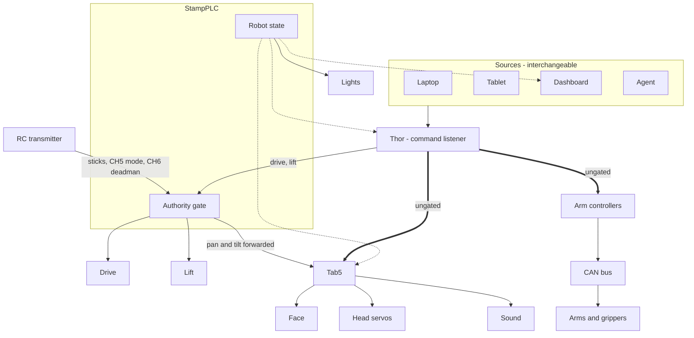

# Command routing

Where a command goes on this robot, and what can stop it. Source for the shared diagram; edit
this and re-export rather than redrawing.

Solid is a command, thick is a command that does not pass the authority gate, dashed is state.

## Known gap — two paths bypass the authority gate

The contactor gates the **drive bus** only: the 60 A buck sits behind it and feeds the PDH and
the drive ESCs. The arms are not on that bus, and the Thor forms and sends their CAN itself. The
Thor also talks to the Tab5 directly.

So in `MANUAL`, releasing the deadman stops drive and lift but does **not** stop the arms, the
head or sound. The intent is that in `MANUAL` the deadman gates motion from every actuator, and
today it does not.

Closing it is one of two things:

- **software** — the Thor already receives state, so the arm and Tab5 paths refuse to emit
  unless authority permits;
- **hardware** — arm power behind a contactor pole, so releasing the deadman removes torque.

## Notes

- The **listener runs on the Thor**. A choreography is one thing it accepts — a list of timed
  calls — and the source that submits it is irrelevant; none of them is privileged.
- **Releasing the deadman stops actuators, not software.** The Thor keeps listening and keeps
  sending; the StampPLC stops acting on what arrives. Worth stating, because "the deadman stops
  the robot" and "the deadman stops the program" are different claims and only the first holds.
- **State is an output** of the StampPLC, broadcast to the Tab5, the Thor and the dashboard.
  Face and lights follow it rather than being commanded per device.
- **The Tab5 drives the head servos.** The StampPLC forwards pan and tilt from the sticks; the
  Thor can also send them directly, which is one of the two ungated paths above.
- **Arms are their own branch** — nothing on that path passes through the StampPLC.

## Not published

This is not in `docs/` because the mkdocs build has no mermaid renderer: `markdown_extensions`
has no `pymdownx.superfences` custom fence and no mermaid plugin, so a fence there would ship as
a code block. Publishing it needs that build change first, and a decision about whether the
known gap above belongs on a public site while it is still open.
