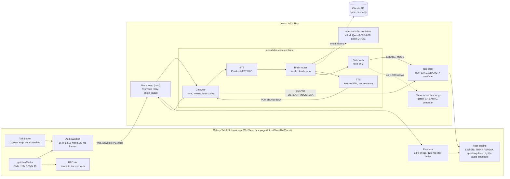

# Voice and a language model for OpenDubs — research and recommendations

**Status: research draft, 2026-10-12. Nothing here is agreed, and nothing in it was measured on a
Thor or on the tablet.** It answers six questions: an on-device LLM on the Thor, speech-to-text and
text-to-speech, audio to and from the Galaxy tablet, wake word and turn-taking, a cloud LLM, and the
end-to-end architecture. Decisions come first; the evidence follows.

**How to read the evidence.** Every number carries one of three tags:

| tag | meaning |
|---|---|
| **[M]** | **Measured**, with where and by whom. Only two kinds exist here: the project's own earlier bench results (cited to the note that holds them), and this study's checks of its own tools on a laptop. **No speech model or LLM was run for this study.** |
| **[C]** | **Cited**: a vendor or community number, with its link. Vendor numbers are labelled as such. |
| **[E]** | **Estimated**: arithmetic or judgement, with the reasoning shown. To be replaced by a measurement. |

**What came before, and what this builds on.** The head's voice plan, `notes/workplan-tab5-audio.md`,
is **paused**, not cancelled. Its decisions were reasoned from the interaction design rather than the
Tab5 hardware, so most of them carry over: push-to-talk, half-duplex, bounded utterances, raw PCM,
and a small contract with the Thor (its Phase C). `notes/design/face-design.md` holds the hard line
this study keeps: **no LLM authority over motion.** `notes/design/tablet-device.md` records that the
tablet's microphone is already live in the kiosk app over HTTPS (TB-1, passed on the robot
2026-10-08).

**Jargon used below.**

- **STT / ASR**: speech-to-text (automatic speech recognition).
- **TTS**: text-to-speech.
- **VAD**: voice activity detection, deciding whether a short slice of audio contains speech.
- **AEC**: acoustic echo cancellation, removing the robot's own voice and music from what its
  microphone hears.
- **Barge-in**: a person interrupting the robot while it is talking.
- **TTFT**: time to first token, from sending a prompt to the model's first output token.
- **TTFS**: time to first sentence, the point at which TTS has something it can speak.
- **Prefill / decode**: an LLM first reads the whole prompt (prefill), then writes one token at a time
  (decode, measured in tokens per second).
- **Quantization**: storing weights in fewer bits. NVFP4 and MXFP4 are 4-bit floating-point formats;
  W4A16 and AWQ are 4-bit integer weights; Q4_K_M is llama.cpp's 4-bit GGUF format.
- **MoE**: mixture-of-experts. A model with many parameters of which only a few billion are used per
  token, so it decodes like a small model and answers like a larger one.
- **Lease**: as in the head protocol, a claim that expires unless its sender renews it.

---

## 1. Decisions for the team

Each of these is a recommendation awaiting a decision. The rest of the document is the evidence for
them.

| # | Decision | Recommendation | Why, in one line |
|---|---|---|---|
| **D1** | How the robot knows it is being spoken to | **Keep push-to-talk** (decided 2026-10-07 in the voice plan) as the default: a fixed **Talk** button on the face, and a "listen" control for the operator on the dashboard. Add a wake word later, as an opt-in mode, detected **on the tablet** (§6). | Capturing audio needs a visible, deliberate act in a shared building; and a wake word in a lab with show music is the least reliable part of any pipeline (§6). |
| **D2** | Where the microphone is captured | **In the face page, with `getUserMedia` in the kiosk's WebView** (already live, TB-1). Native `AudioRecord` in the kiosk app is the fallback if experiment V-2 shows the WebView's echo cancellation fails. | It works today, needs no new app code, and keeps capture, playback and echo reference in one place (§5). |
| **D3** | What a model may do | **The face only**: expression, a face gesture, a read-only status query, and "end conversation" (`tools/voice-bench/safe_tools.py`). **Routines by voice stay off** unless the team decides otherwise. If enabled, they go only through the runner's existing gated path (§7). | `face-design.md`'s hard line excludes "asking a planner nicely". The brief for this study allows requesting pre-validated routines. **These two disagree, and only the team can choose.** |
| **D4** | Which brain answers | **Local by default** (a model on the Thor), with the **Claude API as an opt-in per robot**: `VOICE_BRAIN=local\|cloud\|auto`. In `auto`, cloud is used only while the uplink is healthy, with a per-turn timeout that falls back to local (§8). | The uplink "may be slow or absent", and shows cannot depend on it. Local also keeps every transcript on the robot. |
| **D5** | Local model and runtime | **Qwen3-30B-A3B-Instruct-2507** (MoE, Apache-2.0) on **vLLM** in a container, capped at about 24 GiB. **Qwen3-4B-Instruct-2507** is the light option. **TensorRT Edge-LLM** is the low-latency step after that (§3). | It is the best cited single-stream decode for its quality (61–90 tok/s [C]) on NVIDIA's mainstream Thor runtime. |
| **D6** | STT and TTS | **STT: Parakeet-TDT-0.6B-v2** (CC-BY-4.0), run on each bounded utterance. **TTS: Kokoro-82M** (Apache-2.0), streamed sentence by sentence. Riva 2.26 is plan B: it officially supports Thor, but it is a public beta on a trial licence (§4). | Both licences are permissive, both models are small, and neither needs faster-whisper's aarch64 CUDA build. |
| **D7** | Where the robot's voice plays | **The tablet's own speakers, from the face page**, for conversation. A louder external speaker only with strict half-duplex (§5.6). | Playing in the same page gives the platform AEC its reference, and lets the face animate its speaking state from the real audio, locally. |
| **D8** | Mouth | **For Face & HRI.** `face-design.md` recommends **no mouth** (brows and nods correlated with speech have the measured benefit). The brief for this study asks for a mouth animation. The protocol proposed here (§6.4) carries a *speaking* state and leaves the drawing to the skin, so either choice works. | The protocol should not decide a face-design question. |
| **D9** | Who owns voice | **A new Voice lane**, owning `software/voice/`, `tools/voice-bench/`, this note and a new `notes/workplan-voice.md`. The existing lanes keep their paths (§10). | Voice touches five lanes. Without one owner it becomes everybody's side task, as the Tab5 voice plan warned. |

**The open questions that only hardware can answer** are collected in §11 with each one's
experiment. The three that decide the most:

- **V-2:** does the tablet's echo cancellation remove the robot's own TTS and the show music?
- **L-1 / L-3:** time to first sentence on the bench Thor, alone and beside the perception stack.
- **V-5:** does Android's microphone privacy dot show in lock task?

---

## 2. The recommended pipeline, and a simpler fallback

### 2.1 Recommended



**One turn, in order:**

1. A press on **Talk** opens capture. The page sends `press`, the REC dot lights (driven by the
   track), and the gateway sends `CONVO LISTEN`. The face shows its listening posture, and the
   existing `heard` earcon may sound.
2. 20 ms PCM frames stream up while the button is held.
3. **Release** ends the utterance. No VAD guesswork is needed for the end; a short tail of audio is
   kept. The gateway sends `CONVO THINK` at once, so the face never waits on the pipeline
   (`face-design.md`, "Reflexes local, cognition remote").
4. STT transcribes the bounded clip. A clip with no speech in it gets the voice plan's `NO_SPEECH`
   answer ("say that again"), never an LLM's guess.
5. The router sends the transcript and the short conversation history to the local model (or the
   cloud), **streamed**. Text is cut at sentence ends. Tool calls are checked by `safe_tools.plan()`
   and sent to the face as `EMOTE` or `MOVE` lines.
6. Each sentence goes to TTS as soon as it is complete. The first chunk of audio goes down with
   `CONVO SPEAK`, and the face animates from the audio it is actually playing.
7. A new press during playback **cuts the reply within one 100 ms chunk** (button barge-in) and
   starts a new turn. After the last chunk, `CONVO IDLE`. The mic closes when the button is released,
   or after a short conversation window (§5.5).

### 2.2 Latency budget: release to first audible word

The target is about **1 second at the 90th percentile**. People in conversation leave gaps of
roughly 200 ms between turns ([Stivers et al., PNAS 2009](https://www.pnas.org/doi/10.1073/pnas.0903616106)),
which no pipeline of this shape will match. That is why the face's `THINK` state appears within
about 100 ms of release.

| stage | local brain | cloud brain | basis |
|---|---|---|---|
| End of utterance | 0 ms (button release) | same | push-to-talk; hands-free VAD endpointing would add 300–700 ms [E] |
| Last frames up, Wi-Fi | 20–40 ms | same | [E] 20 ms frames on the robot's own LAN |
| STT, 3 s clip, Parakeet 0.6B on GPU | 50–200 ms | same | [E] Parakeet's RTFx (seconds of audio per second of compute) is about 3,400 on a datacenter GPU ([card](https://huggingface.co/nvidia/parakeet-tdt-0.6b-v2)) [C]. Thor is much smaller, and there is fixed overhead per call. **No Thor number exists** (L-4) |
| LLM to first sentence | 200–450 ms | 400–1,200 ms | local: prefill of a ~600-token persona plus about 12 tokens at 60–90 tok/s [C, §3.2]. Cloud: [E] network round trip plus the model's TTFT, which is unmeasured (C-1) |
| TTS, first chunk of the first sentence | 50–200 ms | same | [E] Kokoro is 82M parameters. **No Thor number exists** (L-4) |
| Down to the tablet, plus jitter buffer | 130 ms | same | 120 ms buffer (the audio lab's default) + about 10 ms Wi-Fi [E] |
| **Total** | **≈ 0.45–1.0 s** | **≈ 0.65–1.8 s** | [E]; replaced by L-1 and C-1 |
| *Face shows THINK* | *< 100 ms after release* | *same* | local animation. The gateway's line goes through the face door, which is on the same Thor |

Decode speed beyond about 20 tok/s buys headroom, not latency. Speech consumes about 3–4 tokens a
second [E: about 150 words a minute, at about 1.3 tokens per word], so what matters is **TTFS**, not
tok/s. `llm_bench.py` measures TTFS for this reason.

### 2.3 The simpler fallback: "one small container, little GPU"

If the GPU budget beside perception turns out to be tight (L-3), or as a first demo that is quick to
stand up:

- **STT:** Moonshine (MIT, streaming, built for CPU; WER about 6.65 on its medium model
  [C](https://huggingface.co/UsefulSensors/moonshine-streaming-medium)), or sherpa-onnx streaming
  (Apache-2.0, aarch64 CPU) — **on the Thor's CPU**.
- **TTS:** Kokoro on the CPU. *(Corrected 2026-10-14: this note first said "through `kokoro-onnx`
  (MIT wrapper)". The wrapper is MIT, but it requires `phonemizer` (GPL-3.0-or-later) and
  `espeakng-loader`, which bundles the GPL espeak-ng library, so it always ships GPL code. The team
  then decided "English only, no GPL"; how that is held is in `notes/workplan-voice.md`, V-O4.)*
- **Brain:** **Claude Haiku 5.5** when the uplink is up, and **Qwen3-4B on llama.cpp** (about
  2.5 GB) when it is not.
- **The same tablet path, protocol and safe tools.** Only the container behind `/ws/voice` changes,
  which is what makes this a fallback rather than a second design.

It costs accuracy and some latency. It buys almost no GPU contention and a single container to
deploy.

---

## 3. Q1 — an LLM on the Thor

### 3.1 Runtimes on Thor and JetPack 7.x

| runtime | on Thor | how it ships | verdict | source |
|---|---|---|---|---|
| **vLLM** | supported; NVIDIA's mainstream path | `nvcr.io/nvidia/vllm:<YY.MM>-py3` (26.09-py3 is the latest seen); `ghcr.io/nvidia-ai-iot/vllm:latest-jetson-thor`; upstream vLLM 0.20 and later | **Recommended for phase 1.** It serves an OpenAI-compatible API with tool calling, so `llm_bench.py` and the router talk to it unchanged | [NGC](https://catalog.ngc.nvidia.com/orgs/nvidia/containers/vllm), [Jetson AI Lab benchmarking](https://www.jetson-ai-lab.com/tutorials/genai-benchmarking), [NVIDIA skill: "use upstream vLLM 0.20+ on Thor"](https://raw.githubusercontent.com/NVIDIA-AI-IOT/jetson-device-skills/main/skills/jetson-llm-serve/SKILL.md) [C] |
| **TensorRT Edge-LLM** | official on JetPack 7.1 and 7.2 | native C++ runtime from apt; engines are built on the device; export in `nvcr.io/nvidia/pytorch:26.05-py3` | **Phase 2, for the lowest latency.** It has no OpenAI-style server, so it needs a thin wrapper, and the project's containers (T-2) have to package it | [tutorial](https://www.jetson-ai-lab.com/tutorials/tensorrt-edge-llm), [benchmarks](https://nvidia.github.io/TensorRT-Edge-LLM/latest/user_guide/performance/performance-benchmarks.html) [C] |
| **llama.cpp** | works (CUDA build, SM 11.0) | `ghcr.io/nvidia-ai-iot/llama_cpp:latest-jetson-thor`, or build with `-DGGML_CUDA=ON` | **The simplest fallback.** One binary and GGUF files, slower than vLLM or Edge-LLM | [JetsonHacks llama-bench](https://jetsonhacks.com/wp-content/uploads/2025/10/thor-llamacpp-bench.html) [C] |
| SGLang | NGC images exist | `nvcr.io/nvidia/sglang:26.01-py3` and later | not first: NVIDIA's own notes warn off the gpt-oss and FP8 paths on Thor | [NVIDIA skill](https://raw.githubusercontent.com/NVIDIA-AI-IOT/jetson-device-skills/main/skills/jetson-inference-mem-tune/SKILL.md) [C] |
| **TensorRT-LLM** | **not supported, and will not be** | — | no | [NVIDIA staff, forum](https://forums.developer.nvidia.com/t/tensorrt-llm/348631) [C] |
| Ollama | works with reported GPU problems | `ghcr.io/nvidia-ai-iot/ollama:r38.2.arm64-sbsa-cu130-24.04` | avoid: CPU fallback reported, and a version warning on Thor | [forum](https://forums.developer.nvidia.com/t/ollama-gpu-support-on-thor/350680), [Live VLM WebUI note](https://www.jetson-ai-lab.com/tutorials/live-vlm-webui) [C] |
| MLC-LLM | container exists, little upkeep | `ghcr.io/nvidia-ai-iot/mlc:r38.2…` | avoid: slow prefill, not resolved | [forum](https://forums.developer.nvidia.com/t/prefill-speed-on-mlc-significantly-slower-than-llama-cpp-on-jetson-thor-any-optimization-suggestions/343483) [C] |
| NIM for Jetson | none found for Thor LLMs | — | no | — |

### 3.2 What the published numbers say (single stream only)

NVIDIA's headline Thor figures are mostly **eight concurrent streams added together**, at MAXN
power. A robot holding one conversation cares about **one stream**, so only single-stream figures are
listed here. All are **[C]**, and none were measured at the robot's 120 W mode (T-5).

| model | quant | runtime | decode tok/s, 1 stream | prefill / TTFT | source, type |
|---|---|---|---|---|---|
| Qwen3-4B-Instruct-2507 | NVFP4 | Edge-LLM | 79.8 (104.6 with DFlash) | 18.6 ms for 57 tokens; 62 ms for 2,048 | [NVIDIA](https://nvidia.github.io/TensorRT-Edge-LLM/latest/user_guide/performance/performance-benchmarks.html) |
| Qwen3-8B | NVFP4 | Edge-LLM | 47.3 (153.7 with EAGLE3) | 27.7 ms / 61 tok; 105 ms / 2,048 | same |
| **Qwen3-30B-A3B** | NVFP4 | Edge-LLM | **89.8** | 56.0 ms / short prompt | same |
| Nemotron-3-Nano-30B-A3B | NVFP4 | Edge-LLM | 77.1 | 75.6 ms | same |
| **Qwen3-30B-A3B** | W4A16 | vLLM (nvidia-ai-iot image) | **81.4** | about 42 ms warm | [independent, forum, Mar 2026](https://forums.developer.nvidia.com/t/jetson-agx-thor-vllm-26-02-moe-performance-significantly-below-reference-missing-fused-moe-config/364663) |
| Qwen3-30B-A3B | not stated | vLLM | 61 | — | [NVIDIA Jetson benchmarks](https://developer.nvidia.com/embedded/jetson-benchmarks) |
| Llama 3.1 8B | W4A16 | vLLM | 45.3 | 39.5 ms warm, **756 ms first run** | independent, same forum thread |
| gpt-oss-120b | NVFP4 | vLLM | 31.0 | 62.5 ms | same thread |
| gpt-oss-20b | MXFP4 | llama.cpp | 57.2 | 1,861 tok/s prefill | [independent, JetsonHacks](https://jetsonhacks.com/wp-content/uploads/2025/10/thor-llamacpp-bench.html) |
| Gemma 3 4B QAT | Q4_0 | llama.cpp | 66.8 | 2,642 tok/s prefill | same |
| Qwen3.6-27B (dense) | NVFP4 | Edge-LLM, MLPerf agentic | 52.3 with MTP | **median TTFT 247 ms** | [NVIDIA](https://developer.nvidia.com/blog/tensorrt-edge-llm-completes-the-mlperf-edge-agentic-benchmark-6-4x-faster-on-jetson-agx-thor/) |

**A sanity check from bandwidth [E].** Decode reads every active weight once per token, so its
ceiling is memory bandwidth divided by the bytes read per token.

- Thor's bandwidth is 273 GB/s ([NVIDIA](https://www.nvidia.com/en-us/autonomous-machines/embedded-systems/jetson-thor/));
  a user measured about 200 GB/s in practice ([forum](https://forums.developer.nvidia.com/t/performance-benchmarking-on-jetson-thor/349494)).
- An 8B model at 4 bits is about 4.5–5 GB, so the ceiling is roughly 40–60 tok/s. Measured: 41–49.
- A 4B model at 4 bits gives a ceiling of roughly 85–115 tok/s. Measured: 80–83.
- So the cited figures sit at about 65–80% of the ceiling, which is plausible.
- The MoE result follows: Qwen3-30B-A3B reads only about 3B parameters per token.

### 3.3 Which model

| candidate | licence | why | against |
|---|---|---|---|
| **Qwen3-30B-A3B-Instruct-2507** (recommended) | Apache-2.0 | about 30B of knowledge at about 3B-parameter speed: 60–90 tok/s [C]; a non-thinking "Instruct" variant, so no hidden reasoning before the first word | about 16–17 GB of weights at 4 bits [E]. **vLLM 26.02 NGC halved its speed** (no Thor fused-MoE config [C, forum 364663]); pin a newer or nvidia-ai-iot image and measure |
| **Qwen3-4B-Instruct-2507** (light) | Apache-2.0 | about 80 tok/s and about 2.5 GB [C/E]; leaves the GPU almost alone | weaker world knowledge and persona |
| gpt-oss-20b | Apache-2.0 | 57 tok/s on llama.cpp [C] | a reasoning model: even at low effort it thinks before speaking, which costs TTFS |
| Nemotron-3-Nano-30B-A3B | NVIDIA Open Model License | NVIDIA-tuned; 77 tok/s on Edge-LLM [C] | a licence to read before shipping |
| Llama 3.x 8B | Llama community licence | widely supported | slower than the MoE models (about 45 tok/s), and its licence carries conditions |

**Reasoning ("thinking") must be off for voice.** A model that thinks silently before its first
visible token turns a 50 ms TTFT into seconds. Qwen3's hybrid models take
`chat_template_kwargs: {"enable_thinking": false}`; the 2507 Instruct models do not think at all.
`llm_bench.py` fails loudly on a stream that carries no visible text, for this reason.

### 3.4 Memory and compute beside the rest of the stack

The Thor has **122 GiB** visible, 2 GB of swap, and runs in **120 W** mode (opendubs2 audit,
`notes/workplan-thor-stack.md`, 2026-10-09) [M, project]. Its GPU memory **is** system memory.

| tenant | budget | basis |
|---|---|---|
| LLM, Qwen3-30B-A3B at 4 bits, 8k context | **≤ 24 GiB** (`--gpu-memory-utilization 0.20`) | [E] weights about 16–17 GB plus KV cache. vLLM's default of 0.9 would take the whole machine, so it **must** be set |
| LLM, Qwen3-4B (light option) | ≤ 6 GiB | [E] |
| STT, Parakeet 0.6B (NeMo, PyTorch) | about 2–4 GiB | [E]; Riva lists 4–4.3 GB for its 0.6–1.1B ASR models on Thor ([support matrix](https://docs.nvidia.com/deeplearning/riva/user-guide/docs/support-matrix/support-matrix.html)) [C] |
| TTS, Kokoro-82M | < 1 GiB | [E]; Riva Magpie would be 8.5 GB [C, same page] |
| VAD, wake word, gateway | < 0.5 GiB | [E] |
| **Voice total** | **≈ 30 GiB** (≈ 12 GiB with the light model) | [E] |
| Existing: the dashboard, ROS nodes, the `openarm` container, the YOLO tracker (torch with CUDA) | not measured | the audit lists them but not their memory. **L-2 records it** |
| Planned: Isaac ROS cuVSLAM and nvblox (Thor plan, Phase 5) | not measured | — |

**Memory is not the constraint; GPU time is.** Decode is bandwidth-bound, and so is much of
perception. An LLM burst during a conversation will slow whatever perception frame is running [E].
How much is experiment **L-3**. Three mitigations exist, in order of cost:

1. **Run at 120 W and measure there.** The project pins 120 W (T-5); every NVIDIA number is at MAXN.
2. **Use the light model, or the fallback in §2.3,** if perception's frame-time p99 grows by more than
   about 10% [E threshold] during a turn.
3. **MIG on Thor**, a technology preview in JetPack 7.2 that splits the GPU 12 + 8 SMs. NVIDIA warns
   it can hide the GPU from vLLM and SGLang containers
   ([JetPack 7.2 blog](https://developer.nvidia.com/blog/deploy-agentic-ready-ai-at-the-edge-with-memory-efficiency-in-nvidia-jetpack-7-2)) [C].
   A later step, not a plan.

**Gotchas to carry into the container work** (all [C], from the forum threads and NVIDIA pages
above):

- Thor is `sm_110` from CUDA 13.0 (it was `sm_101` before). Older wheels fail with "no kernel image".
- A stopped vLLM can leave page cache that makes the next start run out of memory. NGC's Thor note:
  `sync && echo 3 > /proc/sys/vm/drop_caches`.
- The first run after start is slow (756 ms TTFT against 40 ms warm, Llama 8B). **Warm up at boot**,
  or the first visitor waits.
- `nvidia-smi` on Thor reports no per-process data under CUDA 13.0; use `tegrastats`.
- Containers need `--runtime nvidia`. The opendubs2 audit found `runc` as the default runtime, which
  the Thor plan's 1.1 changes.

### 3.5 Containerised, per T-2

Two containers, so the LLM can be swapped without touching speech:

- **`opendubs-llm`**: the vLLM image pinned by digest in `software/stack/versions.env` (a new
  `VOICE_LLM_IMAGE`), started with `--runtime nvidia --network host --ipc=host`. It listens on
  127.0.0.1 only, with `--gpu-memory-utilization` from a per-robot value.
- **`opendubs-voice`**: the gateway, STT, TTS, router and safe tools, built FROM our Isaac ROS base or
  a pinned CUDA 13 base. Not a ROS node: it speaks HTTP to the LLM, UDP to the face door and a
  WebSocket to the dashboard. It may publish `/voice/transcript` for logging later.

Both are the **Thor stack lane's** to place in `versions.env`, `deploy-all.sh` and provisioning. The
voice code is the Voice lane's.

### 3.6 Benchmark plan for the non-robot Thor — ready to run

The scripts are in `tools/voice-bench/`. **None has run on a Thor.**

| # | what | how | records |
|---|---|---|---|
| L-0 | Platform | `thor_llm_bench.sh` writes `platform.txt` itself: L4T, nvpmodel, `free`, Docker, Container Toolkit | the base the numbers belong to |
| L-1 | **vLLM, four candidates** | `VLLM_IMAGE=<pinned> tools/voice-bench/thor_llm_bench.sh vllm`. It serves Qwen3-4B-Instruct-2507, Qwen3-8B-AWQ (thinking off), Qwen3-30B-A3B-Instruct-2507-FP8 and gpt-oss-20b (reasoning low) **one at a time** at a 0.20 memory share, then runs `llm_bench.py` 20 times with no history and 20 times with about 2,000 tokens of history | TTFT, **TTFS**, decode tok/s (p50 and p90), load time, memory after load, tegrastats |
| L-1b | llama.cpp | `LLAMACPP_IMAGE=<pinned> GGUF_DIR=<dir> …/thor_llm_bench.sh llamacpp`, with Qwen3-30B-A3B Q4_K_M, Qwen3-4B Q4_K_M and gpt-oss-20b MXFP4 | the same |
| L-1c | Edge-LLM | NVIDIA's own `llm_bench` from the Edge-LLM tutorial, Qwen3-4B and 30B-A3B NVFP4, with a prompt of the persona's length (about 600 tokens) | prefill ms, decode tok/s |
| L-1d | Power modes | L-1 at **120 W** (the robot's mode) and at MAXN (to compare with NVIDIA's numbers) | the cost of T-5 |
| L-2 | **What the stack already uses** | on opendubs2, read-only: `tegrastats` and `free -m` for 10 minutes while the robot is in normal use. The Thor lane's 0.1 audit is the model for how | the real memory and GPU baseline |
| L-3 | **Coexistence** | on the bench Thor, run a perception stand-in (the YOLO tracker or an Isaac ROS graph on a recorded bag) and record its frame time. Then run L-1's best case at concurrency 1, and again at 2 | perception frame-time p50/p99 with and without voice; LLM TTFS under load |
| L-4 | STT and TTS | Parakeet-TDT-0.6B-v2 on 1, 3 and 8 s clips; Kokoro on a 12-word sentence. Both alone, then during L-3 | RTF, first-chunk latency |
| C-1 | Cloud | `tools/voice-bench/claude_bench.py` from the **robot's own uplink**, not a laptop | TTFT, TTFS and cost per turn for Haiku, Sonnet and Opus 5.5 |

**The pass line for phase 1 [E]:** release-to-first-audio **p90 ≤ 1.2 s** on the bench Thor at 120 W
with perception running, and perception p99 frame time worse by **≤ 10%**.

---

## 4. Q2 — speech-to-text and text-to-speech on the Thor

**No one publishes STT or TTS latency on Thor**, for any model; L-4 is the first. All rows **[C]**
from the linked model cards and repositories unless marked.

### 4.1 Speech-to-text

| model | licence | streaming | accuracy (Open ASR mean WER, lower is better) | Thor status | verdict |
|---|---|---|---|---|---|
| **Parakeet-TDT-0.6B-v2** | CC-BY-4.0 | no (fine for bounded push-to-talk clips) | **6.05**, RTFx about 3,386 | runs via NeMo on AGX Orin per a community guide; Thor "expected" ([discussion](https://huggingface.co/nvidia/parakeet-tdt-0.6b-v3/discussions/21)) | **recommended**, English ([card](https://huggingface.co/nvidia/parakeet-tdt-0.6b-v2)) |
| Parakeet-TDT-0.6B-v3 | CC-BY-4.0 | chunked | 6.34, 25 languages | same | if visitors speak other languages ([card](https://huggingface.co/nvidia/parakeet-tdt-0.6b-v3)) |
| Nemotron-speech-streaming-en-0.6b | NVIDIA Open Model License | **true streaming**, 80–1,120 ms chunks | 7.67 at 160 ms chunks | served by Riva 2.26 on Thor | for hands-free mode, where partial transcripts matter ([card](https://huggingface.co/nvidia/nemotron-speech-streaming-en-0.6b)) |
| Canary-Qwen-2.5B | CC-BY-4.0 | no | **5.63** (the best here) | Jetson/L4T listed, no numbers | too slow for turn-taking (RTFx 418) ([card](https://huggingface.co/nvidia/canary-qwen-2.5b)) |
| Whisper large-v3 / turbo | MIT | no | 7.44 / 7.83 | see faster-whisper | known to invent text not in the audio ([card](https://huggingface.co/openai/whisper-large-v3)) |
| faster-whisper (CTranslate2) | MIT | chunked | as Whisper | **aarch64 wheels are CPU-only**; CUDA needs a source build, targets CUDA 12, and fails on ARM64 GB10 ([speaches #620](https://github.com/speaches-ai/speaches/issues/620)) | **avoid on Thor**, with everything built on it (Speaches, RealtimeSTT) |
| whisper.cpp | MIT | naive streaming example | as Whisper | CUDA build; Thor not documented | possible; not first |
| WhisperTRT | — | no | — | Orin Nano numbers only, tiny/base models | no |
| Moonshine (streaming) | MIT | true streaming | about 6.65 (medium) | CPU-first | **the fallback's CPU STT** ([card](https://huggingface.co/UsefulSensors/moonshine-streaming-medium)) |
| sherpa-onnx | Apache-2.0 | yes | model-dependent | aarch64, Android, WASM; CUDA 13 wheels from v1.13.5 ([releases](https://github.com/k2-fsa/sherpa-onnx/releases)) | fallback, and on-tablet keyword spotting |
| **NVIDIA Riva 2.26** | NVIDIA EULA; "Riva embedded (ARM64) is in public beta", installed on a trial licence; development free, production licensed ([quick start](https://docs.nvidia.com/deeplearning/riva/user-guide/docs/quick-start-guide.html), [forum](https://forums.developer.nvidia.com/t/is-nvidia-riva-free-for-project-integration/322209)) | yes; gRPC, WebSocket and REST | Parakeet and Nemotron models | **officially supports Thor on JetPack 7.x / CUDA 13** ([support matrix](https://docs.nvidia.com/deeplearning/riva/user-guide/docs/support-matrix/support-matrix.html)) | **plan B.** The only officially supported route, but its licence fits an open-source build that others replicate poorly |

### 4.2 Text-to-speech

| model | licence | streaming | Thor status | verdict |
|---|---|---|---|---|
| **Kokoro-82M** | Apache-2.0 weights ([card](https://huggingface.co/hexgrad/Kokoro-82M)); the `kokoro` and `misaki` code is Apache-2.0, **but their default install brings in GPL code** (corrected 2026-10-14, below) | per sentence | jetson-containers packages exist ([dir](https://github.com/dusty-nv/jetson-containers/tree/master/packages/speech/kokoro-tts)); no Thor numbers | **recommended**: small, permissive, 54 voices. Its output is 24 kHz, which sets the downlink format |
| Piper | the original repository (MIT) was **archived 2025-10-06**; development moved to `piper1-gpl`, which is **GPL-3.0**, and voices carry their own licences ([repo](https://github.com/OHF-Voice/piper1-gpl)) | — | jetson-containers package | avoid: GPL in a project with permissive code licences, per-voice terms |
| Riva Magpie TTS | Riva EULA | yes | on Thor, 8.5 GB | plan B, with Riva |
| Magpie TTS multilingual 357M (open weights) | NVIDIA Open Model License | — | L4T listed | if multilingual matters ([card](https://huggingface.co/nvidia/magpie_tts_multilingual_357m)) |
| Chatterbox | MIT; every output carries a watermark | — | jetson-containers package | possible; watermark |
| F5-TTS, XTTS-v2 | non-commercial weights | — | — | no |
| Kyutai TTS / Unmute | CC-BY-4.0 / MIT | true streaming | x86_64 only | no |

**Correction, 2026-10-14: Kokoro and GPL.** Checked against the packages themselves, not only
their licence files. `pip install kokoro` requires `misaki[en]`, whose extra installs
`phonemizer-fork` (GPL-3.0-or-later) and `espeakng-loader` (an MIT wrapper whose wheel bundles the
espeak-ng library, GPL-3.0-or-later, and its data, with no licence declared). `kokoro-onnx` requires
`phonemizer` and `espeakng-loader` too. espeak-ng is how Kokoro pronounces words outside misaki's
English dictionary, and how it speaks Spanish, French, Hindi, Italian and Portuguese. The team
decided **English only, no GPL** (`notes/workplan-voice.md`, V-O4). That needs misaki at a commit of
its main branch: the 0.9.4 release drops out-of-dictionary words when espeak-ng is absent, and a
later commit added an Apache-2.0 neural fallback. The implementation and its checks are in
`software/voice/` (`no_espeak.py`, `image/check_no_gpl.py`, `NOTICE.md`).

### 4.3 VAD and end-of-turn

- **Silero VAD** (MIT per its LICENSE file; under 1 ms per 30 ms chunk on one CPU thread
  [C](https://github.com/snakers4/silero-vad)). With push-to-talk it only trims silence and rejects
  empty clips. In hands-free mode it finds the end of speech.
- **Pipecat Smart Turn v3.2** (BSD-2, code and weights; about 10–100 ms on CPU
  [C](https://github.com/pipecat-ai/smart-turn)): a model that judges whether a pause is the end of a
  turn. For hands-free mode only.
- **Avoid:** TEN VAD (no Linux aarch64 build, and an anti-competition clause in its licence) and the
  LiveKit turn detector (its licence forbids use outside LiveKit).

### 4.4 Frameworks: copy the shape, not the dependency

**Pipecat** (BSD-2) and NVIDIA's **Nemotron Voice Agent blueprint** (Apache-2.0; its single-GPU
profile lists Thor on JetPack 7.0
[C](https://github.com/NVIDIA-AI-Blueprints/nemotron-voice-agent)) already do VAD, turn-taking,
interruption and sentence-streamed TTS. Pipecat's `MinWordsInterruptionStrategy` stops a one-word
"uh-huh" from cutting the robot off. NVIDIA's **Multi-Modal AI Studio** is a Thor voice demo with a
barge-in toggle ([tutorial](https://www.jetson-ai-lab.com/tutorials/multi-modal-ai-studio)).

**Recommendation:** build phase 1 as a small gateway of our own. Push-to-talk removes most of what a
framework adds, and our transport, protocol and safety rules are specific. **Reach for Pipecat in
phase 3** if hands-free mode arrives, because that is where its VAD and interruption logic earns its
weight. Whether it runs on aarch64 is undocumented; no blocker is known.

---

## 5. Q3 — audio to and from the Galaxy tablet, exactly

### 5.1 What is already true

All **[M, project]** from `notes/design/tablet-device.md` unless marked.

- **The tablet** is a Galaxy Tab A11, SM-X133: Android 15, One UI 7, WebView 131 on the robot unit.
  MediaTek Helio G99 (MT6789). The panel is 1340 × 800 at 90 Hz.
- **Speakers:** two speakers, 1.0 W, plus a 3.5 mm jack
  ([Samsung](https://www.samsung.com/nz/business/tablets/galaxy-tab-a/galaxy-tab-a11-wifi-gray-128gb-sm-x133nzaexnz/))
  [C]. **The microphone count is not published** [C: not in GSMArena or Samsung]. That limits voice
  direction (the Tab5's left/right glance) until it is checked.
- **The microphone already works in the kiosk** over `https://<thor>:8443/` with the robot's CA:
  `isSecureContext` true, and `getUserMedia({audio})` returns a live track with **no prompt** (TB-1,
  on the robot, 2026-10-08).
- **The pieces that make that work** are already in the kiosk app:
  - The manifest declares `RECORD_AUDIO` and `MODIFY_AUDIO_SETTINGS` (`AndroidManifest.xml`).
  - The device owner grants `RECORD_AUDIO` (`DeviceOwner.kt`). On Android 12 and later, a device
    owner "may continue granting" sensor permissions unless provisioning opted out
    ([DevicePolicyManager](https://developer.android.com/reference/android/app/admin/DevicePolicyManager))
    [C].
  - `onPermissionRequest` grants `RESOURCE_AUDIO_CAPTURE`, **and only to the dashboard's own
    origin** (`KioskActivity.kt`).
  - Autoplay is allowed (`mediaPlaybackRequiresUserGesture = false`), so TTS plays without a tap.
- **Music played for ten minutes through screen-off** with no foreground service (TB-2), so voice
  playback needs none either.
- **The WebView reports 37 ms of output latency** (`getOutputTimestamp()`); whether that is true is
  still open.

### 5.2 Capture: in the WebView, not native

**Recommendation: capture in the face page** with:

```js
getUserMedia({audio: {echoCancellation: true, noiseSuppression: true, autoGainControl: true, channelCount: 1}})
```

then an AudioWorklet that low-pass filters, resamples to **16 kHz** and emits **20 ms frames of
16-bit mono PCM** (640 bytes). `tools/voice-bench/audio_lab.html` contains exactly this worklet.

**Why the filter matters.** The voice plan already found the trap: decimating 48 kHz to 16 kHz with
no low-pass folds a 12 kHz ESC whine onto 4 kHz, right on top of the vowels. The audio still sounds
fine and transcribes badly.

**Why the WebView, and what it does underneath.** These are **[C]** from Chromium's source, read for
this study:

- On Android, Chromium uses the **platform's** echo canceller when the device reports one
  (`AcousticEchoCanceler.isAvailable()`;
  [audio_manager_android.cc](https://chromium.googlesource.com/chromium/src/+/HEAD/media/audio/android/audio_manager_android.cc),
  [media_stream_audio_processor_options.cc](https://chromium.googlesource.com/chromium/src/+/HEAD/third_party/blink/renderer/platform/mediastream/media_stream_audio_processor_options.cc)).
- It opens the microphone with the **voice-communication** preset when echo cancellation is on.
- Holding `MODIFY_AUDIO_SETTINGS`, it switches the device into **call mode** (`MODE_IN_COMMUNICATION`)
  while the mic is open. **While call mode is on, Chromium's own audio output also uses the
  voice-communication path**, which is the path the platform AEC takes its reference from.
- **So audio played by the same WebView — TTS through Web Audio, music through `<audio>` — should be
  the echo reference.** "Should" because two things are unknown:
  - whether the Helio G99's audio layer honours it, and how well;
  - whether **call mode degrades show music** (volume, bandwidth).

  Both are experiment **V-2**.
- If the device reports **no** platform AEC, Chromium's in-page WebRTC canceller references only
  audio that arrives over an `RTCPeerConnection`. TTS played through `<audio>` or Web Audio would then
  **not** be cancelled [C, same source; the consequence is inferred].

**The native alternative**, for when V-2 fails: `AudioRecord` with
`MediaRecorder.AudioSource.VOICE_COMMUNICATION` plus `AcousticEchoCanceler` in the kiosk app
([AudioSource](https://developer.android.com/reference/android/media/MediaRecorder.AudioSource),
[AcousticEchoCanceler](https://developer.android.com/reference/android/media/audiofx/AcousticEchoCanceler))
[C]. Frames would pass to the page over the JavaScript bridge, or go straight to the Thor from the
app. It costs Kotlin in the kiosk, which the scope rule resists (TD-2), and a second owner of the
microphone. **Second choice.**

### 5.3 Transport: a WebSocket through the dashboard, raw PCM

**Recommendation:** a new WebSocket, **`/ws/voice`**, on the dashboard's own origin (`wss://` on
8443), relayed unchanged to the voice service on `127.0.0.1`. This is exactly how `/rosbridge` is
already proxied (`backend/app.py`). The page talks to one origin (choreography standing rule 12),
and `origin_guard.refuse_websocket` applies.

| direction | content | rate | basis |
|---|---|---|---|
| **up** | binary: an 8-byte header (`u32 seq`, `u32 page_ms`), then 320 samples of s16le PCM at 16 kHz, mono = 648 bytes every 20 ms | **≈ 260 kbit/s**, only while capture is open | [E] arithmetic |
| **down** | binary: s16le PCM at 24 kHz mono (Kokoro's native rate), 100 ms chunks of 4,800 bytes | ≈ 384 kbit/s, only while speaking | [E] |
| control, both ways | JSON text frames: `hello` (format, rate, mode), `press`, `release`, `barge_in`, `played`; from the service `turn` (status `ok \| unintelligible \| declined \| busy`, transcript), `tts_end`, `stop` | — | the voice plan's Phase C contract, kept: `seq`, `NO_SPEECH`, `floor`/`peak` confidence, and status separate from an empty reply |

**Raw PCM, not Opus**, as the voice plan decided:

- 260 kbit/s is nothing on the robot's own LAN, and Opus adds an encoder in the page and a decoder on
  the Thor.
- If robot Wi-Fi turns out to be congested (V-1), WebCodecs `AudioEncoder` (Opus) is available in
  Chrome 94 and later, so WebView 131 has it
  ([MDN](https://developer.mozilla.org/en-US/docs/Web/API/AudioEncoder)) [C]. That would be a small
  change.

**A WebSocket, not WebRTC, for phase 1:**

- WebRTC would bring ICE, DTLS, `aiortc` on the Thor, and a new kind of server inside a FastAPI
  dashboard.
- Its two real advantages are a jitter buffer and packet-loss concealment. A LAN with a 120 ms
  playback buffer may not need either (V-3).
- **WebRTC becomes the plan if V-2 finds no platform AEC.** TTS sent back as a remote WebRTC track is
  what the in-page canceller does reference. [`aiortc`](https://github.com/aiortc/aiortc) (BSD-3)
  would carry it.

**A WebSocket per session, not TCP per utterance.** That is a change from the voice plan, and only
because a web page cannot open a raw TCP socket. A WebSocket is TCP, and the bounded-utterance
behaviour is unchanged.

### 5.4 Buffering

- **Up:** no buffering beyond the 20 ms frame. The service keeps the whole utterance from press to
  release (the voice plan's rule: start from the press, not the onset, or the first plosive is lost).
  The cap is 12 s, as before.
- **Down:** a **120 ms** jitter buffer in the page, the audio lab's default, to be tuned in V-3.
  Chunks are scheduled back to back; a chunk that arrives late is counted as an audible gap. 100 ms is
  both the playback granularity and the barge-in granularity, as the voice plan found.

### 5.5 Echo, barge-in and the microphone's lifetime

- **Phase 1 is half-duplex,** as decided in the voice plan: while the robot speaks, the page sends no
  uplink frames. **Button barge-in** works anyway: a press during a reply sends `barge_in`, the
  service stops, and the page drops its queue, so the robot stops within about 100 ms.
- **Full-duplex voice barge-in waits on V-2.** If the canceller removes about 20 dB or more of the
  robot's own TTS [E threshold], the uplink can stay open while the robot speaks. A VAD hit on the
  echo-cancelled stream then interrupts, with Pipecat's minimum-words rule so a cough does not.
- **The microphone's lifetime is visible and short.** It opens on a press, or at the start of a
  conversation the operator opens. It **closes** after about 20 s with no turn [E], so the mic is
  never left open by accident. Re-opening costs a `getUserMedia` call, perhaps 100–300 ms [E]
  (V-6). That is why a conversation window, rather than closing after every turn, is worth having.
- **During a show the microphone is closed and Talk is hidden.**
  - The show-audio role is held (`GET /api/choreo/audio`), or the runner is running.
  - Music must not be routed through call mode (§5.2, V-2).
  - A robot that answers in the middle of its own routine is a choreography fault, not a feature.

### 5.6 Where the robot's voice plays

**The tablet's speakers, from the face page.** The alternatives were weighed:

| | tablet speakers (recommended) | a speaker on the Thor | a Bluetooth speaker on the tablet |
|---|---|---|---|
| echo reference for the tablet's AEC | **yes**, same WebView (V-2) | **no**: the tablet cannot cancel what it never played, so half-duplex is mandatory | depends on the platform (unverified) |
| the face animates from the real audio | **yes**, locally (an `AnalyserNode` on the playing audio) | needs an envelope sent over the network | yes |
| loudness in a show crowd | **two 1 W speakers [C]: likely too quiet for a crowd** [E] | as loud as the amplifier | louder |
| one audio owner on the tablet | yes, shared with show music | no | yes |

**For conversation, the tablet. For loud events, an external speaker with half-duplex only.** The
voice plan's open question 2 ("whose voice is the robot's") is answered this way for the tablet head.

### 5.7 Android 15, lock task and permissions

- **Nothing new is needed for the microphone:** the permission, the device-owner grant and the
  origin-limited WebView grant are already in place (§5.1).
- **No foreground service:** the lock-task activity is always in front. A microphone foreground
  service, which Android 14 and later require for capture while not visible
  ([FGS types](https://developer.android.com/develop/background-work/services/fgs/service-types)) [C],
  is needed only if capture ever moves out of the activity.
- **The privacy indicator stays, and that is good.** Android 12 and later show a microphone icon
  whenever an app records; it is a compatibility requirement
  ([AOSP](https://source.android.com/docs/core/permissions/privacy-indicators)), and there is no API
  to hide it [C]. Whether it is still drawn while the kiosk hides the system bars in lock task is
  **unverified (V-5)**. The face's own REC dot (§6.4) must not depend on it.
- **Do not set `DISALLOW_MICROPHONE_TOGGLE`.** It would stop anyone from muting the microphone from
  quick settings. Lock task already hides quick settings, so it buys nothing and reads badly.
- **The face's origin matters.**
  - The WebView grants the microphone only to the provisioned dashboard origin (`KioskActivity.kt`).
    The face page at `https://<thor>:8443/face/` qualifies.
  - **If the face moves into the app's own assets** (DT-9, `https://appassets.androidplatform.net`),
    the grant check must add that origin. `origin_guard` already allows it by default
    (`OPENDUBS_DASH_ALLOWED_ORIGINS`), so the socket would pass.
  - A Tablet-lane change, noted here so it is not discovered by a silent microphone.
- **Certificate validity, a risk to check.** The robot's leaf certificate is valid for 397 days
  (`deploy/make-robot-ca.sh`). A July 2026 write-up reports newer Chromium enforcing a shorter leaf
  validity in WebView
  ([NVISO](https://blog.nviso.eu/2026/07/22/intercepting-android-webview-traffic-under-new-certificate-validity-requirement-by-chromium/))
  [C, unverified]. If that applies to a privately installed root, the planned WebView 153 update could
  turn TB-1 red. **Run `kiosk_check.py` after that update** (it already checks the secure context).

### 5.8 What to add or change, and who owns it

| change | path | lane |
|---|---|---|
| Capture worklet, uplink, playback, Talk button, REC dot | new `software/face-web/voice/` | Tablet |
| Listening, thinking and speaking looks; mouth or brows (D8) | `software/face-web/engine/face.js`, `anim.js`, skins | Face & HRI |
| `CONVO` message (§6.4): spec, vocabulary, reference head, conformance | `notes/design/head-protocol.md`, `software/head-protocol/*` | Tablet (agreed with Face & HRI) |
| `/ws/voice` relay to the voice service | new `software/kiosk-dashboard/backend/voice_proxy.py`, one `include_router` line in `app.py` | Voice (new module); `app.py` is a **shared path** |
| Operator controls: open or close a conversation, mic status, transcript view | `frontend/operate.js` | Tablet |
| Mic grant for an in-app face origin | `software/tablet-kiosk/.../KioskActivity.kt` | Tablet |
| The voice service: gateway, STT, TTS, router, safe tools, Dockerfile | new `software/voice/` | **Voice (new)** |
| Image pins, deployment, provisioning, GPU memory share | `software/stack/versions.env`, `deploy-all.sh`, provisioning | Thor stack |
| Voice off during shows | **none needed**: the voice service reads `GET /api/choreo/audio` and the runner's state, read-only | Choreography (consulted) |
| Troubleshooting codes (`VOICE_MIC_UNAVAILABLE`, `VOICE_BRAIN_OFFLINE`, …) | new `docs/reference/registry/voice.yaml`, through the Docs lane's generator | Voice |
| Benchmarks | `tools/voice-bench/` (this PR) | Voice |

---

## 6. Q4 — wake word, turn-taking and what the face shows

### 6.1 Push-to-talk first, and why it still holds

The voice plan chose push-to-talk on 2026-10-07 because it settles **privacy by construction**: no
one is recorded without a visible, deliberate act. Nothing about the tablet changes that argument.
It also removes the two weakest stages of any voice pipeline: deciding *whether* someone is
addressing the robot, and *when* they have finished.

**The Talk button:**

- A fixed region of the face, in the system strip: never skinnable, never covered by media.
- It does not conflict with the face's other touches (DT-12: a touch holds the head and brings up
  the dashboard). Where it sits is the Tablet lane's to settle.

**Other ways to start a turn:**

- **The operator's dashboard:** "listen now", for staged dialogue in a demo.
- **A Bluetooth button** (the arcade controller already requested as E16).

The RC transmitter has no spare channel (CH7 and CH8 are in use).

### 6.2 A wake word, later, on the tablet

If the team wants hands-free mode:

| option | licence / cost | where it runs | verdict |
|---|---|---|---|
| **sherpa-onnx keyword spotting** | Apache-2.0 | Android and **WASM**, so it can run in the face page | **recommended for on-tablet detection**; CPU cost on the Helio G99 unknown (V-7) ([repo](https://github.com/k2-fsa/sherpa-onnx)) |
| **openWakeWord, custom-trained** | code Apache-2.0; **pretrained models are CC BY-NC-SA 4.0, so do not ship them**; the licence of a self-trained model is unverified | Python/ONNX, so **on the Thor**; no browser or Android port | **for Thor-side verification**; trains in about 10 minutes on a free Colab GPU from synthetic speech; its target is under 0.5 false accepts per hour ([repo](https://github.com/dscripka/openWakeWord)) |
| Porcupine (Picovoice) | **free tier ended 2026-06-30**; enterprise only ([HA forum](https://community.home-assistant.io/t/fyi-picovoice-confirmed-free-tier-accesskeys-will-stop-working-after-june-30-2026/1012744)) | Android, WASM | no |
| Android's own hotword | `AlwaysOnHotwordDetector` is a system API since Android 12 ([AOSP](https://source.android.com/docs/whatsnew/android-12-release)) | — | not available to the kiosk |
| microWakeWord | Apache-2.0 | microcontrollers (TFLite Micro) | not for this head |

**Detect on the tablet, verify on the Thor.**

- **Why the tablet:** on-tablet detection means audio leaves the tablet only after the wake word.
  Detection on the Thor would stream the room's audio continuously, which is the privacy cost
  push-to-talk was chosen to avoid.
- **Why verify:** the tablet sends about 1.5 s of pre-roll with the request, and a second, stronger
  model on the Thor (openWakeWord, custom-trained) confirms it before the robot reacts. False accepts
  then need two independent mistakes.

**False triggers in a lab or a show:**

- **Wake word off during shows** (§5.5).
- Thresholds tuned on **recordings of the robot's own environment** (drive motors, ESCs, the lift,
  the show music) with the target written down before tuning: under 0.5 false accepts per hour
  [C, openWakeWord's target].
- A false wake costs one `CONVO LISTEN` that times out after about 8 s with no speech, plus a
  `NO_SPEECH` answer: the face looks attentive and then relaxes. **It never speaks unprompted.**

### 6.3 Turn-taking

| | push-to-talk (phase 1) | hands-free (phase 3) |
|---|---|---|
| start | the press | wake word, verified |
| end | the release | Silero VAD silence (200 ms) plus Smart Turn, Pipecat's default ([docs](https://docs.pipecat.ai/pipecat/learn/speech-input)) [C] |
| robot interrupted | a new press (button barge-in) | VAD on the echo-cancelled stream, minimum words, only if V-2 passes |
| robot speaks unprompted | never | never |

### 6.4 What the face must show, and the head-protocol messages for it

**Three indicators, three different sources of truth:**

1. **REC (the microphone is open): driven by the microphone track itself, never by a message.**
   - A red dot in the system strip, lit while `track.readyState === "live" && track.enabled`.
   - Not skinnable, not themeable, not hideable by media, like E_STOP's reserved colours.
   - **The Thor cannot turn it off.** A message could be lost or lie; the track cannot.
   - `audio_lab.html` implements this rule.
   - `PING` reports it (`mic=open|off`) so the dashboard can show it too.
2. **Listening, thinking and speaking: the voice service's state,** sent with leases so a dead Thor
   cannot leave the face stuck "thinking". This is the new message below. It is also the "real
   source" the suppressed edge ring was waiting for (`face-decision-register.md`: motion could earn
   its place "once there is a real source for it (mic gate, inference running, audio playing)").
3. **Speaking motion: local,** from the audio the page is playing (an envelope from an
   `AnalyserNode`).
   - No per-syllable network traffic.
   - It is correlated with the real speech, which is the condition `face-design.md` found for brows
     and nods to help intelligibility.
   - Whether it drives a mouth or brows and nods is D8.

**Proposed message, `CONVO`, status *new* (not agreed).** It is written in the protocol's style:
one line, one reply, a lease on anything that holds, and the Tab5 answering `ERR unknown`. It is
**for the Tablet lane to agree with Face & HRI** (`head-protocol.md`: "a new head message is agreed
with the Tablet lane before either side ships it"). Nothing in this PR implements it.

| message | reply | notes |
|---|---|---|
| `CONVO LISTEN [lease_ms]` | `OK convo listen` | The voice service is taking an utterance. The face shows its listening posture: eyes attend, edge ring in its "listening" motion. Lease default 8000, max 15000. |
| `CONVO THINK [lease_ms]` | `OK convo think` | The utterance is closed; STT and the model are working. A visible, honest "thinking" state (`face-design.md`). Default 3000, max 10000, renewed each second while working. |
| `CONVO SPEAK [lease_ms]` | `OK convo speak` | A reply is playing. The face animates speaking, from the local audio envelope when the audio plays in the page, otherwise a generic speaking rhythm. Default 3000, max 10000, renewed while playing. |
| `CONVO IDLE` | `OK convo idle` | The conversation is over; back to the face's own behaviour. |
| malformed | `ERR convo LISTEN\|THINK\|SPEAK [lease_ms] \| IDLE` | |

- **On a lease's expiry the face returns to idle**, smoothly, as a head never jumps (§4 of the
  protocol). So a Thor that crashes mid-reply leaves a face that relaxes within a few seconds.
- **`CONVO` never changes `EMOTE`'s pin or the robot's `STATE`.** A reserved state (`DEGRADED`,
  `E_STOP`) keeps its own look over any conversation state, as it does over themes and skins.
- **`PING` adds `convo=<idle|listen|think|speak> mic=<open|off>`** to the `tablet-face` fields.
- **Why not reuse `VOICE`:** on the Tab5, `VOICE PRESS/RELEASE` *commands the head to capture*. `CONVO`
  *reports the pipeline's state for display*. Overloading one verb with both directions would make the
  conformance suite's job, and a reader's, harder. `VOICE` stays Tab5-only.
- **Sent by** the voice service, to the face door (`UDP 127.0.0.1:4242`, relayed to the newest face
  page), exactly as the show runner sends `EMOTE` today. No new transport.

---

## 7. The safety boundary

**A language model gets the face, not the body.** This is `face-design.md`'s hard line, implemented
as an allowlist with tests: `tools/voice-bench/safe_tools.py` and `test_voice_bench.py`, 8 of 8
passing **[M, this study, laptop]**.

- **The only effects,** with routines off (the default):
  - `EMOTE <name>` and `MOVE <name>` to the face, eyes on a screen;
  - `GET /api/choreo/robot`, read-only, so the robot can answer "are you e-stopped?" truthfully;
  - ending the conversation.
- **The vocabularies come from `software/head-protocol/head_protocol.py`,** so the allowlist cannot
  drift from what the face accepts. **Anything outside an enum is refused.** That also closes the
  route of a newline smuggled into a UDP line: the test sends `"SOFT\nGAZE 0 0"` and expects a
  refusal.
- **The test enumerates every effect the module can produce** and fails if any head verb outside
  {`EMOTE`, `MOVE`} appears. `GAZE`, `TRACK`, `TOUCH`, `PARK`, `MAST`, `DRIVE`, `ESTOP`, the arms:
  none can be reached.
- **Face changes are rate-limited** (4 per 2 s), so a model looping on a tool cannot strobe the face.
- **Routines by voice (D3), if the team enables them:**
  - `OPENDUBS_VOICE_ROUTINES` names the allowed palette routines, per robot.
  - `request_routine` only `POST`s the dashboard's existing `/api/choreo/run/<id>`.
  - **The runner's own preflight still refuses unless CH5 is in AUTO, the deadman is held and the
    arms are active**, and an e-stop or a released deadman ends it. A model can ask; the robot moves
    only while a person holds the deadman.
  - **Still, this is the "asking a planner nicely" that `face-design.md` excluded.** Prompt injection
    by anyone who can talk to the robot becomes a way to request a routine. Recommended: off.
- **The model is told the truth about itself.** The persona says the operator controls all movement
  and that it must never say it will move (`llm_bench.py`'s `PERSONA`). A model that promises motion
  it cannot perform spends the credibility `hri-interaction-design.md` warns about.
- **The API key never reaches the tablet.** Cloud calls start on the Thor, so the face page never
  holds a secret.

---

## 8. Q5 — a cloud LLM: the Claude API

### 8.1 Models, for a voice turn

Prices are from the Claude API reference (model table cached 2026-10-06) **[C]**; latency is unmeasured
(C-1).

| model | id | $ per million tokens, in / out | fit for a spoken turn |
|---|---|---|---|
| **Claude Haiku 5.5** | `claude-haiku-5-5` | **0.10 / 0.50** (prompts up to 100k tokens) | **recommended for `cloud` mode.** Built for latency-sensitive, high-volume work. Thinking can be turned off at effort `high` or below |
| Claude Sonnet 5.5 | `claude-sonnet-5-5` | 2.00 / 10.00 | a richer persona if C-1 shows its first sentence fits the budget. Thinking off via `between_tools` |
| Claude Opus 5.5 | `claude-opus-5-5` | 4.00 / 20.00 | not for real-time turns: thinking cannot be disabled (effort is the only control, default `medium`). Better for offline work, such as drafting and reviewing the persona and its knowledge |

**Other vendors, briefly.** Several vendors offer speech-to-speech "realtime" APIs. They remove a hop,
but they stream the room's **raw audio** off the robot, tie the robot's voice to the vendor, and make
the offline fallback a different system. **Not recommended:** this design sends **text only**.

### 8.2 How it is wired

- **Streaming:** `client.messages.stream(...)`. Text deltas go to the sentence splitter and into TTS
  as each sentence closes; `claude_bench.py` shows the shape.
- **Tool use:** the tools from `safe_tools.tool_definitions()`, with `strict: true` and enums.
  `tool_choice` stays `auto`: Opus 5.5 and Sonnet 5.5 reject forced tool choice. Each `tool_use` block
  is checked by `safe_tools.plan()` before anything is sent, and a refusal goes back as an `is_error`
  tool result.
- **Latency settings:**
  - `output_config.effort: "low"`;
  - thinking off where the model allows it;
  - the system prompt ends "Latency-sensitive: begin your spoken answer immediately", a reference
    recommendation for voice routes.
- **Prompt caching:** the persona and tools are a stable prefix with `cache_control`. **A prefix
  shorter than the model's minimum (512–4,096 tokens, model-dependent) silently does not cache.**
  Check `cache_read_input_tokens` in C-1 before counting on it.
- **Refusals:**
  - Check `stop_reason == "refusal"` before reading content. A refused turn speaks a canned line
    ("I'd rather not talk about that").
  - Sonnet and Opus 5.5 requests carry the server-side fallback (`fallbacks: "default"`, beta
    `server-side-fallback-2026-07-01`); Haiku has none.
- **Timeouts and offline fallback,** in `auto` mode:
  - Cloud is used only while a health probe (one tiny request a minute while idle) succeeds.
  - **A turn with no first text after 2.5 s [E]** is abandoned. The same transcript goes to the local
    model, and cloud is marked unhealthy for 60 s.
  - The face shows `THINK` throughout, so the switch is invisible except as a slower answer.

### 8.3 What it costs [E]

**Assumptions:**

- A conversation-minute is about **4 turns**.
- Each turn sends about **1,500 input tokens**: the persona and tools (about 1,200) plus short
  history.
- Each turn produces about **100 output tokens**: a two-sentence reply, plus a little thinking when
  it is on.

| model | per turn, no caching | per conversation-minute | a 2-hour open house, 60 minutes of talk |
|---|---|---|---|
| Haiku 5.5 | 1,500 × $0.10/M + 100 × $0.50/M ≈ **$0.0002** | **≈ $0.001** | **≈ $0.05** |
| Sonnet 5.5 | 1,500 × $2/M + 100 × $10/M ≈ $0.004 | ≈ $0.016 | ≈ $1 |
| Opus 5.5 | 1,500 × $4/M + 100 × $20/M ≈ $0.008 (more with thinking) | ≈ $0.03+ | ≈ $2+ |

**Cost does not decide this; latency, the uplink and privacy do.** Caching lowers the input share
further. `claude_bench.py` prints the real cost per turn from the API's own usage report.

### 8.4 Where the key lives

- **Never in the repository, and never in the browser.**
- **On a robot:** a root-owned file, `/etc/opendubs/voice.env` (mode 0600, readable by the voice
  service), loaded by the container's `--env-file` or the unit's `EnvironmentFile`. It is per-robot
  configuration, like `robot.env` ("per-robot values stay on the robot").
- **On a laptop:** the shell environment or the git-ignored `ops/`.

**What leaves the robot in cloud mode:** the transcript of what was said and the robot's persona, as
text. **No audio.** A sign by the robot saying so is the honest minimum. Check your institution's
policy on recording and on sending transcripts to a third party before turning cloud mode on in a
public space.

---

## 9. Failure modes

| failure | what the person sees and hears | what the system does |
|---|---|---|
| **Tablet ↔ Thor link lost** | Talk greyed out with "can't hear right now"; REC off | The page closes the mic when `/ws/voice` drops, never leaving it open. `CONVO` leases expire and the face relaxes. The face's existing link state shows. The voice plan's rule: **never invite speech that cannot be routed.** |
| **Internet lost** (cloud or auto mode) | a normal answer, perhaps slower | auto switches to local; cloud-only mode speaks a pre-synthesised "I can't think right now". `VOICE_BRAIN_OFFLINE` in the dashboard |
| **Thor busy** (GPU contention, slow STT or LLM) | THINK lasts longer | at 6 s [E] a pre-synthesised "give me a moment"; at 10 s, "sorry, I lost my train of thought", and the turn is dropped. The latency is logged per stage |
| **Mic unavailable** (`getUserMedia` fails, `NotReadableError`) | Talk greyed out | `VOICE_MIC_UNAVAILABLE` to the dashboard and the troubleshooting page |
| **A show is running** | Talk hidden; no REC | voice is off while the show-audio role is held or the runner is running; a turn in flight is cut |
| **E-stop** | the tablet keeps its battery, so the face and voice can continue | the robot can say it is stopped (`robot_status`). Routines are refused anyway. The Tab5 head, if fitted, is off by design |
| **Tablet lifted off the head** (CONTROLLER mode) | no Talk button | voice is a face feature; a held tablet is the operator's controller (DT-11) |
| **Nothing intelligible in the clip** | "Sorry, could you say that again?" with a brief squint | STT's `NO_SPEECH` or a low floor-to-peak ratio → status `unintelligible`, **never** passed to the LLM to guess |
| **The model refuses** (cloud) | a canned polite decline | `stop_reason: refusal` handled first; fallback on Sonnet and Opus |
| **The model emits a tool that is not allowed** | nothing happens on the robot | `safe_tools.plan()` refuses; the refusal goes back to the model |
| **Prompt injection by a bystander** | at most, a face expression | face-only tools; routines off (D3) |
| **The Thor reboots mid-turn** | the face relaxes within a lease | leases, as for the neck |
| **TTS late or the Wi-Fi jitters** | a short gap in speech | 120 ms jitter buffer; gaps counted (V-3) |

---

## 10. Phased plan

**Phase 0 — measure; no product code (needs the bench Thor and the tablet, and nobody at the robot
except for V-5)**

- **V-1 to V-7 on the tablet,** with `tools/voice-bench/audio_lab.py` (§11).
- **L-0 to L-4 and C-1** on the non-robot Thor and the robot's uplink (§3.6).
- **Decide D1 to D9.**
- *Done when* every [E] in §2.2 has a measurement beside it.

**Phase 1 — a minimal demo (about 2–3 weeks of one lane [E])**

- Push-to-talk on the face; `/ws/voice`; the `opendubs-voice` container (Parakeet, Kokoro, router,
  safe tools); the `opendubs-llm` container (vLLM, Qwen3-30B-A3B or 4B).
- `CONVO` agreed and implemented by the face; the REC dot; half-duplex; button barge-in; local brain
  only.
- *Done when* ten visitors in a row each get an answer, release-to-first-audio is **p90 ≤ 1.2 s on the
  robot**, perception holds its frame time, and the REC dot is never wrong. Each check is measured,
  not felt.

**Phase 2 — hardening**

- `auto` brain with Claude Haiku 5.5 and the timeout fallback.
- Show interlock, warm-up at boot, pre-synthesised fallback lines.
- Fault codes in the troubleshooting registry.
- `CONVO` in the conformance suite and `fake_head.py`.
- Images pinned in `versions.env` and deployed by `deploy-all.sh`.
- A small persona eval set (20–50 visitor questions with the answers the team accepts) run on every
  model or prompt change.
- Logging: per-stage latency always. **No audio kept.** Transcripts in memory for the conversation
  only, cleared after it ends.

**Phase 3 — optional, each its own decision**

- Wake word (on-tablet sherpa-onnx, Thor-side verification).
- Full-duplex barge-in, if V-2 passed.
- Pipecat for hands-free turn-taking.
- TensorRT Edge-LLM for lower TTFS.
- Routines by voice (D3).
- A voice glance (left/right/centre), if the tablet has two usable mics.
- Captions on the face of what the robot says, for visitors who are deaf or hard of hearing, and in
  loud rooms.

---

## 11. Open questions that need the real tablet or Thor

| # | question | how | kill criterion / what it decides |
|---|---|---|---|
| **V-1** | Uplink round trip and loss on the robot's Wi-Fi | `audio_lab.py` on the Thor (a free port, the robot's certificate), the kiosk pointed at it; test 1 | p95 ack under 100 ms with no lost frames → WebSocket PCM holds; otherwise Opus or WebRTC |
| **V-2** | **Echo:** how much of the robot's own TTS (Web Audio) and of music (`<audio>`) the mic hears, with the canceller on and off; and **whether call mode spoils the music** | `audio_lab` test 3, then a show track played while the mic is open, listened to by a person | about 20 dB or more removed → full-duplex is plausible; under about 10 dB → half-duplex stays, and WebRTC (or native) is tried. Music degraded → the mic stays closed whenever music plays |
| **V-3** | Downlink gaps with a 120 ms buffer | `audio_lab` test 2, 20 runs | no audible gaps → keep 120 ms; otherwise raise it |
| **V-4** | Does `track.getSettings()` report echo cancellation on, and does the device report a platform AEC? | the page log; `AcousticEchoCanceler.isAvailable()` logged by the kiosk app | explains V-2 |
| **V-5** | Is Android's mic privacy dot drawn over the lock-task, immersive face? | look at it, with a person at the tablet | either way, the face's REC dot is the indicator; this decides whether it is the *only* one |
| **V-6** | `getUserMedia` reopen time | time from press to the first frame, mic closed beforehand | decides the conversation window (§5.5) |
| **V-7** | sherpa-onnx keyword spotting in the face page: CPU and false accepts with show music | phase 3 only | wake word on the tablet or not |
| **V-8** | How many microphones does the SM-X133 expose? | `getUserMedia` with `channelCount: 2`; `dumpsys media.audio_policy` | whether a voice glance is possible |
| **V-9** | Does WebView 153 still accept the robot's 397-day leaf certificate? | `kiosk_check.py` after the WebView update | if not, `LEAF_DAYS` shrinks and renewals become routine |
| **L-1** | **TTFS of each candidate on the bench Thor at 120 W** | `thor_llm_bench.sh vllm` and `llamacpp` | picks D5's model |
| **L-2** | **What the robot's stack already uses**, memory and GPU | read-only `tegrastats` on opendubs2 in normal use | the real budget for §3.4 |
| **L-3** | **Perception frame time with an LLM turn running beside it** | §3.6 | ≤ 10% worse at p99, or the light model or fallback |
| **L-4** | Parakeet and Kokoro latency on Thor, alone and under load | §3.6 | confirms D6, or Riva |
| **C-1** | Claude TTFS and cost from the robot's uplink | `claude_bench.py` | decides whether `cloud`/`auto` is worth offering |

---

## 12. What this study measured, and what it did not

**Measured [M, this study], on a laptop (Apple silicon, macOS), with no robot, tablet, Thor or model:**

- `tools/voice-bench/test_voice_bench.py` passes 8 of 8. `llm_bench.py` times a synthetic stream
  correctly (first token at the fake server's 150 ms delay; decode rate within the expected band), and
  the allowlist cannot produce a motion verb from any tool or any hostile string tried.
- `claude_bench.py` builds the intended requests: checked against a local fake endpoint with the
  official Python SDK (0.125.0). The fallback beta and `fallbacks: "default"` go only on Sonnet and
  Opus; thinking is `disabled` on Haiku and `between_tools` on Sonnet. **No request reached the API;
  there was no key.**
- `audio_lab.py` and `audio_lab.html` load in a desktop browser as a secure context (`localhost`), and
  the downlink test streamed 30 chunks of 100 ms with no gaps over loopback. The uplink and echo
  tests could not run there (no microphone in that environment); they are for the tablet.

**Not measured:** every LLM, STT and TTS number in this note, and everything about the tablet's
audio beyond what `tablet-device.md` already records.

## Sources not linked inline

- Galaxy Tab A11 specifications: [GSMArena](https://www.gsmarena.com/samsung_galaxy_tab_a11-14141.php).
- Android lock task mode: [developer.android.com](https://developer.android.com/work/dpc/dedicated-devices/lock-task-mode).
- `WebChromeClient.onPermissionRequest` and `PermissionRequest`:
  [WebChromeClient](https://developer.android.com/reference/android/webkit/WebChromeClient),
  [PermissionRequest](https://developer.android.com/reference/android/webkit/PermissionRequest).
- Secure contexts: [W3C](https://w3c.github.io/webappsec-secure-contexts/),
  [MDN getUserMedia](https://developer.mozilla.org/en-US/docs/Web/API/MediaDevices/getUserMedia).
- AudioWorklet availability: [MDN](https://developer.mozilla.org/en-US/docs/Web/API/AudioWorklet).
- NVIDIA vLLM container 3.5× announcement:
  [forum](https://forums.developer.nvidia.com/t/announcing-new-vllm-container-3-5x-increase-in-gen-ai-performance-in-just-5-weeks-of-jetson-agx-thor-launch/346634).
- vLLM second-start out-of-memory on Thor:
  [forum](https://forums.developer.nvidia.com/t/vllm-container-on-jetson-thor-second-start-fails-until-vm-drop-caches-3-system-issue-or-thor-vllm-container-25-08-py3-base-bug/347575).
- CUDA 13 on Thor:
  [NVIDIA blog](https://developer.nvidia.com/blog/whats-new-in-cuda-toolkit-13-0-for-jetson-thor-unified-arm-ecosystem-and-more/).
- Thor power modes:
  [RidgeRun](https://developer.ridgerun.com/wiki/index.php/NVIDIA_Jetson_AGX_Thor/JetPack_7.0/Performance_Tuning/Tuning_Power).
- Riva 2.26 release notes:
  [NVIDIA](https://docs.nvidia.com/deeplearning/riva/user-guide/docs/release-notes.html).
- Pipecat interruptions: [docs](https://docs.pipecat.ai/pipecat/fundamentals/interruptions).
